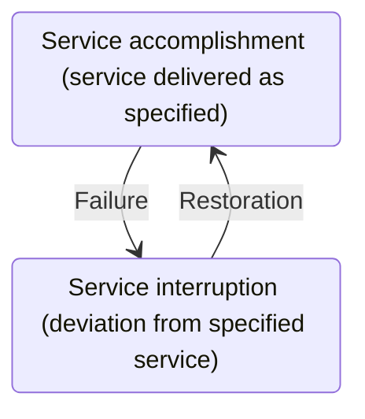
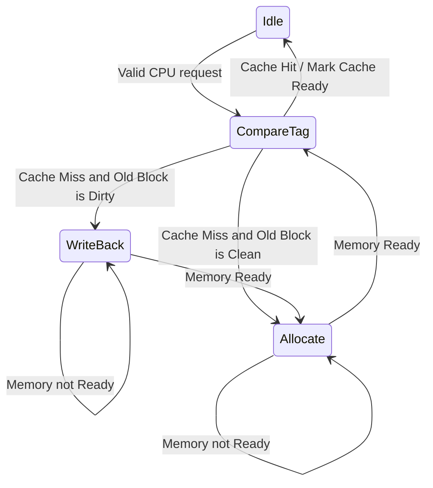

# Chapter 5 — Large and Fast: Exploiting Memory Hierarchy

> [!info] Scope
> All slides (**P.1–P.106**) of `UCA2026_Chapter_5.pdf`.
> - §5.1 Introduction → P.2–4
> - §5.2 Memory Technologies → P.5–16 (P.11–16 are borrowed from *Chapter 6 — Storage and Other I/O Topics*; the footer says so)
> - §5.3 The Basics of Caches → P.17–35
> - §5.4 Measuring and Improving Cache Performance → P.36–57
> - §5.5 Dependable Memory Hierarchy → P.58–63 (P.58–59 footer: Chapter 6)
> - §5.6 Virtual Machines → P.64–67
> - §5.7 Virtual Memory → P.68–81
> - §5.8 A Common Framework for Memory Hierarchies → P.82–88
> - §5.9 Using a Finite-State Machine to Control a Simple Cache → P.89–92
> - §5.10 Parallelism and Memory Hierarchies: Cache Coherence → P.93–97
> - §5.13 The ARM Cortex-A53 and Intel Core i7 Memory Hierarchies → P.98–100
> - §5.14 Real Stuff: RISC-V System and Special Instructions → P.101
> - §5.15 Going Faster: Cache Blocking and Matrix Multiply → P.102
> - §5.16 Fallacies and Pitfalls → P.103–105
> - §5.17 Concluding Remarks → P.106
>
> (The slides skip §5.11–5.12.) Callouts marked **💡 Note** are my own explanations or checks. Everything else follows the slides.

## §5.1 Introduction

### Principle of Locality (P.2)
Programs access a **small proportion of their address space at any time**.

| Type | Definition | Examples |
|---|---|---|
| **Temporal locality** | Items accessed **recently** are likely to be accessed **again soon** | Instructions in a loop, induction variables |
| **Spatial locality** | Items **near** those accessed recently are likely to be accessed soon | Sequential instruction access, array data |

### Taking Advantage of Locality (P.3)
**Memory hierarchy:**
1. Store everything on **disk**.
2. Copy recently accessed (and nearby) items from disk to smaller **DRAM** memory → this is **main memory**.
3. Copy more recently accessed (and nearby) items from DRAM to smaller **SRAM** memory → this is **cache memory** attached to the CPU.

```
CPU ⇄ Cache (SRAM) ⇄ Main memory (DRAM) ⇄ Disk
  smaller · faster · more $/GB  ←→  larger · slower · cheaper
```

### Memory Hierarchy Levels (P.4)
*Figure:* Processor ↔ upper level (small) ↔ lower level (large); "data is transferred" between levels in blocks.

- **Block** (aka **line**): the **unit of copying**
  - May be multiple words
- If accessed data is **present** in the upper level:
  - **Hit**: access satisfied by the upper level
  - **Hit ratio** = hits / accesses
- If accessed data is **absent**:
  - **Miss**: block copied from the lower level
    - Time taken: **miss penalty**
    - **Miss ratio** = misses / accesses = **1 − hit ratio**
  - Then the accessed data is supplied from the upper level

---

## §5.2 Memory Technologies

### Memory Technology (P.5)

| Technology | Access time | Cost per GB |
|---|---|---|
| **Static RAM (SRAM)** | 0.5 ns – 2.5 ns | \$500 – \$1000 |
| **Dynamic RAM (DRAM)** | 50 ns – 70 ns | \$3 – \$6 |
| **Magnetic disk** | 5 ms – 20 ms | \$0.01 – \$0.02 |

**Ideal memory** = access time of SRAM + capacity and cost/GB of disk.
(The memory hierarchy is how we approximate this ideal.)

### DRAM Technology (P.6)
- Data stored as a **charge in a capacitor**
  - A **single transistor** is used to access the charge
  - Must be **periodically refreshed**
    - Read contents and write back
    - Performed on a DRAM **"row"**

*Figure:* internal DRAM organization — multiple **banks**; each bank is an array of **rows**; commands shown are **Act** (activate a row), **Pre** (precharge), and **Column Rd/Wr** (read/write a column of the open row).

### Advanced DRAM Organization (P.7)
- Bits in a DRAM are organized as a **rectangular array**
  - DRAM accesses an **entire row**
  - **Burst mode**: supply successive words from a row with reduced latency
- **Double data rate (DDR) DRAM**
  - Transfer on **rising and falling** clock edges
- **Quad data rate (QDR) DRAM**
  - **Separate** DDR inputs and outputs

### DRAM Generations (P.8)

| Year | Capacity | \$/GB |
|---|---|---|
| 1980 | 64 Kibibit | \$6,480,000 |
| 1983 | 256 Kibibit | \$1,980,000 |
| 1985 | 1 Mebibit | \$720,000 |
| 1989 | 4 Mebibit | \$128,000 |
| 1992 | 16 Mebibit | \$30,000 |
| 1996 | 64 Mebibit | \$9,000 |
| 1998 | 128 Mebibit | \$900 |
| 2000 | 256 Mebibit | \$840 |
| 2004 | 512 Mebibit | \$150 |
| 2007 | 1 Gibibit | \$40 |
| 2010 | 2 Gibibit | \$13 |
| 2012 | 4 Gibibit | \$5 |
| 2015 | 8 Gibibit | \$7 |
| 2018 | 16 Gibibit | \$6 |

> [!tip] 💡 Note
> Capacity per chip grew ~$2^{18}\times$ (64 Kib → 16 Gib) from 1980 to 2018, while \$/GB dropped by ~6 orders of magnitude, then flattened after ~2012.

### DRAM Performance Factors (P.9)
- **Row buffer**
  - Allows several words to be read and refreshed **in parallel**
- **Synchronous DRAM**
  - Allows consecutive accesses in **bursts** without needing to send each address
  - Improves bandwidth
- **DRAM banking**
  - Allows **simultaneous access to multiple DRAMs**
  - Improves bandwidth

### Increasing Memory Bandwidth (P.10)
*Figure:* three organizations —
**(a)** one-word-wide memory (Processor – Cache – Bus – Memory),
**(b)** wider memory organization (Processor – Multiplexor – Cache – wide Bus – Memory),
**(c)** interleaved memory organization (Processor – Cache – Bus – Memory banks 0, 1, 2, 3).

Uses the timing assumptions from [[#Main Memory Supporting Caches (P.35)|P.35]]: 1 bus cycle for address, 15 bus cycles per DRAM access, 1 bus cycle per data transfer; 4-word (16-byte) block.

| Organization | Miss penalty | Bandwidth |
|---|---|---|
| (a) 1-word-wide (from P.35) | 1 + 4×15 + 4×1 = **65** bus cycles | 16 B / 65 = **0.25 B/cycle** |
| (b) **4-word wide** memory | 1 + 15 + 1 = **17** bus cycles | 16 B / 17 = **0.94 B/cycle** |
| (c) **4-bank interleaved** memory | 1 + 15 + 4×1 = **20** bus cycles | 16 B / 20 = **0.8 B/cycle** |

> [!tip] 💡 Note — why these numbers
> - **Wide**: one address, one (wide) DRAM access, one (wide) transfer.
> - **Interleaved**: one address, all 4 banks access **in parallel** (one 15-cycle wait), but the bus is still 1 word wide → 4 transfers.

### Flash Storage (P.11)
*(Footer: Chapter 6 — Storage and Other I/O Topics)*
- **Nonvolatile semiconductor storage**
  - **100× – 1000× faster** than disk
  - Smaller, lower power, more robust
  - But more \$/GB (**between disk and DRAM**)

### Flash Types (P.12)
- **NOR flash**: bit cell like a NOR gate
  - **Random** read/write access
  - Used for **instruction memory in embedded systems**
- **NAND flash**: bit cell like a NAND gate
  - **Denser** (bits/area), but **block-at-a-time** access
  - **Cheaper** per GB
  - Used for USB keys, media storage, …
- Flash bits **wear out after 1000's of accesses**
  - Not suitable for direct RAM or disk replacement
  - **Wear leveling**: remap data to less used blocks

### Disk Storage (P.13)
- **Nonvolatile, rotating magnetic storage**
- *Figure:* stacked platters; terms **track** (a ring on one surface), **sector** (a segment of a track), **cylinder** (the set of tracks at the same position on all surfaces).

### Disk Sectors and Access (P.14)
**Each sector records:**
- Sector ID
- Data (**512 bytes**, 4096 bytes proposed)
- Error correcting code (**ECC**)
  - Used to hide defects and recording errors
- Synchronization fields and gaps

**Access to a sector involves:**
1. **Queuing delay** if other accesses are pending
2. **Seek**: move the heads
3. **Rotational latency**
4. **Data transfer**
5. **Controller overhead**

### Disk Access Example (P.15)
**Given:** 512 B sector, 15,000 rpm, 4 ms average seek time, 100 MB/s transfer rate, 0.2 ms controller overhead, idle disk.

**Average read time:**

| Component | Calculation | Time |
|---|---|---|
| Seek | (given) | 4 ms |
| Rotational latency | ½ / (15,000/60) | 2 ms |
| Transfer | 512 / 100 MB/s | 0.005 ms |
| Controller | (given) | 0.2 ms |
| **Total** | | **6.2 ms** |

If the **actual** average seek time is **1 ms** → average read time = **3.2 ms**.

> [!tip] 💡 Note
> - Rotational latency = time for **half** a rotation on average: 15,000 rpm = 250 rev/s → 1 rev = 4 ms → ½ rev = 2 ms.
> - Transfer: 512 B ÷ (100 × 10⁶ B/s) = 5.12 µs ≈ 0.005 ms.
> - Idle disk ⇒ no queuing delay.
> - With 1 ms seek: 1 + 2 + 0.005 + 0.2 ≈ 3.2 ms → seek dominates.

### Disk Performance Issues (P.16)
- Manufacturers quote **average seek time**
  - Based on **all possible** seeks
  - **Locality and OS scheduling** lead to smaller actual average seek times
- **Smart disk controllers** allocate physical sectors on disk
  - Present a **logical sector interface** to the host
  - SCSI, ATA, SATA
- **Disk drives include caches**
  - **Prefetch** sectors in anticipation of access
  - Avoid seek and rotational delay

---

## §5.3 The Basics of Caches

### Cache Memory (P.17)
- **Cache memory**: the level of the memory hierarchy **closest to the CPU**
- Given accesses $X_1, \dots, X_{n-1}, X_n$:
  - *Figure:* (a) before the reference to $X_n$ — cache holds $X_4, X_1, X_{n-2}, X_{n-1}, X_2, X_3$ (with empty slots); (b) after the reference to $X_n$ — $X_n$ has been placed into a previously empty slot.
- Key questions:
  - **How do we know if the data is present?**
  - **Where do we look?**

### Direct Mapped Cache (P.18)
- Location determined by **address**
- **Direct mapped**: only **one choice**

$$\text{Cache index} = (\text{Block address}) \bmod (\#\text{Blocks in cache})$$

- **#Blocks is a power of 2**
- ⇒ Use the **low-order address bits** as the index

*Figure:* 8-block cache (indices 000–111) and memory. Memory addresses **00001, 01001, 10001, 11001** all map to cache block **001**; addresses **00101, 01101, 10101, 11101** all map to cache block **101** (index = lowest 3 bits).

### Tags and Valid Bits (P.19)
- How do we know **which particular block** is stored in a cache location?
  - Store the **block address** as well as the data
  - Actually, only need the **high-order bits** → called the **tag**
- What if there is **no data** in a location?
  - **Valid bit**: 1 = present, 0 = not present
  - Initially 0

### Cache Example (P.20–25)
**Setup:** 8 blocks, 1 word/block, direct mapped.
Word address is 5 bits → **index = low 3 bits**, **tag = high 2 bits**.

**Access trace:**

| Slide | Word addr | Binary addr (tag index) | Hit/Miss | Cache block | What happens |
|---|---|---|---|---|---|
| P.21 | 22 | 10 110 | **Miss** | 110 | Block 110 ← Mem[10110], tag 10 |
| P.22 | 26 | 11 010 | **Miss** | 010 | Block 010 ← Mem[11010], tag 11 |
| P.23 | 22 | 10 110 | **Hit** | 110 | |
| P.23 | 26 | 11 010 | **Hit** | 010 | |
| P.24 | 16 | 10 000 | **Miss** | 000 | Block 000 ← Mem[10000], tag 10 |
| P.24 | 3 | 00 011 | **Miss** | 011 | Block 011 ← Mem[00011], tag 00 |
| P.24 | 16 | 10 000 | **Hit** | 000 | |
| P.25 | 18 | 10 010 | **Miss** | 010 | **Replaces** Mem[11010] (tag 11) with Mem[10010] (tag 10) |

**Initial state (P.20):** all 8 entries have V = N.

**Final state (after P.25):**

| Index | V | Tag | Data |
|---|---|---|---|
| 000 | Y | 10 | Mem[10000] |
| 001 | N | | |
| 010 | Y | 10 | Mem[10010] |
| 011 | Y | 00 | Mem[00011] |
| 100 | N | | |
| 101 | N | | |
| 110 | Y | 10 | Mem[10110] |
| 111 | N | | |

> [!tip] 💡 Note
> - First accesses to 22, 26, 16, 3 are **compulsory (cold) misses**.
> - The miss on 18 is a **conflict**: 26 (11 010) and 18 (10 010) share index 010 but have different tags → 18 evicts 26.
> - Totals: 8 accesses, **5 misses, 3 hits**.

### Address Subdivision (P.26)
*Figure:* direct-mapped cache with **1024 entries**, 1 word (32 bits) per block, **64-bit address**.

| Field | Bits | Width |
|---|---|---|
| Tag | 63 – 12 | **52 bits** |
| Index | 11 – 2 | **10 bits** (→ 2¹⁰ = 1024 entries, indices 0–1023) |
| Byte offset | 1 – 0 | 2 bits |

Each entry: **Valid** | **Tag** (52 bits) | **Data** (32 bits).

**Hit logic:** use Index to select an entry → compare stored tag with address tag (`=` comparator) → **Hit = Valid AND (tags equal)**. Data (32 bits) is output.

### Example — Larger Block Size (P.27)
- **64 blocks, 16 bytes/block**
  - To what block number does address **1200** map?
- Block address = ⌊1200 / 16⌋ = **75**
- Block number = 75 modulo 64 = **11**

| Field | Bits | Width (as on slide) |
|---|---|---|
| Tag | 63 – 10 | 22 bits |
| Index | 9 – 4 | 6 bits (2⁶ = 64 blocks) |
| Offset | 3 – 0 | 4 bits (2⁴ = 16 bytes/block) |

> [!warning] 💡 Note — inconsistency on the slide
> The slide labels the tag as **22 bits**, but bits **63–10** are **54 bits** wide (64 − 6 − 4 = 54). "22 bits" is what you'd get with a **32-bit** address (bits 31–10), as in the older MIPS edition of this slide. For a 64-bit address, **tag = 54 bits**.

> [!tip] 💡 Note — quick check with bits
> 1200 = `100 1011 0000`₂ → offset (bits 3–0) = `0000`, index (bits 9–4) = `001011`₂ = **11** ✔, tag (bits 63–10) = `1`.

### Block Size Considerations (P.28)
- **Larger blocks should reduce miss rate**
  - Due to **spatial locality**
- But in a **fixed-sized** cache:
  - Larger blocks ⇒ **fewer of them**
    - More competition ⇒ **increased miss rate**
  - Larger blocks ⇒ **pollution**
- **Larger miss penalty**
  - Can **override** the benefit of reduced miss rate
  - **Early restart** and **critical-word-first** can help

### Cache Misses (P.29)
- On **cache hit**: CPU proceeds normally
- On **cache miss**:
  - **Stall** the CPU pipeline
  - **Fetch block** from next level of hierarchy
  - **Instruction cache miss** → restart instruction fetch
  - **Data cache miss** → complete data access

### Write-Through (P.30)
- On data-write hit, could just update the block in cache
  - But then cache and memory would be **inconsistent**
- **Write through**: **also update memory**
- But makes **writes take longer**
  - e.g., base CPI = 1, 10% of instructions are stores, write to memory takes 100 cycles

$$\text{Effective CPI} = 1 + 0.1 \times 100 = 11$$

- **Solution: write buffer**
  - Holds data waiting to be written to memory
  - CPU **continues immediately**
    - Only stalls on write if the **write buffer is already full**

### Write-Back (P.31)
- Alternative: on data-write hit, **just update the block in cache**
  - Keep track of whether each block is **dirty**
- When a **dirty block is replaced**:
  - **Write it back** to memory
  - Can use a **write buffer** to allow the replacing block to be **read first**

### Write Allocation (P.32)
What should happen on a **write miss**?

| Policy | Option | Action |
|---|---|---|
| **Write-through** | **Allocate on miss** | Fetch the block |
| | **Write around** | Don't fetch the block — since programs often write a whole block before reading it (e.g., initialization) |
| **Write-back** | | **Usually fetch** the block |

> [!summary] Write-through vs Write-back (💡 my summary)
> | | Write-through | Write-back |
> |---|---|---|
> | On write hit | Update cache **and** memory | Update cache only; mark **dirty** |
> | Memory consistent? | Yes | No, until the dirty block is evicted |
> | Extra hardware | Write buffer | Dirty bit (+ optional write buffer) |
> | Write miss | Allocate *or* write around | Usually allocate (fetch) |

### Example — Intrinsity FastMATH (P.33–34)
**P.33**
- **Embedded MIPS processor**
  - **12-stage** pipeline
  - Instruction and data access on **each cycle**
- **Split cache**: separate **I-cache** and **D-cache**
  - Each **16 KB**: **256 blocks × 16 words/block**
  - D-cache: write-through or write-back
- **SPEC2000 miss rates**
  - I-cache: **0.4%**
  - D-cache: **11.4%**
  - Weighted average: **3.2%**

**P.34** — *Figure:* cache organization, **32-bit address**:

| Field | Bits | Width |
|---|---|---|
| Tag | 31 – 14 | **18 bits** |
| Index | 13 – 6 | **8 bits** (→ 256 entries) |
| Block offset | 5 – 2 | **4 bits** (selects 1 of 16 words) |
| Byte offset | 1 – 0 | 2 bits |

- Each entry: **V** | **Tag (18 bits)** | **Data (512 bits** = 16 words × 32 bits)
- Hit = V AND (stored 18-bit tag = address tag)
- A **Mux**, controlled by the **block offset**, selects one **32-bit** word from the 16 words of the block → Data out

> [!tip] 💡 Note — size check
> 256 blocks × 16 words × 4 B = 16,384 B = **16 KB** ✔ (matches P.33).
> Bits: 18 + 8 + 4 + 2 = 32 ✔.

### Main Memory Supporting Caches (P.35)
- Use **DRAMs** for main memory
  - **Fixed width** (e.g., 1 word)
  - Connected by **fixed-width clocked bus**
    - Bus clock is typically **slower** than CPU clock
- **Example cache block read**
  - **1** bus cycle for address transfer
  - **15** bus cycles per DRAM access
  - **1** bus cycle per data transfer
- For **4-word block, 1-word-wide DRAM**:
  - Miss penalty = 1 + 4×15 + 4×1 = **65 bus cycles**
  - Bandwidth = 16 bytes / 65 cycles = **0.25 B/cycle**

> [!tip] 💡 Note
> This is the baseline (organization **a**) that [[#Increasing Memory Bandwidth (P.10)|P.10]] improves on with wider memory (17 cycles) and interleaving (20 cycles).

---

---

## §5.4 Measuring and Improving Cache Performance

### Measuring Cache Performance (P.36)
**Components of CPU time:**
- **Program execution cycles**
  - Includes cache **hit time**
- **Memory stall cycles**
  - Mainly from cache **misses**

**With simplifying assumptions:**

$$\text{Memory stall cycles} = \frac{\text{Memory accesses}}{\text{Program}} \times \text{Miss rate} \times \text{Miss penalty}$$

$$= \frac{\text{Instructions}}{\text{Program}} \times \frac{\text{Misses}}{\text{Instruction}} \times \text{Miss penalty}$$

### Cache Performance Example (P.37)
**Given:**
- I-cache miss rate = **2%**
- D-cache miss rate = **4%**
- Miss penalty = **100 cycles**
- Base CPI (ideal cache) = **2**
- Loads & stores are **36%** of instructions

**Miss cycles per instruction:**
- I-cache: 0.02 × 100 = **2**
- D-cache: 0.36 × 0.04 × 100 = **1.44**

**Actual CPI** = 2 + 2 + 1.44 = **5.44**
→ Ideal CPU is 5.44 / 2 = **2.72 times faster**

> [!tip] 💡 Note
> Every instruction is fetched → I-cache misses apply to **100%** of instructions. Only loads/stores touch the D-cache → multiply the D-cache miss rate by **0.36**.

### Average Access Time (P.38)
- **Hit time** is also important for performance
- **Average memory access time (AMAT):**

$$\text{AMAT} = \text{Hit time} + \text{Miss rate} \times \text{Miss penalty}$$

- **Example:** CPU with 1 ns clock, hit time = 1 cycle, miss penalty = 20 cycles, I-cache miss rate = 5%
  - AMAT = 1 + 0.05 × 20 = **2 ns**
  - = **2 cycles** per instruction

### Performance Summary (P.39)
- When CPU performance increases → **miss penalty becomes more significant**
- **Decreasing base CPI** → greater proportion of time spent on memory stalls
- **Increasing clock rate** → memory stalls account for more CPU cycles
- **Can't neglect cache behavior** when evaluating system performance

### Associative Caches (P.40)
- **Fully associative**
  - Allow a given block to go in **any** cache entry
  - Requires **all entries to be searched at once**
  - **Comparator per entry** (expensive)
- **n-way set associative**
  - Each set contains **n entries**
  - Block number determines **which set**:

$$\text{Set} = (\text{Block number}) \bmod (\#\text{Sets in cache})$$

  - Search **all entries in a given set** at once
  - **n comparators** (less expensive)

### Associative Cache Example (P.41)
*Figure:* where memory **block 12** can go in an **8-block** cache:

| Organization | Placement of block 12 | Tags searched |
|---|---|---|
| **Direct mapped** | Block 12 mod 8 = **4** | 1 |
| **Set associative** (2-way, 4 sets) | Set 12 mod 4 = **0** (either entry of set 0) | 2 (both entries of the set) |
| **Fully associative** | Any of the 8 blocks | All 8 |

### Spectrum of Associativity (P.42)
For a cache with **8 entries**:

| Organization | Sets × ways |
|---|---|
| One-way set associative (= **direct mapped**) | 8 sets × 1 |
| Two-way set associative | 4 sets × 2 |
| Four-way set associative | 2 sets × 4 |
| Eight-way set associative (= **fully associative**) | 1 set × 8 |

Each "way" holds a (Tag, Data) pair.

### Associativity Example (P.43–44)
Compare **4-block** caches: direct mapped, 2-way set associative, fully associative.
**Block access sequence: 0, 8, 0, 6, 8**

**Direct mapped (P.43)** — index = block address mod 4

| Block address | Cache index | Hit/miss | [0] | [1] | [2] | [3] |
|---|---|---|---|---|---|---|
| 0 | 0 | miss | Mem[0] | | | |
| 8 | 0 | miss | Mem[8] | | | |
| 0 | 0 | miss | Mem[0] | | | |
| 6 | 2 | miss | Mem[0] | | Mem[6] | |
| 8 | 0 | miss | Mem[8] | | Mem[6] | |

→ **5 misses**

**2-way set associative (P.44)** — set = block address mod 2; the entry replaced is the least recently used one

| Block address | Cache index (set) | Hit/miss | Set 0 | Set 0 | Set 1 | Set 1 |
|---|---|---|---|---|---|---|
| 0 | 0 | miss | Mem[0] | | | |
| 8 | 0 | miss | Mem[0] | Mem[8] | | |
| 0 | 0 | **hit** | Mem[0] | Mem[8] | | |
| 6 | 0 | miss | Mem[0] | Mem[6] | | |
| 8 | 0 | miss | Mem[8] | Mem[6] | | |

→ **4 misses** (6 replaces 8, the LRU entry; then 8 replaces 0)

**Fully associative (P.44)**

| Block address | Hit/miss | Cache content after access | | | |
|---|---|---|---|---|---|
| 0 | miss | Mem[0] | | | |
| 8 | miss | Mem[0] | Mem[8] | | |
| 0 | **hit** | Mem[0] | Mem[8] | | |
| 6 | miss | Mem[0] | Mem[8] | Mem[6] | |
| 8 | **hit** | Mem[0] | Mem[8] | Mem[6] | |

→ **3 misses**

> [!tip] 💡 Note
> 0, 8, 6 are all even → all map to set 0 in the 2-way cache and to index 0 or 2 in the direct-mapped cache. Fully associative has only the 3 compulsory misses.

### How Much Associativity (P.45)
- Increased associativity **decreases miss rate**
  - But with **diminishing returns**
- Simulation: 64 KB D-cache, 16-word blocks, SPEC2000

| Associativity | Miss rate |
|---|---|
| 1-way | 10.3% |
| 2-way | 8.6% |
| 4-way | 8.3% |
| 8-way | 8.1% |

### Set Associative Cache Organization (P.46)
*Figure:* **4-way** set-associative cache, **256 sets** (index 0–255), 32-bit address.

| Field | Bits | Width |
|---|---|---|
| Tag | 31 – 10 | **22 bits** |
| Index | 9 – 2 | **8 bits** (→ 256 sets) |
| Byte offset | 1 – 0 | 2 bits |

- Index selects one set → the **4 ways** are read in parallel.
- Each way: **V | Tag (22) | Data (32)**; **4 comparators** (`=`) compare the stored tag with the address tag; each result is ANDed with V.
- **Hit** = OR of the 4 way-hit signals.
- A **4-to-1 multiplexor** (controlled by the way-hit signals) selects the **Data** from the hitting way.

### Replacement Policy (P.47)
- **Direct mapped**: no choice
- **Set associative**
  - Prefer a **non-valid** entry, if there is one
  - Otherwise, choose among entries in the set
- **Least-recently used (LRU)**
  - Choose the one **unused for the longest time**
    - Simple for 2-way, manageable for 4-way, too hard beyond that
- **Random**
  - Gives approximately the same performance as LRU for **high associativity**

### Multilevel Caches (P.48)
- **Primary cache** attached to CPU
  - Small, but fast
- **Level-2 cache** services misses from the primary cache
  - Larger, slower, but still faster than main memory
- **Main memory** services L-2 cache misses
- Some high-end systems include an **L-3 cache**

### Multilevel Cache Example (P.49–50)
**Given (P.49):**
- CPU base CPI = **1**, clock rate = **4 GHz** (→ cycle time 0.25 ns)
- Miss rate/instruction = **2%**
- Main memory access time = **100 ns**

**With just a primary cache:**
- Miss penalty = 100 ns / 0.25 ns = **400 cycles**
- Effective CPI = 1 + 0.02 × 400 = **9**

**Now add an L-2 cache (P.50):**
- Access time = **5 ns**
- **Global** miss rate to main memory = **0.5%**
- Primary miss with **L-2 hit**: penalty = 5 ns / 0.25 ns = **20 cycles**
- Primary miss with **L-2 miss**: extra penalty = 500 cycles *(as printed on the slide — see note)*
- **CPI** = 1 + 0.02 × 20 + 0.005 × 400 = **3.4**
- **Performance ratio** = 9 / 3.4 = **2.6**

> [!warning] 💡 Note — inconsistency on the slide
> The slide says the extra penalty on an L-2 miss is **500 cycles**, but the CPI calculation uses **400** (= main memory access, 100 ns / 0.25 ns). The textbook uses **400**, and 1 + 0.4 + 0.005 × 400 = 3.4 matches the slide's answer. With 500 the CPI would be 1 + 0.4 + 2.5 = 3.9. **Use 400.**

### Multilevel Cache Considerations (P.51)
- **Primary cache**
  - Focus on **minimal hit time**
- **L-2 cache**
  - Focus on **low miss rate** to avoid main memory access
  - Hit time has less overall impact
- **Results**
  - L-1 cache usually **smaller** than a single cache
  - L-1 block size **smaller** than L-2 block size

### Interactions with Advanced CPUs (P.52)
- **Out-of-order CPUs** can execute instructions during a cache miss
  - Pending store stays in load/store unit
  - Dependent instructions wait in reservation stations
    - Independent instructions continue
- Effect of a miss depends on **program data flow**
  - Much harder to analyse
  - Use **system simulation**

### Interactions with Software (P.53)
- Misses depend on **memory access patterns**
  - **Algorithm behavior**
  - **Compiler optimization** for memory access
- *Figure:* **Radix Sort vs Quicksort**, size 4K–4096K items to sort; three graphs: (a) instructions/item, (b) clock cycles/item, (c) cache misses/item.
  - Radix sort executes **fewer instructions per item** than Quicksort for large inputs,
  - but has many **more cache misses per item**, so its **clock cycles per item** stay higher than Quicksort's at every size.

### Software Optimization via Blocking (P.54)
- **Goal:** maximize accesses to data **before it is replaced**
- Consider inner loops of **DGEMM**:

```c
for (int j = 0; j < n; ++j)
{
  double cij = C[i+j*n];
  for( int k = 0; k < n; k++ )
    cij += A[i+k*n] * B[k+j*n];
  C[i+j*n] = cij;
}
```

> [!tip] 💡 Note
> `X[a+b*n]` = element (a, b) in **column-major** order, so `C[i+j*n]` = C[i][j], `A[i+k*n]` = A[i][k], `B[k+j*n]` = B[k][j].

### DGEMM Access Pattern (P.55)
*Figure:* snapshot of accesses to the **C** (x, indexed i,j), **A** (y, indexed i,k), and **B** (z, indexed k,j) arrays for n = 6, when i = 1. Light = **older accesses**, dark = **new accesses**.
- For one row i of C, the inner loops read **all of row i of A** and **all of B**.
- If the cache can't hold all of B (N×N), B is re-fetched for every i → many capacity misses.

### Cache Blocked DGEMM (P.56)

```c
#define BLOCKSIZE 32
void do_block (int n, int si, int sj, int sk, double *A, double
*B, double *C)
{
  for (int i = si; i < si+BLOCKSIZE; ++i)
    for (int j = sj; j < sj+BLOCKSIZE; ++j)
    {
      double cij = C[i+j*n];/* cij = C[i][j] */
      for( int k = sk; k < sk+BLOCKSIZE; k++ )
        cij += A[i+k*n] * B[k+j*n];/* cij+=A[i][k]*B[k][j] */
      C[i+j*n] = cij;/* C[i][j] = cij */
    }
}
void dgemm (int n, double* A, double* B, double* C)
{
  for ( int sj = 0; sj < n; sj += BLOCKSIZE )
    for ( int si = 0; si < n; si += BLOCKSIZE )
      for ( int sk = 0; sk < n; sk += BLOCKSIZE )
        do_block(n, si, sj, sk, A, B, C);
}
```

- Work on **BLOCKSIZE × BLOCKSIZE** sub-matrices that fit in the cache, so loaded data is reused many times before being replaced.

### Blocked DGEMM Access Pattern (P.57)
*Figure:* with blocking (block size 3 in the drawing), only small sub-blocks of C, A and B are touched at a time.

**Performance (GFLOPS):**

| Matrix size | Unoptimized | Blocked |
|---|---|---|
| 32×32 | 1.7 | 1.7 |
| 160×160 | 1.5 | 1.6 |
| 480×480 | 1.3 | 1.6 |
| 960×960 | 0.8 | 1.5 |

→ Unoptimized performance **drops** as matrices outgrow the cache; blocked stays almost flat.

---

## §5.5 Dependable Memory Hierarchy

### Dependability (P.58)
*(Footer: Chapter 6 — Storage and Other I/O Topics)*



- **Fault**: failure of a **component**
  - May or may not lead to **system failure**

### Dependability Measures (P.59)
*(Footer: Chapter 6 — Storage and Other I/O Topics)*
- **Reliability**: mean time to failure (**MTTF**)
- **Service interruption**: mean time to repair (**MTTR**)
- **Mean time between failures**:

$$\text{MTBF} = \text{MTTF} + \text{MTTR}$$

$$\text{Availability} = \frac{\text{MTTF}}{\text{MTTF} + \text{MTTR}}$$

- **Improving availability**
  - **Increase MTTF**: fault avoidance, fault tolerance, fault forecasting
  - **Reduce MTTR**: improved tools and processes for diagnosis and repair

### The Hamming SEC Code (P.60)
- **Hamming distance**: number of bits that are **different** between two bit patterns
- **Minimum distance = 2** → single-bit error **detection**
  - E.g., **parity code**
- **Minimum distance = 3** → **single error correction** (SEC), **2-bit error detection**

### Encoding SEC (P.61)
To calculate the Hamming code:
- Number bits **from 1 on the left**
- All bit positions that are a **power of 2** are **parity bits**
- Each parity bit checks certain data bits:

| Bit position | 1 | 2 | 3 | 4 | 5 | 6 | 7 | 8 | 9 | 10 | 11 | 12 |
|---|---|---|---|---|---|---|---|---|---|---|---|---|
| Encoded data bits | **p1** | **p2** | d1 | **p4** | d2 | d3 | d4 | **p8** | d5 | d6 | d7 | d8 |
| p1 coverage | X | | X | | X | | X | | X | | X | |
| p2 coverage | | X | X | | | X | X | | | X | X | |
| p4 coverage | | | | X | X | X | X | | | | | X |
| p8 coverage | | | | | | | | X | X | X | X | X |

> [!tip] 💡 Note — the rule behind the table
> Parity bit **p_k** covers every position whose binary number has the **k bit set**:
> p1 → positions with bit 0 set (1, 3, 5, 7, 9, 11); p2 → bit 1 (2, 3, 6, 7, 10, 11); p4 → bit 2 (4–7, 12); p8 → bit 3 (8–12).

### Decoding SEC (P.62)
- The value of the parity bits **indicates which bit is in error**
  - Use the numbering from the encoding procedure
  - E.g.
    - Parity bits = **0000** → **no error**
    - Parity bits = **1010** → **bit 10** was flipped

> [!tip] 💡 Note
> Read the check bits as p8 p4 p2 p1 = 1 0 1 0₂ = 8 + 2 = **10**.

### SEC/DEC Code (P.63)
- Add an **additional parity bit for the whole word** ($p_n$)
- Make Hamming distance = **4**
- **Decoding** — let H = SEC parity bits:

| H | $p_n$ | Meaning |
|---|---|---|
| even | even | **No error** |
| odd | odd | **Correctable single-bit error** |
| even | odd | Error in the **$p_n$ bit** |
| odd | even | **Double error** occurred |

- Note: **ECC DRAM** uses SEC/DEC with **8 bits protecting each 64 bits**

---

## §5.6 Virtual Machines

### Virtual Machines (P.64)
- **Host computer emulates guest operating system** and machine resources
  - Improved **isolation** of multiple guests
  - Avoids security and reliability problems
  - Aids **sharing** of resources
- Virtualization has some **performance impact**
  - Feasible with modern high-performance computers
- Examples
  - IBM VM/370 (1970s technology!)
  - VMWare
  - Microsoft Virtual PC

### Virtual Machine Monitor (P.65)
- **Maps virtual resources to physical resources**
  - Memory, I/O devices, CPUs
- Guest code runs on native machine in **user mode**
  - **Traps to VMM** on privileged instructions and access to protected resources
- Guest OS may be **different** from host OS
- VMM handles **real I/O devices**
  - Emulates **generic virtual I/O devices** for guest

### Example — Timer Virtualization (P.66)
- In a **native machine**, on timer interrupt:
  - OS suspends current **process**, handles interrupt, selects and resumes next process
- With a **Virtual Machine Monitor**:
  - VMM suspends current **VM**, handles interrupt, selects and resumes next VM
- If a VM requires timer interrupts:
  - VMM **emulates a virtual timer**
  - Emulates an interrupt for the VM when the physical timer interrupt occurs

### Instruction Set Support (P.67)
- **User and System modes**
- **Privileged instructions** only available in system mode
  - **Trap** to system if executed in user mode
- **All physical resources** only accessible using privileged instructions
  - Including page tables, interrupt controls, I/O registers
- **Renaissance** of virtualization support
  - Current ISAs (e.g., x86) adapting

---

## §5.7 Virtual Memory

### Virtual Memory (P.68)
- Use **main memory as a "cache"** for secondary (disk) storage
  - Managed jointly by **CPU hardware and the operating system (OS)**
- Programs share main memory
  - Each gets a **private virtual address space** holding its frequently used code and data
  - **Protected** from other programs
- CPU and OS **translate virtual addresses to physical addresses**
  - VM "block" is called a **page**
  - VM translation "miss" is called a **page fault**

| Cache term | Virtual memory term |
|---|---|
| Block | **Page** |
| Miss | **Page fault** |

### Address Translation (P.69)
- **Fixed-size pages** (e.g., 4K)
- *Figure (left):* virtual addresses are mapped by **address translation** either to **physical addresses** (pages in main memory) or to **disk addresses**.
- *Figure (right):*

| | Page number | Page offset |
|---|---|---|
| **Virtual address** (bits 47–0) | Virtual page number (bits 47–12) | bits 11–0 |
| **Physical address** (bits 39–0) | Physical page number (bits 39–12) | bits 11–0 |

- Only the **page number is translated**; the **page offset is copied unchanged**.

### Page Fault Penalty (P.70)
- On a page fault, the page must be **fetched from disk**
  - Takes **millions of clock cycles**
  - Handled by **OS code**
- Try to **minimize page fault rate**
  - **Fully associative** placement
  - **Smart replacement** algorithms

### Page Tables (P.71)
- Stores **placement information**
  - Array of **page table entries (PTEs)**, indexed by **virtual page number**
  - **Page table register** in CPU points to the page table in physical memory
- If page is **present** in memory
  - PTE stores the **physical page number**
  - Plus other status bits (**referenced, dirty**, …)
- If page is **not present**
  - PTE can refer to a location in **swap space on disk**

### Translation Using a Page Table (P.72)
*Figure:*
- **Page table register** → start of the page table
- Virtual address (48 bits): **virtual page number = 36 bits** (47–12) | **page offset = 12 bits** (11–0)
- VPN indexes the page table; each entry = **Valid** | **Physical page number**
  - If Valid = **0** → page is **not present in memory**
- Physical address (40 bits): **physical page number = 28 bits** (39–12) | page offset 12 bits (copied)

> [!tip] 💡 Note
> 12-bit offset ↔ 2¹² = **4 KiB pages**. 36-bit VPN → 2³⁶ page-table entries.

### Mapping Pages to Storage (P.73)
*Figure:* the virtual page number indexes the **page table**; each entry has a **Valid** bit and a **"physical page or disk address"**.
- Valid = **1** → points to a page in **physical memory**
- Valid = **0** → points to a page in **disk storage**

### Replacement and Writes (P.74)
- To reduce page fault rate, prefer **least-recently used (LRU)** replacement
  - **Reference bit** (aka **use bit**) in PTE set to 1 on access to page
  - **Periodically cleared to 0** by OS
  - A page with reference bit = 0 has **not been used recently**
- **Disk writes take millions of cycles**
  - Block at once, not individual locations
  - **Write through is impractical**
  - Use **write-back**
  - **Dirty bit** in PTE set when page is written

### Fast Translation Using a TLB (P.75–76)
**P.75**
- Address translation would appear to require **extra memory references**
  - One to access the **PTE**
  - Then the **actual memory access**
- But access to page tables has **good locality**
  - So use a **fast cache of PTEs** within the CPU
  - Called a **Translation Look-aside Buffer (TLB)**
  - Typical: **16–512 PTEs**, **0.5–1 cycle** for hit, **10–100 cycles** for miss, **0.01%–1%** miss rate
  - Misses could be handled by **hardware or software**

**P.76** — *Figure:*
- The virtual page number is looked up in the **TLB** (entries: Valid | Dirty | Ref | Tag | Physical page address).
  - TLB hit → physical page address in **physical memory**.
- On a TLB miss → the **page table** (Valid | Dirty | Ref | Physical page or disk address).
  - Valid = 1 → page in physical memory; Valid = 0 → page in **disk storage**.
- The TLB holds a **subset** of the page table's entries.

### TLB Misses (P.77)
- If page **is in memory**
  - **Load the PTE from memory and retry**
  - Could be handled in **hardware**
    - Can get complex for more complicated page table structures
  - Or in **software**
    - Raise a special exception, with optimized handler
- If page is **not in memory** (**page fault**)
  - **OS** handles fetching the page and updating the page table
  - Then **restart the faulting instruction**

### TLB Miss Handler (P.78)
- A TLB miss indicates either:
  - Page **present**, but PTE **not in TLB**, or
  - Page **not present**
- Must recognize the TLB miss **before the destination register is overwritten**
  - Raise exception
- Handler **copies PTE from memory to TLB**
  - Then **restarts** instruction
  - If page not present, **page fault** will occur

### Page Fault Handler (P.79)
1. Use **faulting virtual address** to find PTE
2. **Locate page on disk**
3. **Choose page to replace**
   - If **dirty**, write to disk first
4. **Read page into memory** and update page table
5. Make process **runnable again**
   - Restart from faulting instruction

### TLB and Cache Interaction (P.80)
*Figure (Intrinsity FastMATH):*
- **Virtual address** (32 bits): virtual page number **20 bits** (31–12) | page offset **12 bits** (11–0)
- **TLB** (fully associative: one comparator per entry): Valid | Dirty | Tag | Physical page number → **TLB hit**
- **Physical address** = physical page number (20) | page offset (12), re-split for the cache as:

| Field | Width |
|---|---|
| Physical address tag | **18 bits** |
| Cache index | **8 bits** |
| Block offset | **4 bits** |
| Byte offset | **2 bits** |

- **Cache**: Valid | Tag; tag compare AND valid → **Cache hit**; Data out **32 bits**

**Key points:**
- If cache tag uses **physical address**
  - Need to **translate before cache lookup**
- Alternative: use **virtual address tag**
  - Complications due to **aliasing**
    - Different virtual addresses for a shared physical address

### Memory Protection (P.81)
- Different tasks can **share parts** of their virtual address spaces
  - But need to **protect against errant access**
  - Requires **OS assistance**
- **Hardware support for OS protection**
  - Privileged **supervisor mode** (aka **kernel mode**)
  - **Privileged instructions**
  - Page tables and other state information **only accessible in supervisor mode**
  - **System call exception** (e.g., `ecall` in RISC-V)

---

## §5.8 A Common Framework for Memory Hierarchies

### The Memory Hierarchy — The BIG Picture (P.82)
- **Common principles apply at all levels** of the memory hierarchy
  - Based on notions of **caching**
- At each level in the hierarchy:
  1. **Block placement**
  2. **Finding a block**
  3. **Replacement on a miss**
  4. **Write policy**

### Block Placement (P.83)
- Determined by **associativity**
  - **Direct mapped** (1-way associative) → **one** choice for placement
  - **n-way set associative** → **n** choices within a set
  - **Fully associative** → **any** location
- **Higher associativity reduces miss rate**
  - Increases **complexity, cost, and access time**

### Finding a Block (P.84)

| Associativity | Location method | Tag comparisons |
|---|---|---|
| Direct mapped | Index | 1 |
| n-way set associative | Set index, then search entries within the set | n |
| Fully associative | Search all entries | #entries |
| Fully associative | Full lookup table | 0 |

- **Hardware caches**
  - Reduce comparisons to reduce cost
- **Virtual memory**
  - **Full table lookup** makes **full associativity** feasible
  - Benefit in reduced miss rate

### Replacement (P.85)
- Choice of entry to replace on a miss
  - **Least recently used (LRU)**
    - Complex and costly hardware for high associativity
  - **Random**
    - Close to LRU, easier to implement
- **Virtual memory**
  - **LRU approximation** with hardware support

### Write Policy (P.86)
- **Write-through**
  - Update **both** upper and lower levels
  - Simplifies replacement, but may require **write buffer**
- **Write-back**
  - Update **upper level only**
  - Update lower level **when block is replaced**
  - Need to keep **more state**
- **Virtual memory**
  - **Only write-back is feasible**, given disk write latency

### Sources of Misses (P.87) — the "3 Cs"
- **Compulsory misses** (aka **cold start** misses)
  - **First access** to a block
- **Capacity misses**
  - Due to **finite cache size**
  - A replaced block is later accessed again
- **Conflict misses** (aka **collision** misses)
  - In a **non-fully associative** cache
  - Due to **competition for entries in a set**
  - Would **not occur in a fully associative cache** of the same total size

### Cache Design Trade-offs (P.88)

| Design change | Effect on miss rate | Negative performance effect |
|---|---|---|
| **Increase cache size** | Decrease **capacity** misses | May increase access time |
| **Increase associativity** | Decrease **conflict** misses | May increase access time |
| **Increase block size** | Decrease **compulsory** misses | Increases miss penalty. For very large block size, may increase miss rate due to pollution. |

---

## §5.9 Using a Finite-State Machine to Control a Simple Cache

### Cache Control (P.89)
**Example cache characteristics:**
- **Direct-mapped, write-back, write allocate**
- Block size: **4 words (16 bytes)**
- Cache size: **16 KB (1024 blocks)**
- **32-bit byte addresses**
- **Valid bit and dirty bit** per block
- **Blocking cache**
  - CPU waits until access is complete

| Field | Bits | Width |
|---|---|---|
| Tag | 31 – 14 | **18 bits** |
| Index | 13 – 4 | **10 bits** |
| Offset | 3 – 0 | **4 bits** |

### Interface Signals (P.90)

| Signal | CPU ↔ Cache | Cache ↔ Memory |
|---|---|---|
| Read/Write | → | → |
| Valid | → | → |
| Address | → 32 bits | → 32 bits |
| Write Data | → 32 bits | → **128 bits** |
| Read Data | ← 32 bits | ← **128 bits** |
| Ready | ← | ← |

- Memory side: **multiple cycles per access**
- 128 bits = one whole 4-word block.

### Finite State Machines (P.91)
- Use an FSM to **sequence control steps**
- **Set of states**, transition **on each clock edge**
  - State values are **binary encoded**
  - Current state stored in a **register**
  - Next state = $f_n$(current state, current inputs)
- Control output signals = $f_o$(current state)
- *Figure:* combinational control logic takes **inputs from the cache datapath** + the **state register**; outputs = **datapath control outputs** + **next state** (fed back to the state register).

> [!tip] 💡 Note
> Outputs depend only on the current state → this is a **Moore machine**.

### Cache Controller FSM (P.92)



| State | Action |
|---|---|
| **Idle** | Wait for a valid CPU request |
| **Compare Tag** | If Valid && Hit: Set Valid, Set Tag, if Write Set Dirty |
| **Write-Back** | Write old block to memory |
| **Allocate** | Read new block from memory |

- Note on slide: Compare Tag **could be partitioned into separate states to reduce clock cycle time**.

---

## §5.10 Parallelism and Memory Hierarchies: Cache Coherence

### Cache Coherence Problem (P.93)
- Suppose two CPU cores **share a physical address space**
  - **Write-through** caches

| Time step | Event | CPU A's cache | CPU B's cache | Memory |
|---|---|---|---|---|
| 0 | | | | 0 |
| 1 | CPU A reads X | 0 | | 0 |
| 2 | CPU B reads X | 0 | 0 | 0 |
| 3 | CPU A writes 1 to X | 1 | **0** ⚠️ | 1 |

→ After step 3, CPU B's cache still holds the **stale value 0**.

### Coherence Defined (P.94)
- **Informally:** reads return the **most recently written** value
- **Formally:**
  1. P writes X; P reads X (no intervening writes) → read returns the written value
  2. P1 writes X; P2 reads X (**sufficiently later**) → read returns the written value
     - c.f. CPU B reading X after step 3 in the example
  3. P1 writes X, P2 writes X → **all processors see writes in the same order**
     - End up with the same final value for X

### Cache Coherence Protocols (P.95)
- Operations performed by caches in multiprocessors to ensure coherence
  - **Migration** of data to local caches
    - Reduces bandwidth for shared memory
  - **Replication** of read-shared data
    - Reduces contention for access
- **Snooping protocols**
  - Each cache **monitors bus reads/writes**
- **Directory-based protocols**
  - Caches and memory record **sharing status of blocks in a directory**

### Invalidating Snooping Protocols (P.96)
- Cache gets **exclusive access** to a block when it is to be written
  - **Broadcasts an invalidate message** on the bus
  - Subsequent read in another cache **misses**
    - **Owning cache supplies the updated value**

| CPU activity | Bus activity | CPU A's cache | CPU B's cache | Memory |
|---|---|---|---|---|
| | | | | 0 |
| CPU A reads X | Cache miss for X | 0 | | 0 |
| CPU B reads X | Cache miss for X | 0 | 0 | 0 |
| CPU A writes 1 to X | **Invalidate for X** | 1 | *(invalidated)* | 0 |
| CPU B reads X | Cache miss for X | 1 | 1 | 1 |

> [!tip] 💡 Note
> Memory stays 0 after A's write → this example assumes **write-back** caches. On B's miss, A (the owner) supplies 1, and memory is updated too.

### Memory Consistency (P.97)
- **When** are writes seen by other processors?
  - "Seen" means a read returns the written value
  - Can't be instantaneously
- **Assumptions**
  - A write **completes only when all processors have seen it**
  - A processor **does not reorder writes** with other accesses
- **Consequence**
  - P writes X then writes Y → all processors that see new Y **also see new X**
  - Processors can **reorder reads, but not writes**

---

## §5.13 The ARM Cortex-A53 and Intel Core i7 Memory Hierarchies

### Multilevel On-Chip Caches (P.98)

| Characteristic | ARM Cortex-A53 | Intel Core i7 |
|---|---|---|
| L1 cache organization | Split instruction and data caches | Split instruction and data caches |
| L1 cache size | Configurable 16 to 64 KiB each for instructions/data | 32 KiB each for instructions/data per core |
| L1 cache associativity | Two-way (I), four-way (D) set associative | Four-way (I), eight-way (D) set associative |
| L1 replacement | Random | Approximated LRU |
| L1 block size | 64 bytes | 64 bytes |
| L1 write policy | Write-back, variable allocation policies (default is Write-allocate) | Write-back, No-write-allocate |
| L1 hit time (load-use) | Two clock cycles | Four clock cycles, pipelined |
| L2 cache organization | Unified (instruction and data) | Unified (instruction and data) per core |
| L2 cache size | 128 KiB to 2 MiB | 256 KiB (0.25 MiB) |
| L2 cache associativity | 16-way set associative | 8-way set associative |
| L2 replacement | Approximated LRU | Approximated LRU |
| L2 block size | 64 bytes | 64 bytes |
| L2 write policy | Write-back, Write-allocate | Write-back, Write-allocate |
| L2 hit time | 12 clock cycles | 10 clock cycles |
| L3 cache organization | – | Unified (instruction and data) |
| L3 cache size | – | 8 MiB, shared |
| L3 cache associativity | – | 16-way set associative |
| L3 replacement | – | Approximated LRU |
| L3 block size | – | 64 bytes |
| L3 write policy | – | Write-back, Write-allocate |
| L3 hit time | – | 35 clock cycles |

### 2-Level TLB Organization (P.99)

| Characteristic | ARM Cortex-A53 | Intel Core i7 |
|---|---|---|
| Virtual address | 48 bits | 48 bits |
| Physical address | 40 bits | 44 bits |
| Page size | Variable: 4, 16, 64 KiB, 1, 2 MiB, 1 GiB | Variable: 4 KiB, 2/4 MiB |
| TLB organization | 1 TLB for instructions and 1 TLB for data per core | 1 TLB for instructions and 1 TLB for data per core |
| | Both micro TLBs are fully associative, with 10 entries, round robin replacement | Both L1 TLBs are four-way set associative, LRU replacement |
| | 64-entry, four-way set-associative TLBs | L1 I-TLB has 128 entries for small pages, seven per thread for large pages |
| | | L1 D-TLB has 64 entries for small pages, 32 for large pages |
| | | The L2 TLB is four-way set associative, LRU replacement |
| | | The L2 TLB has 512 entries |
| | TLB misses handled in hardware | TLB misses handled in hardware |

### Supporting Multiple Issue (P.100)
- Both have **multi-banked caches** that allow **multiple accesses per cycle**, assuming no bank conflicts
- Other optimizations
  - **Return requested word first**
  - **Non-blocking cache**
    - **Hit under miss**
    - **Miss under miss**
  - **Data prefetching**

---

## §5.14 Real Stuff: RISC-V System and Special Instructions

### RISC-V System Instructions (P.101)

| Type | Mnemonic | Name |
|---|---|---|
| Mem ordering | `fence.i` | Instruction fence |
| | `fence` | Fence |
| | `sfence.vm` | Address translation fence |
| CSR access | `csrrwi` | CSR read/write immediate |
| | `csrrsi` | CSR read/set immediate |
| | `csrrci` | CSR read/clear immediate |
| | `csrrw` | CSR read/write |
| | `csrrs` | CSR read/set |
| | `csrrc` | CSR read/clear |
| System | `ecall` | Environment call |
| | `ebreak` | Environment breakpoint |
| | `sret` | Supervisor exception return |
| | `wfi` | Wait for interrupt |

---

## §5.15 Going Faster: Cache Blocking and Matrix Multiply

### DGEMM (P.102)
- **Combine cache blocking and subword parallelism**

**Performance (GFLOPS):**

| Matrix size | Unoptimized | AVX | AVX + unroll | AVX + unroll + blocked |
|---|---|---|---|---|
| 32×32 | 1.7 | 6.4 | 14.6 | 13.6 |
| 160×160 | 1.5 | 3.5 | 6.6 | 12.7 |
| 480×480 | 1.3 | 2.3 | 4.7 | 11.7 |
| 960×960 | 0.8 | 2.5 | 5.1 | 12.0 |

> [!tip] 💡 Note
> Without blocking, AVX + unroll falls from 14.6 to ~5 GFLOPS once the matrices no longer fit in cache. Adding blocking keeps large matrices at ~12 GFLOPS (≈ 15× the unoptimized 0.8 at 960×960).

---

## §5.16 Fallacies and Pitfalls

### Pitfalls (P.103)
- **Byte vs. word addressing**
  - Example: 32-byte direct-mapped cache, 4-byte blocks
    - **Byte 36** maps to block **1**
    - **Word 36** maps to block **4**
- **Ignoring memory system effects** when writing or generating code
  - Example: iterating over **rows vs. columns** of arrays
  - **Large strides** result in poor locality

> [!tip] 💡 Note — why
> The cache has 32 / 4 = **8 blocks**.
> - Byte 36 → block address ⌊36/4⌋ = 9 → 9 mod 8 = **1**.
> - Word 36 → byte address 144 → block address 36 → 36 mod 8 = **4**.

### Pitfalls (P.104)
- In a multiprocessor with **shared L2 or L3 cache**
  - **Less associativity than cores** results in **conflict misses**
  - More cores ⇒ need to **increase associativity**
- Using **AMAT** to evaluate performance of **out-of-order processors**
  - Ignores effect of **non-blocked accesses**
  - Instead, evaluate performance by **simulation**

### Pitfalls (P.105)
- **Extending address range using segments**
  - E.g., Intel 80286
  - But a segment is **not always big enough**
  - Makes **address arithmetic complicated**
- **Implementing a VMM on an ISA not designed for virtualization**
  - E.g., **non-privileged instructions accessing hardware resources**
  - Either **extend the ISA**, or require the guest OS **not to use problematic instructions**

---

## §5.17 Concluding Remarks

### Concluding Remarks (P.106)
- **Fast memories are small, large memories are slow**
  - We really want fast, large memories ☹
  - **Caching gives this illusion** ☺
- **Principle of locality**
  - Programs use a small part of their memory space frequently
- **Memory hierarchy**
  - L1 cache ↔ L2 cache ↔ … ↔ DRAM memory ↔ disk
- **Memory system design is critical for multiprocessors**

---

## Formula Sheet

| Quantity | Formula |
|---|---|
| Hit ratio | hits / accesses |
| Miss ratio | misses / accesses = 1 − hit ratio |
| Direct-mapped index | (Block address) mod (#Blocks in cache) |
| Block address | ⌊Byte address / Bytes per block⌋ |
| Offset bits | log₂(bytes per block) |
| Index bits | log₂(#sets) (direct mapped: log₂(#blocks)) |
| Tag bits | Address bits − index bits − offset bits |
| Disk read time | seek + rotational latency + transfer + controller (+ queuing) |
| Avg. rotational latency | 0.5 rotation / (rpm / 60) |
| Write-through CPI (no buffer) | base CPI + (store fraction × memory write cycles) |
| Miss penalty, 1-word-wide | 1 + n×15 + n×1 (n = words/block) |
| Miss penalty, n-word-wide | 1 + 15 + 1 |
| Miss penalty, n-bank interleaved | 1 + 15 + n×1 |
| Bandwidth | bytes per block / miss penalty (cycles) |
| Memory stall cycles | (Memory accesses / Program) × Miss rate × Miss penalty |
| | = (Instructions / Program) × (Misses / Instruction) × Miss penalty |
| Actual CPI | Base CPI + I-miss rate × penalty + (load/store fraction) × D-miss rate × penalty |
| AMAT | Hit time + Miss rate × Miss penalty |
| CPI with L2 | Base CPI + L1 miss rate × L2 hit time + global miss rate × main memory penalty |
| Set index | (Block number) mod (#Sets in cache) |
| #Sets | #Blocks / associativity |
| MTBF | MTTF + MTTR |
| Availability | MTTF / (MTTF + MTTR) |
| Page offset bits | log₂(page size) |

---

## Self-Test Questions

> [!question]- What are the two kinds of locality? Give an example of each.
> **Temporal**: recently accessed items are likely to be accessed again soon (loop instructions, induction variables).
> **Spatial**: items near recently accessed ones are likely to be accessed soon (sequential instructions, array data).

> [!question]- Order SRAM, DRAM, disk by access time and by \$/GB.
> Access time: SRAM 0.5–2.5 ns < DRAM 50–70 ns < disk 5–20 ms.
> \$/GB: SRAM \$500–1000 > DRAM \$3–6 > disk \$0.01–0.02.

> [!question]- Why must DRAM be refreshed, and how?
> Data is stored as charge in a capacitor, which leaks. Refresh = read the contents and write them back, performed on a whole DRAM row.

> [!question]- NOR vs NAND flash?
> NOR: random read/write access, used for instruction memory in embedded systems. NAND: denser, cheaper per GB, but block-at-a-time access; used for USB keys and media storage. Both wear out → wear leveling.

> [!question]- 15,000 rpm, 4 ms seek, 100 MB/s, 0.2 ms controller, 512 B sector. Average read time?
> 4 + 2 + 0.005 + 0.2 = **6.2 ms** (3.2 ms if actual seek is 1 ms).

> [!question]- What are the tag and valid bit for?
> Tag = high-order address bits stored with the block, to identify **which** memory block is in that cache location. Valid bit = whether the entry holds data at all (initially 0).

> [!question]- 64 blocks, 16 B/block. Which block does byte address 1200 map to?
> ⌊1200/16⌋ = 75; 75 mod 64 = **11**.

> [!question]- Why can larger blocks increase the miss rate?
> In a fixed-size cache, larger blocks mean fewer blocks → more competition (and pollution). Also the miss penalty grows, which can override the reduced miss rate.

> [!question]- Base CPI 1, 10% stores, 100-cycle memory write, write-through without a buffer. Effective CPI?
> 1 + 0.1 × 100 = **11**. A write buffer fixes this; the CPU only stalls if the buffer is full.

> [!question]- Write-through: allocate on miss vs write around?
> Allocate: fetch the block on a write miss. Write around: don't fetch it (programs often write a whole block before reading it, e.g. initialization). Write-back usually fetches.

> [!question]- FastMATH address breakdown?
> 32-bit address: tag 18 (31–14), index 8 (13–6), block offset 4 (5–2), byte offset 2 (1–0). 256 entries × 512-bit blocks = 16 KB.

> [!question]- Miss penalty & bandwidth for a 4-word block: 1-word-wide, 4-word-wide, 4-bank interleaved?
> 65 cycles / 0.25 B/cycle; 17 cycles / 0.94 B/cycle; 20 cycles / 0.8 B/cycle.

> [!question]- I-miss 2%, D-miss 4%, penalty 100, base CPI 2, 36% loads/stores. Actual CPI?
> 2 + 0.02×100 + 0.36×0.04×100 = 2 + 2 + 1.44 = **5.44** → ideal CPU is 2.72× faster.

> [!question]- 1 ns clock, hit time 1 cycle, miss penalty 20 cycles, miss rate 5%. AMAT?
> 1 + 0.05 × 20 = **2 ns** (2 cycles).

> [!question]- 4-block caches, block sequence 0, 8, 0, 6, 8. Misses for direct mapped / 2-way / fully associative?
> **5 / 4 / 3**.

> [!question]- What happens to the miss rate going from 1-way to 8-way (64 KB D-cache, SPEC2000)?
> 10.3% → 8.6% → 8.3% → 8.1%: it decreases, with diminishing returns.

> [!question]- 4 GHz, base CPI 1, 2% miss/instr, 100 ns memory. Add an L2 (5 ns, global miss rate 0.5%). CPI before and after?
> Before: 1 + 0.02×400 = **9**. After: 1 + 0.02×20 + 0.005×400 = **3.4**. Ratio 9/3.4 ≈ **2.6**.

> [!question]- What should L1 and L2 each focus on?
> L1: minimal hit time. L2: low miss rate (to avoid main memory). So L1 is smaller and has smaller blocks than L2.

> [!question]- Why does cache blocking speed up DGEMM?
> It works on sub-matrices that fit in the cache, maximizing accesses to data before it is replaced. 960×960: 0.8 → 1.5 GFLOPS (blocked); with AVX + unroll + blocked: 12.0 GFLOPS.

> [!question]- Minimum Hamming distance needed for SEC? For SEC/DED?
> SEC: **3** (also detects 2-bit errors). SEC/DED: **4** (add a parity bit p_n for the whole word).

> [!question]- SEC/DED decoding: H odd, p_n even?
> **Double error** occurred. (H even/p_n even = no error; H odd/p_n odd = correctable single error; H even/p_n odd = error in p_n.)

> [!question]- How many check bits does ECC DRAM use?
> SEC/DED with **8 bits protecting each 64 bits**.

> [!question]- How does a VMM handle a privileged instruction from a guest?
> Guest code runs in user mode; a privileged instruction **traps to the VMM**, which emulates it.

> [!question]- What are the virtual memory names for "block" and "miss"?
> Block → **page**; miss → **page fault**.

> [!question]- Why does virtual memory use fully associative placement, LRU-approximation and write-back?
> A page fault costs millions of cycles, so minimizing the fault rate is worth it (full associativity via a full lookup table, reference bits for LRU). Disk writes are too slow for write-through, so write-back with a dirty bit.

> [!question]- What is a TLB, and what are its typical numbers?
> A fast cache of PTEs in the CPU. 16–512 PTEs, 0.5–1 cycle hit, 10–100 cycles miss, 0.01%–1% miss rate.

> [!question]- TLB miss vs page fault?
> TLB miss: PTE isn't in the TLB → load it from the page table and retry (hardware or software). Page fault: page isn't in memory at all → OS fetches it from disk, updates the page table, restarts the instruction.

> [!question]- Steps of the page fault handler?
> Find PTE from the faulting VA → locate page on disk → choose page to replace (write to disk first if dirty) → read page in and update page table → make process runnable, restart faulting instruction.

> [!question]- Physically tagged vs virtually tagged cache?
> Physical tag: must translate (TLB) before cache lookup. Virtual tag: no translation first, but **aliasing** (different VAs for the same PA) complicates things.

> [!question]- Name the 3 Cs of misses and which design change reduces each.
> **Compulsory** → bigger blocks. **Capacity** → bigger cache. **Conflict** → higher associativity.

> [!question]- States of the cache controller FSM?
> **Idle → Compare Tag** → (hit) Idle; (miss, clean) **Allocate**; (miss, dirty) **Write-Back** → Allocate → Compare Tag.

> [!question]- Snooping vs directory-based coherence?
> Snooping: every cache monitors bus reads/writes. Directory: sharing status of blocks is recorded in a directory.

> [!question]- What does an invalidating snooping protocol do on a write?
> The writing cache gets exclusive access by broadcasting an invalidate on the bus; another cache's later read misses, and the owning cache supplies the updated value.

> [!question]- 32-byte direct-mapped cache, 4-byte blocks: where do byte 36 and word 36 map?
> Byte 36 → block **1**; word 36 → block **4**.
