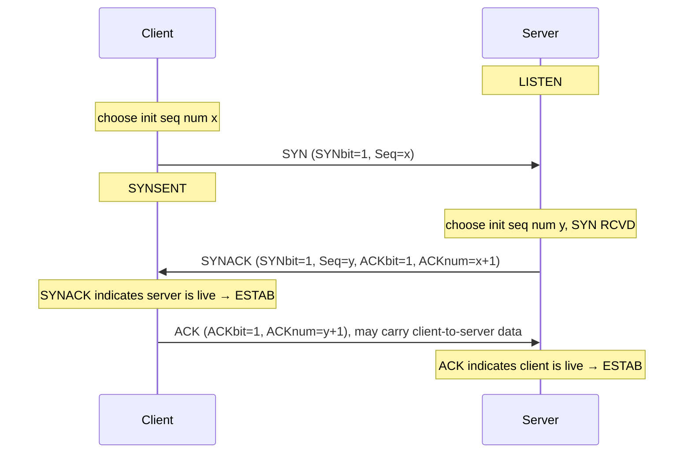
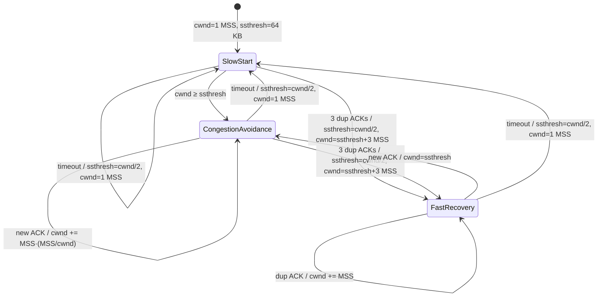

# Ch3 Transport Layer

> [!abstract] Chapter goals
> - Understand the principles behind transport-layer services:
>   - multiplexing, demultiplexing
>   - reliable data transfer
>   - flow control
>   - congestion control
> - Learn the Internet's transport-layer protocols:
>   - **UDP**: connectionless transport
>   - **TCP**: connection-oriented reliable transport
>   - TCP congestion control

> [!info] How this note is marked
> - `[!bug] Erratum`: a typo or error in the original slides
> - `[!info] Supplement`: something the slides leave unclear, skip over, or that is now outdated
> - Everything is collected in [[#Errata and Supplements Summary]] at the end
> - Slide numbers like (3-45) refer to the slide footer. Part I covers 3-1 to 3-74; Part II restarts at 3-1 for its title slide and runs to 3-54, so Part II slides are written as (II 3-xx).

## Contents
- **Part I**
  - [[#1. Transport-Layer Services]]
  - [[#2. Multiplexing and Demultiplexing]]
  - [[#3. UDP - Connectionless Transport]]
  - [[#4. Principles of Reliable Data Transfer]]
- **Part II**
  - [[#5. TCP - Connection-Oriented Transport]]
  - [[#6. Principles of Congestion Control]]
  - [[#7. TCP Congestion Control]]
- [[#Review Questions]]
- [[#Errata and Supplements Summary]]

---

# Part I

## 1. Transport-Layer Services

### 1.1 Transport services and protocols
- Provide **logical communication between application processes** running on different hosts
- Transport protocol actions in end systems:
  - **sender**: breaks application messages into **segments**, passes them to the network layer
  - **receiver**: reassembles segments into messages, passes them to the application layer
- Two transport protocols available to Internet apps: **TCP** and **UDP**

### 1.2 Transport vs. network layer

| | Network layer | Transport layer |
|---|---|---|
| Logical communication between | **hosts** | **processes** |
| Relationship | — | relies on, and enhances, network-layer services |

> [!example] Household analogy
> 12 kids in Ann's house send letters to 12 kids in Bill's house.
> - hosts = houses
> - processes = kids
> - app messages = letters in envelopes
> - transport protocol = Ann and Bill, who demux to their in-house siblings
> - network-layer protocol = postal service

### 1.3 Transport-layer actions

| Sender | Receiver |
|---|---|
| is passed an application-layer message | receives segment from IP |
| determines segment header field values | checks header values |
| creates segment | extracts application-layer message |
| passes segment to IP | demultiplexes message up to the application via a **socket** |

### 1.4 Two principal Internet transport protocols

| TCP (Transmission Control Protocol) | UDP (User Datagram Protocol) |
|---|---|
| reliable, in-order delivery | unreliable, unordered delivery |
| congestion control | no-frills extension of "best-effort" IP |
| flow control | |
| connection setup | |

> [!important] Services **not** available from either
> - delay guarantees
> - bandwidth guarantees

---

## 2. Multiplexing and Demultiplexing

- **Multiplexing at sender**: handle data from multiple sockets, add a transport header (later used for demultiplexing)
- **Demultiplexing at receiver**: use header info to deliver received segments to the correct socket
- Slides 3-11 to 3-15 animate the encapsulation: HTTP msg → `Ht` (transport header) + msg → `Hn` (network header) + `Ht` + msg, then demux back up at the server, with two clients (P-client1, P-client2) talking to one server

### 2.1 How demultiplexing works
- Host receives IP datagrams
  - each datagram has a source IP address and destination IP address
  - each datagram carries one transport-layer segment
  - each segment has a source and destination **port number**
- Host uses **IP addresses & port numbers** to direct the segment to the right socket

TCP/UDP segment format (32 bits wide): `source port # | dest port #`, then other header fields, then application data (payload).

### 2.2 Connectionless (UDP) demultiplexing
- When creating a socket, you must specify a host-local port #:
  ```java
  DatagramSocket mySocket1 = new DatagramSocket(12534);
  ```
- When creating a datagram to send into a UDP socket, you must specify the **destination IP address** and **destination port #**
- When the receiving host gets a UDP segment, it:
  - checks the destination port # in the segment
  - directs the segment to the socket with that port #

> [!important] Key point
> IP/UDP datagrams with the **same destination port #** but different source IP addresses and/or source port numbers go to the **same socket** at the receiving host.

> [!example]- Example from 3-19 (expand for the "?" answers)
> Three hosts: left client `mySocket2` on port 9157, server `serverSocket` on port 6428, right client `mySocket1` on port 5775.
> - Left client ↔ server: (src 9157, dst 6428) and reply (src 6428, dst 9157), as shown on the slide
> - Right client ↔ server, the two "?" segments: (src **5775**, dst **6428**) and reply (src **6428**, dst **5775**)
> - Both clients' segments arrive at the same server socket (port 6428)

### 2.3 Connection-oriented (TCP) demultiplexing
- A TCP socket is identified by a **4-tuple**:
  - source IP address
  - source port number
  - dest IP address
  - dest port number
- **Demux**: the receiver uses **all four values** to direct the segment to the right socket
- A server may support many simultaneous TCP sockets:
  - each socket is identified by its own 4-tuple
  - each socket is associated with a different connecting client

> [!example] Example from 3-21
> Three segments all go to server B, port 80:
> - (A, 9157) → (B, 80)
> - (C, 5775) → (B, 80)
> - (C, 9157) → (B, 80)
>
> They are demultiplexed to **three different sockets**. Note that (A, 9157) and (C, 9157) use the same source port but different source IPs, so the 4-tuples still differ.

### 2.4 Summary
- Mux/demux is based on segment and datagram header field values
- **UDP**: demux using the destination port number (only)
- **TCP**: demux using the 4-tuple: source and destination IP addresses and port numbers
- Mux/demux happens at **all layers**

---

## 3. UDP - Connectionless Transport

### 3.1 UDP: User Datagram Protocol [RFC 768]
- "No frills", "bare bones" Internet transport protocol
- "Best effort" service; UDP segments may be:
  - lost
  - delivered out of order to the app
- **Connectionless**:
  - no handshaking between UDP sender and receiver
  - each UDP segment handled independently of the others

**Why is there a UDP?**
- no connection establishment (which can add RTT delay)
- simple: no connection state at sender or receiver
- small header size
- no congestion control
  - UDP can blast away as fast as desired!
  - can function in the face of congestion

**UDP uses**: streaming multimedia apps (loss tolerant, rate sensitive), DNS, SNMP, HTTP/3

If reliable transfer is needed over UDP (e.g., HTTP/3):
- add the needed reliability at the application layer
- add congestion control at the application layer

> [!info]- Supplement: HTTP/3 runs over QUIC
> The slides say HTTP/3 uses UDP but don't name the layer in between. HTTP/3 runs over **QUIC**, a protocol built on top of UDP that implements reliability, congestion control, and TLS encryption itself. That's the concrete example of "add reliability and congestion control at the application layer".

### 3.2 UDP transport-layer actions (SNMP example)

| UDP sender | UDP receiver |
|---|---|
| is passed an application-layer message | receives segment from IP |
| determines UDP segment header field values | **checks UDP checksum** header value |
| creates UDP segment | extracts application-layer message |
| passes segment to IP | demultiplexes message up to the app via a socket |

### 3.3 UDP segment header

| Field (16 bits each) | Meaning |
|---|---|
| source port # | |
| dest port # | |
| length | length in bytes of the UDP segment, **including header** |
| checksum | error detection |

Followed by application data (payload). The header is **8 bytes** total.

### 3.4 UDP checksum
**Goal**: detect errors (flipped bits) in the transmitted segment.

> [!example] Intuition from 3-31
> Transmitted: 5, 6, sum = 11. Received: 4, 6, sum field 11.
> Receiver computes 4 + 6 = 10 ≠ 11 → error detected.

| Sender | Receiver |
|---|---|
| treat contents of the UDP segment (including UDP header fields **and IP addresses**) as a sequence of 16-bit integers | compute the checksum of the received segment |
| checksum = addition (**one's complement sum**) of segment content | check whether computed checksum equals the checksum field value |
| put checksum value into the UDP checksum field | not equal → error detected; equal → no error detected (but there may still be errors!) |

### 3.5 Internet checksum: an example
Add two 16-bit integers:

```
      1110 0110 0110 0110
    + 1101 0101 0101 0101
    ---------------------
    1 1011 1011 1011 1011    ← carry out of the MSB
wraparound:
      1011 1011 1011 1011
    +                   1
    ---------------------
sum   1011 1011 1011 1100
checksum (1's complement)
      0100 0100 0100 0011
```

> [!note] When adding, a carry out of the most significant bit is added back to the result (wraparound).

> [!warning] Internet checksum: weak protection! (3-34)
> If the same bit position is flipped in opposite directions in two words (e.g., one word's bit goes 0→1 while the other's goes 1→0), the sum doesn't change, so the checksum can't detect the error.

> [!info]- Supplement: how the receiver checks, and the "pseudo-header"
> - Shortcut used in practice: the receiver adds **all** 16-bit words **including the checksum field**. If there are no errors, the result is all 1s (`1111 1111 1111 1111`). Any 0 bit means an error.
> - "Including IP addresses" on 3-32 refers to the **pseudo-header**: source IP, destination IP, protocol number, and UDP length are included in the checksum computation even though they aren't part of the UDP segment. This catches segments delivered to the wrong host.
> - In IPv4, the UDP checksum is optional (all zeros = not used); in IPv6 it's mandatory, because IPv6 dropped the IP header checksum.

### 3.6 Summary: UDP
- "No frills" protocol:
  - segments may be lost or delivered out of order
  - best-effort service: "send and hope for the best"
- UDP has its pluses:
  - no setup/handshaking needed (no RTT incurred)
  - can function when network service is compromised
  - helps with reliability (checksum)
- Build additional functionality on top of UDP in the application layer (e.g., HTTP/3)

---

## 4. Principles of Reliable Data Transfer

### 4.1 The problem
- **Reliable service abstraction**: sending process → reliable channel → receiving process
- **Reliable service implementation**: sender-side rdt protocol → **unreliable channel** → receiver-side rdt protocol
- The complexity of the rdt protocol depends **strongly** on the characteristics of the unreliable channel (does it lose, corrupt, or reorder data?)
- Sender and receiver don't know each other's "state" (e.g., was a message received?) unless it's communicated in a message

### 4.2 rdt interfaces

| Function | Called by | Purpose |
|---|---|---|
| `rdt_send()` | above (e.g., app) | pass data to deliver to the receiver's upper layer |
| `udt_send()` | rdt | transfer a packet over the unreliable channel to the receiver |
| `rdt_rcv()` | when a packet arrives on the receiver side of the channel | |
| `deliver_data()` | rdt | deliver data to the upper layer |

Communication over the unreliable channel is **bi-directional**.

### 4.3 Approach
- Incrementally develop sender and receiver sides of rdt
- Consider only **unidirectional data transfer** (but control info flows in both directions!)
- Use **finite state machines (FSMs)** to specify sender and receiver
  - state: when in this "state", the next state is uniquely determined by the next event
  - transition label: `event causing state transition` / `actions taken on state transition`
  - `Λ` means "no action" (or "no event")

### 4.4 The rdt versions at a glance

| Version | Channel assumption | Mechanisms added |
|---|---|---|
| **rdt1.0** | perfectly reliable (no bit errors, no loss) | none: sender sends, receiver reads |
| **rdt2.0** | may flip bits | checksum, **ACK/NAK**, retransmission on NAK (stop-and-wait) |
| **rdt2.1** | bit errors, incl. in ACK/NAK | **sequence numbers** (0/1), discard duplicates |
| **rdt2.2** | same as 2.1 | **NAK-free**: ACK carries seq # of last good packet; duplicate ACK = NAK |
| **rdt3.0** | bit errors **and loss** | **countdown timer**, retransmit on timeout |

### 4.5 rdt1.0: reliable transfer over a reliable channel
- Separate FSMs for sender and receiver, each with one state
- Sender: `rdt_send(data)` → `packet = make_pkt(data); udt_send(packet)`
- Receiver: `rdt_rcv(packet)` → `extract(packet, data); deliver_data(data)`

### 4.6 rdt2.0: channel with bit errors
- Underlying channel may flip bits → use a **checksum** to detect bit errors
- How to recover? (How do humans recover from "errors" in conversation?)
  - **ACKs**: receiver explicitly tells sender the packet was received OK
  - **NAKs**: receiver explicitly tells sender the packet had errors
  - sender **retransmits** the packet on receipt of a NAK
- **Stop and wait**: sender sends one packet, then waits for the receiver's response

**Sender FSM** (two states):
- *Wait for call from above* —`rdt_send(data)` / `sndpkt = make_pkt(data, checksum); udt_send(sndpkt)`→ *Wait for ACK or NAK*
- *Wait for ACK or NAK* —`isNAK` / `udt_send(sndpkt)`→ stay
- *Wait for ACK or NAK* —`isACK` / `Λ`→ *Wait for call from above*

**Receiver FSM** (one state, *Wait for call from below*):
- `corrupt(rcvpkt)` / `udt_send(NAK)`
- `notcorrupt(rcvpkt)` / `extract; deliver_data; udt_send(ACK)`

> [!bug]- Erratum (3-45 to 3-48)
> The sender FSM says `snkpkt = make_pkt(data, checksum)` and then `udt_send(sndpkt)`. The variable name is misspelled in the first line: it should be **`sndpkt`** both times.

### 4.7 rdt2.0's fatal flaw → rdt2.1
**What if the ACK/NAK is corrupted?**
- sender doesn't know what happened at the receiver
- can't just retransmit: possible duplicate

**Handling duplicates:**
- sender retransmits the current packet if the ACK/NAK is corrupted
- sender adds a **sequence number** to each packet
- receiver **discards** (doesn't deliver up) duplicate packets

**rdt2.1 discussion:**

| Sender | Receiver |
|---|---|
| seq # added to packet | must check if the received packet is a duplicate |
| two seq #s (0, 1) suffice | state indicates whether 0 or 1 is the expected seq # |
| must check if received ACK/NAK is corrupted | **cannot know** if its last ACK/NAK was received OK at the sender |
| twice as many states (state must "remember" whether the "expected" packet should have seq # 0 or 1) | |

> [!info]- Supplement: why do two sequence numbers (0, 1) suffice? (3-52 asks but doesn't answer)
> Because of stop-and-wait, there is at most one packet outstanding. The receiver only ever needs to tell apart "the packet I'm expecting next" from "a retransmission of the packet I just got". One bit is enough for that.

### 4.8 rdt2.2: a NAK-free protocol
- Same functionality as rdt2.1, using **ACKs only**
- Instead of a NAK, the receiver sends an ACK for the **last packet received OK**
  - the receiver must explicitly include the **seq # of the packet being ACKed**
- A **duplicate ACK** at the sender has the same effect as a NAK: retransmit the current packet
- TCP uses this approach to be NAK-free

### 4.9 rdt3.0: channels with errors and loss
New assumption: the channel can also **lose** packets (data or ACKs). Checksums, seq #s, ACKs, and retransmissions help, but aren't quite enough.

**Approach**: the sender waits a "reasonable" amount of time for an ACK
- retransmits if no ACK is received in that time
- if the packet (or ACK) was just **delayed** (not lost):
  - the retransmission is a duplicate, but seq #s already handle this
  - the receiver must specify the seq # of the packet being ACKed
- uses a **countdown timer** to interrupt after a "reasonable" amount of time

**rdt3.0 sender FSM** (4 states: *Wait for call 0*, *Wait for ACK0*, *Wait for call 1*, *Wait for ACK1*):
- `rdt_send(data)` → `make_pkt(seq, data, checksum); udt_send; start_timer`
- in *Wait for ACKn*: `timeout` → `udt_send(sndpkt); start_timer`
- in *Wait for ACKn*: corrupt or wrong ACK → `Λ` (do nothing, let the timer handle it)
- in *Wait for ACKn*: `notcorrupt && isACK(rcvpkt, n)` → `stop_timer`
- in *Wait for call n*: any `rdt_rcv` → `Λ` (ignore stray ACKs)

> [!info]- Supplement: the rdt3.0 receiver isn't shown
> The slides only give the rdt3.0 sender. The receiver is the same as the **rdt2.2 receiver**: losses are handled entirely by the sender's timer, so the receiver doesn't need anything new.

**rdt3.0 in action (3-59, 3-60):**

| Scenario | What happens |
|---|---|
| (a) no loss | pkt0 → ack0 → pkt1 → ack1 → … |
| (b) packet loss | pkt1 lost → sender times out → resends pkt1 |
| (c) ACK loss | ack1 lost → timeout → resend pkt1 → receiver **detects duplicate**, re-sends ack1 |
| (d) premature timeout / delayed ACK | sender resends pkt1 too early → receiver detects duplicate, sends ack1 again → sender **ignores** the second ack1 |

### 4.10 Performance of rdt3.0 (stop-and-wait)
- $U_{sender}$: **utilization**, the fraction of time the sender is busy sending
- Example: 1 Gbps link, 15 ms propagation delay, 8000-bit packet
  - time to transmit a packet: $D_{trans} = \dfrac{L}{R} = \dfrac{8000 \text{ bits}}{10^9 \text{ bits/s}} = 8\ \mu s$
  - RTT = 2 × 15 ms = 30 ms

$$U_{sender} = \frac{L/R}{RTT + L/R} = \frac{0.008}{30.008} \approx 0.00027$$

(units are milliseconds)

- rdt3.0 protocol performance stinks!
- The protocol limits the performance of the underlying infrastructure (channel)

> [!info]- Supplement: what that means in throughput
> The sender delivers 8000 bits every 30.008 ms, so effective throughput ≈ 8000 / 0.030008 ≈ **267 kbps** on a 1 Gbps link.

### 4.11 Pipelined protocols
- **Pipelining**: the sender allows multiple "in-flight", yet-to-be-ACKed packets
  - the range of sequence numbers must be increased
  - buffering at the sender and/or receiver
- With 3-packet pipelining:

$$U_{sender} = \frac{3L/R}{RTT + L/R} = \frac{0.024}{30.008} \approx 0.00081$$

  i.e., utilization increases by a factor of 3

### 4.12 Go-Back-N (GBN)

**Sender:**
- "window" of up to **N** consecutive transmitted but unACKed packets
  - k-bit seq # in the packet header
- **Cumulative ACK**: `ACK(n)` ACKs all packets up to and including seq # n
  - on receiving `ACK(n)`: move the window forward to begin at n+1
- **Timer for the oldest in-flight packet**
- `timeout(n)`: retransmit packet n **and all higher seq # packets** in the window

**Receiver:**
- ACK-only: always send an ACK for the correctly received packet with the **highest in-order seq #**
  - may generate duplicate ACKs
  - only needs to remember `rcv_base`
- On receipt of an out-of-order packet:
  - can discard (don't buffer) or buffer: an implementation decision
  - re-ACK the packet with the highest in-order seq #

> [!example] GBN in action (N = 4), pkt2 lost
> | Sender | Receiver |
> |---|---|
> | send pkt0–pkt3, wait | rcv pkt0 → ack0; rcv pkt1 → ack1 |
> | rcv ack0 → send pkt4; rcv ack1 → send pkt5 | rcv pkt3, pkt4, pkt5 → **discard**, re-send ack1 each time |
> | ignore duplicate ACKs | |
> | **pkt2 timeout** → resend pkt2, 3, 4, 5 | rcv pkt2..5 in order → deliver, ack2..ack5 |

### 4.13 Selective Repeat (SR)
- Receiver **individually** acknowledges all correctly received packets
  - buffers packets as needed for eventual in-order delivery to the upper layer
- Sender times out/retransmits **individually** for unACKed packets
  - sender keeps a **timer for each unACKed packet**
- Sender window: N consecutive seq #s; limits seq #s of sent, unACKed packets

Sender view (3-70): `send_base` marks the oldest unACKed packet, `nextseqnum` the next to send. Colors: already ACKed, sent but not yet ACKed, usable but not yet sent, not usable.

> [!info]- Supplement: the receiver half of 3-70 is missing
> The PDF only shows "(a) sender view"; the receiver view was an animation frame that didn't export. In the receiver view, `rcv_base` marks the next expected packet, and the window `[rcv_base, rcv_base+N-1]` contains: out-of-order packets already received and ACKed (buffered), packets acceptable (within window) but not yet received, and not-usable seq #s outside the window.

**SR sender:**
- *data from above*: if the next available seq # is in the window, send the packet
- *timeout(n)*: resend packet n, restart its timer
- *ACK(n) in [sendbase, sendbase+N−1]*:
  - mark packet n as received
  - if n is the smallest unACKed packet, advance the window base to the next unACKed seq #

**SR receiver:**
- *packet n in [rcvbase, rcvbase+N−1]*:
  - send `ACK(n)`
  - out of order: buffer
  - in order: deliver (also deliver buffered in-order packets), advance the window to the next not-yet-received packet
- *packet n in [rcvbase−N, rcvbase−1]*: send `ACK(n)` (it's an old packet whose ACK may have been lost)
- *otherwise*: ignore

> [!bug]- Erratum (3-71): the sender's ACK range is off by one
> The slide says `ACK(n) in [sendbase, sendbase+N]`. The window holds N seq #s, so the range should be **[sendbase, sendbase+N−1]** (as in the textbook). It's written that way above.

> [!example] SR in action (N = 4), pkt2 lost
> | Sender | Receiver |
> |---|---|
> | send pkt0–pkt3 | rcv pkt0 → ack0; rcv pkt1 → ack1 |
> | rcv ack0 → send pkt4; rcv ack1 → send pkt5 | rcv pkt3 → **buffer**, ack3; pkt4 → buffer, ack4; pkt5 → buffer, ack5 |
> | record ack3 (and ack4, ack5) arrived | |
> | **pkt2 timeout** → resend **only pkt2** | rcv pkt2 → deliver pkt2, 3, 4, 5; send ack2 |
>
> **Q (3-72): what happens when ack2 arrives?**
> Packets 3, 4, 5 are already marked ACKed, so `send_base` jumps from 2 to **6**. The window becomes [6, 9] and the sender can send pkt6–pkt9.

### 4.14 Selective repeat: a dilemma
Example: seq #s 0, 1, 2, 3 (base-4 counting), window size = 3.

- (a) no problem: pkt0–pkt2 delivered, ACKs arrive, sender sends pkt3 and then a **new** pkt0 → receiver correctly accepts it
- (b) oops: pkt0–pkt2 delivered, but **all three ACKs are lost** → sender times out and retransmits the **old** pkt0 → receiver's window is now [3, 0, 1], so it accepts the old pkt0 as **new data**!

The receiver can't see the sender side. Its behavior is identical in both cases, so something is (very) wrong.

> [!info]- Supplement: the answer to 3-74's question (window size vs. seq # space)
> With a k-bit seq # space (2^k numbers):
> - **Selective Repeat**: window size $N \le 2^{k}/2 = 2^{k-1}$
>   (so the sender's possible old window and the receiver's new window never overlap)
> - **Go-Back-N**: window size $N \le 2^k - 1$
>
> In the example, 4 seq #s means SR needs N ≤ 2, but N = 3 was used.

---

# Part II

## 5. TCP - Connection-Oriented Transport

### 5.1 TCP overview (RFCs 793, 1122, 2018, 5681, 7323)
- **Point-to-point**: one sender, one receiver
- **Reliable, in-order byte stream**: no "message boundaries"
- **Full duplex data**:
  - bi-directional data flow in the same connection
  - **MSS**: maximum segment size
- **Cumulative ACKs**
- **Pipelining**: TCP congestion and flow control set the window size
- **Connection-oriented**: handshaking (exchange of control messages) initializes sender and receiver state before data exchange
- **Flow controlled**: the sender won't overwhelm the receiver

> [!bug]- Erratum (II 3-3)
> "reliable, in-order byte **steam**" → byte **stream**.

> [!info]- Supplement: the RFC list
> RFC 793 is the original TCP spec; it has since been replaced by **RFC 9293** (2022), which consolidates TCP and its updates. RFC 2018 is SACK (selective acknowledgment), RFC 5681 is congestion control, RFC 7323 is high-performance extensions (window scaling, timestamps).

### 5.2 TCP segment structure (32 bits wide)

| Field | Meaning |
|---|---|
| source port #, dest port # | 16 bits each |
| **sequence number** | counts **bytes** of data in the byte stream (not segments!) |
| **acknowledgement number** | seq # of the next expected byte; valid when the A bit is set |
| head len | length of the TCP header |
| not used | reserved bits |
| **C, E** | congestion notification (CWR, ECE) |
| **U** | urgent data (rarely used) |
| **A** | this is an ACK |
| **P** | push data now (rarely used) |
| **R, S, F** | RST, SYN, FIN: connection management |
| **receive window** | flow control: # bytes the receiver is willing to accept |
| checksum | Internet checksum (like UDP) |
| Urg data pointer | |
| options | variable length (e.g., MSS, window scaling, timestamps) |
| application data | variable length; data sent by the app into the TCP socket |

> [!info]- Supplement: units of the header length field
> Like IPv4's IHL, TCP's header length is in **32-bit words**: 5 → 20 bytes (no options), max 15 → 60 bytes.

### 5.3 TCP sequence numbers and ACKs
- **Sequence number**: byte-stream "number" of the **first byte** in the segment's data
- **Acknowledgement**: seq # of the **next byte expected** from the other side; **cumulative** ACK
- Q: how does the receiver handle out-of-order segments? A: the TCP spec doesn't say; it's up to the implementor

Sender seq # space (window size N): sent & ACKed | sent, not yet ACKed ("in-flight") | usable but not yet sent | not usable.

> [!example] Simple telnet scenario (II 3-6)
> | Direction | Segment | Meaning |
> |---|---|---|
> | A → B | Seq=42, ACK=79, data='C' | user types 'C' |
> | B → A | Seq=79, ACK=43, data='C' | B ACKs receipt of 'C', echoes back 'C' |
> | A → B | Seq=43, ACK=80 | A ACKs receipt of the echoed 'C' |
>
> Note how B's ACK (43) = A's seq (42) + 1 byte, and A's ACK (80) = B's seq (79) + 1 byte. The ACK is **piggybacked** on the data segment.

### 5.4 TCP round trip time and timeout
**How to set the TCP timeout value?**
- longer than RTT, but RTT varies!
- too short: premature timeout, unnecessary retransmissions
- too long: slow reaction to segment loss

**How to estimate RTT?**
- `SampleRTT`: measured time from segment transmission until ACK receipt
  - **ignore retransmissions**
- `SampleRTT` varies, so we want a "smoother" estimate: average several recent measurements

$$\text{EstimatedRTT} = (1-\alpha)\cdot\text{EstimatedRTT} + \alpha\cdot\text{SampleRTT}$$

- **exponential weighted moving average (EWMA)**
- influence of past samples decreases exponentially fast
- typical value: $\alpha = 0.125$

**Timeout interval** = EstimatedRTT plus a "safety margin" (larger variation → larger margin):

$$\text{TimeoutInterval} = \text{EstimatedRTT} + 4\cdot\text{DevRTT}$$

$$\text{DevRTT} = (1-\beta)\cdot\text{DevRTT} + \beta\cdot|\text{SampleRTT} - \text{EstimatedRTT}|$$

typically $\beta = 0.25$

> [!info]- Supplement: why ignore retransmissions, and what happens on timeout
> - If a segment was retransmitted, you can't tell whether the ACK is for the original or the retransmission, so the sample would be ambiguous (Karn's algorithm).
> - In practice TCP also **doubles** the timeout interval after each timeout (exponential backoff), and goes back to the formula once a fresh ACK arrives.

### 5.5 TCP sender (simplified)

| Event | Action |
|---|---|
| **data received from application** | create segment with seq # (= byte-stream number of first data byte); start timer if not already running (think of the timer as for the **oldest unACKed segment**; expiration interval: `TimeOutInterval`) |
| **timeout** | retransmit the segment that caused the timeout; restart timer |
| **ACK received** | if it ACKs previously unACKed segments: update what is known to be ACKed; start timer if there are still unACKed segments |

### 5.6 TCP receiver: ACK generation [RFC 5681]

| Event at receiver | TCP receiver action |
|---|---|
| arrival of in-order segment with expected seq #; all data up to expected seq # already ACKed | **delayed ACK**: wait up to 500 ms for the next segment; if none, send ACK |
| arrival of in-order segment with expected seq #; one other segment has an ACK pending | immediately send a single **cumulative ACK**, ACKing both in-order segments |
| arrival of out-of-order segment with higher-than-expected seq #; **gap detected** | immediately send a **duplicate ACK**, indicating the seq # of the next expected byte |
| arrival of a segment that partially or completely fills the gap | immediately send an ACK, provided the segment starts at the lower end of the gap |

> [!bug]- Errata (II 3-11)
> - "higher-than-**expect** seq. #" → higher-than-**expected**
> - "**immediate** send ACK" → **immediately** send ACK

### 5.7 TCP retransmission scenarios

| Scenario | What happens |
|---|---|
| **Lost ACK** | A sends Seq=92 (8 bytes); ACK=100 is lost; A times out and resends Seq=92; B re-ACKs 100 |
| **Premature timeout** | A sends Seq=92 (8 B) and Seq=100 (20 B); ACKs are delayed; A times out and resends Seq=92; B sends a **cumulative ACK=120**; A's SendBase goes to 120 |
| **Cumulative ACK covers an earlier lost ACK** | A sends Seq=92 and Seq=100; ACK=100 is lost but ACK=120 arrives before the timeout, so nothing is retransmitted; A continues with Seq=120 |

### 5.8 TCP fast retransmit
- If the sender receives **3 additional ACKs for the same data** ("**triple duplicate ACKs**"), resend the unACKed segment with the smallest seq #
  - it's likely that the unACKed segment was lost, so don't wait for the timeout
- Receiving three duplicate ACKs means 3 segments were received after a missing segment, so the lost segment is likely. Retransmit!

### 5.9 TCP flow control
**Q**: what happens if the network layer delivers data faster than the application layer removes data from the socket buffers?

> [!important] Flow control
> The **receiver controls the sender**, so the sender won't overflow the receiver's buffer by transmitting too much, too fast.

- The TCP receiver "advertises" its free buffer space in the **rwnd** field of the TCP header
  - `RcvBuffer` size is set via socket options (typical default is 4096 bytes)
  - many operating systems auto-adjust `RcvBuffer`
- The sender limits the amount of unACKed ("in-flight") data to the received `rwnd`
- This **guarantees** the receive buffer won't overflow

> [!info]- Supplement: the formula, a corner case, and an outdated number
> - The free space is $\text{rwnd} = \text{RcvBuffer} - (\text{LastByteRcvd} - \text{LastByteRead})$, and the sender keeps $\text{LastByteSent} - \text{LastByteAcked} \le \text{rwnd}$.
> - **Zero window**: if the receiver advertises rwnd = 0, the sender keeps sending tiny 1-byte "window probe" segments. Otherwise it would never learn when space frees up (the receiver only sends ACKs in response to data).
> - The "typical default is 4096 bytes" is very old. Modern OSes start much larger (tens to hundreds of KB) and auto-tune up to several MB. The 16-bit rwnd field alone maxes out at 65,535 bytes, so the **window scale option** (RFC 7323) is used to go beyond that.

### 5.10 TCP connection management
Before exchanging data, sender and receiver "handshake":
- agree to establish a connection (each knowing the other is willing)
- agree on connection parameters (e.g., starting seq #s)

Both sides then keep connection state (ESTAB) and connection variables: seq # client-to-server and server-to-client, rcvBuffer size at server and client.

```java
Socket clientSocket = new Socket("hostname", "port number");
Socket connectionSocket = welcomeSocket.accept();
```

> [!bug]- Erratum (II 3-22)
> The slide writes `newSocket("hostname","port number")`. The space is missing: it should be **`new Socket(...)`**.

#### Why not a 2-way handshake?
2-way: client sends `req_conn(x)`, server replies `acc_conn(x)`, both go to ESTAB.

Will it always work in a network with variable delays, retransmitted messages (from loss), message reordering, and no way to "see" the other side?

| Scenario | Result |
|---|---|
| normal | ✅ no problem |
| `req_conn(x)` retransmitted; client finishes and terminates; old `req_conn(x)` arrives at the server again | ❌ **half-open connection** (no client) |
| `req_conn(x)` and `data(x+1)` both retransmitted; client terminates; old copies arrive after the server forgot x | ❌ **duplicate data accepted** |

#### TCP 3-way handshake



Python socket calls on each side:
- Server: `socket(AF_INET, SOCK_STREAM)`, `bind(('', serverPort))`, `listen(1)`, `accept()`
- Client: `socket(AF_INET, SOCK_STREAM)`, `connect((serverName, serverPort))`

#### Closing a TCP connection
- Client and server each close their side of the connection: send a TCP segment with **FIN bit = 1**
- Respond to a received FIN with an ACK; on receiving a FIN, the ACK can be combined with your own FIN
- Simultaneous FIN exchanges can be handled

> [!info]- Supplement: the close sequence and TIME_WAIT (no diagram in the slides)
> Typical close:
> 1. client → FIN (client enters FIN_WAIT_1)
> 2. server → ACK (client: FIN_WAIT_2; server: CLOSE_WAIT)
> 3. server → FIN when it's done sending (server: LAST_ACK)
> 4. client → ACK, then waits in **TIME_WAIT** for 2 × MSL (maximum segment lifetime) before closing
>
> TIME_WAIT exists so that if the final ACK is lost, the client is still around to re-ACK the server's retransmitted FIN, and so that stray old segments die out before the same 4-tuple is reused.

---

## 6. Principles of Congestion Control

### 6.1 What is congestion?
- Informally: "too many sources sending too much data too fast for the **network** to handle"
- Manifestations:
  - **long delays** (queueing in router buffers)
  - **packet loss** (buffer overflow at routers)
- A top-10 problem!

| Congestion control | Flow control |
|---|---|
| too many senders, sending too fast | one sender too fast for one receiver |

### 6.2 Causes and costs of congestion

**Scenario 1**: one router, **infinite** buffers, input/output link capacity R, two flows, no retransmissions
- Maximum per-connection throughput: **R/2**
- As arrival rate $\lambda_{in}$ approaches R/2, delay grows very large

**Scenario 2**: one router, **finite** buffers, sender retransmits lost/timed-out packets
- application-layer input = application-layer output: $\lambda_{in} = \lambda_{out}$
- transport-layer input includes retransmissions: $\lambda'_{in} \ge \lambda_{in}$

| Idealization | Result |
|---|---|
| **perfect knowledge**: sender sends only when router buffers are available | throughput $\lambda_{out}$ reaches R/2 |
| **some perfect knowledge**: packets can be dropped at a full buffer; sender knows when a packet was dropped and only resends lost ones | "wasted" capacity due to retransmissions; $\lambda_{out}$ < R/2 |
| **realistic, un-needed duplicates**: sender can time out prematurely, sending two copies, both delivered | even more wasted capacity |

"Costs" of congestion from scenario 2:
- more work (retransmission) for a given receiver throughput
- unneeded retransmissions: the link carries multiple copies of a packet, decreasing maximum achievable throughput

> [!bug]- Errata (II 3-35, II 3-36)
> - II 3-35: "some packets **are needed** retransmissions" → "some packets **are** needed retransmissions" (or "need retransmission")
> - II 3-36 / 3-37: "but sender **times** can time out prematurely" → "but sender **timers** can time out prematurely"

**Scenario 3**: four senders, multi-hop paths, timeout/retransmit
- Q: what happens as $\lambda_{in}$ and $\lambda'_{in}$ increase?
- A: as red $\lambda'_{in}$ increases, all arriving blue packets at the upper queue are dropped, and blue throughput → 0
- Another "cost" of congestion: when a packet is dropped, any **upstream** transmission capacity and buffering used for that packet was **wasted**

### 6.3 Insights
- throughput can never exceed capacity
- delay increases as capacity is approached
- loss/retransmission decreases effective throughput
- un-needed duplicates further decrease effective throughput
- upstream transmission capacity / buffering is wasted for packets lost downstream

### 6.4 Approaches to congestion control

| End-end | Network-assisted |
|---|---|
| no explicit feedback from the network | routers give direct feedback to sending/receiving hosts whose flows pass through a congested router |
| congestion **inferred** from observed loss and delay | may indicate congestion level or explicitly set sending rate |
| approach taken by **TCP** | TCP ECN, ATM, DECbit protocols |

---

## 7. TCP Congestion Control

### 7.1 AIMD (Additive Increase, Multiplicative Decrease)
- Approach: senders increase their sending rate until packet loss (congestion) occurs, then decrease the rate on a loss event
  - **Additive increase**: increase sending rate by 1 MSS every RTT until loss is detected
  - **Multiplicative decrease**: cut the sending rate in half at each loss event
- Result: the **AIMD sawtooth**, probing for bandwidth

**Multiplicative decrease detail:**
- cut in half on loss detected by **triple duplicate ACK** (TCP **Reno**)
- cut to **1 MSS** on loss detected by **timeout** (TCP **Tahoe**)

**Why AIMD?** As a distributed, asynchronous algorithm, AIMD has been shown to:
- optimize congested flow rates network-wide
- have desirable stability properties

> [!info]- Supplement: Tahoe vs. Reno, more precisely
> The slide's wording suggests Reno and Tahoe differ by loss type. More precisely: **both** go back to cwnd = 1 MSS on a **timeout**. The difference is on **triple duplicate ACKs**: Tahoe still drops to 1 MSS, while Reno halves cwnd and enters fast recovery.

### 7.2 cwnd
- **cwnd** (congestion window) limits how much the sender can have in flight:

$$\text{LastByteSent} - \text{LastByteAcked} \le \text{cwnd}$$

- Roughly: send cwnd bytes, wait one RTT for ACKs, then send more:

$$\text{TCP rate} \approx \frac{\text{cwnd}}{\text{RTT}} \text{ bytes/sec}$$

- cwnd is dynamically adjusted in response to observed network congestion

> [!bug]- Erratum / supplement (II 3-46)
> - The slide writes `LastByteSent - LastByteAcked < cwnd`. It should be **≤** (the sender may fill the window exactly).
> - The full constraint combines flow and congestion control: in-flight data ≤ **min(cwnd, rwnd)**.

### 7.3 Slow start
- When a connection begins, increase the rate **exponentially** until the first loss event:
  - initially cwnd = 1 MSS
  - double cwnd every RTT
  - done by incrementing cwnd by 1 MSS **for every ACK received**
- Summary: the initial rate is slow, but ramps up exponentially fast

### 7.4 From slow start to congestion avoidance
- Q: when should the exponential increase switch to linear?
- A: when cwnd gets to **1/2 of its value before the loss**
- Implementation:
  - variable **ssthresh**
  - on a loss event, ssthresh is set to 1/2 of cwnd just before the loss

> [!info]- Supplement
> The slide (II 3-48) says "1/2 of its value before **timeout**", but ssthresh is set on **any** loss event (timeout or triple duplicate ACK), as the next bullet on the same slide says.

### 7.5 Summary: TCP congestion control FSM



| State | Event | Action |
|---|---|---|
| (start) | — | cwnd = 1 MSS, ssthresh = 64 KB, dupACKcount = 0 |
| **Slow start** | new ACK | cwnd = cwnd + MSS; dupACKcount = 0; transmit new segments as allowed |
| | duplicate ACK | dupACKcount++ |
| | cwnd ≥ ssthresh | → congestion avoidance |
| | timeout | ssthresh = cwnd/2; cwnd = 1 MSS; dupACKcount = 0; retransmit missing segment |
| | dupACKcount == 3 | ssthresh = cwnd/2; cwnd = ssthresh + 3 MSS; retransmit missing segment; → fast recovery |
| **Congestion avoidance** | new ACK | cwnd = cwnd + MSS·(MSS/cwnd); dupACKcount = 0 |
| | duplicate ACK | dupACKcount++ |
| | timeout | ssthresh = cwnd/2; cwnd = 1 MSS; → slow start |
| | dupACKcount == 3 | ssthresh = cwnd/2; cwnd = ssthresh + 3 MSS; retransmit; → fast recovery |
| **Fast recovery** | duplicate ACK | cwnd = cwnd + MSS; transmit new segments as allowed |
| | new ACK | cwnd = ssthresh; dupACKcount = 0; → congestion avoidance |
| | timeout | ssthresh = cwnd/2; cwnd = 1 MSS; → slow start |

> [!bug]- Errata (II 3-49)
> - The timeout transition out of fast recovery says `cwnd = 1`; every other transition says `cwnd = 1 MSS`. It should be **1 MSS**.
> - `cwnd = ssthresh + 3` is missing its unit: it means **ssthresh + 3·MSS** (one MSS for each of the 3 segments the duplicate ACKs prove have left the network).
> - In the PDF text, the congestion-avoidance update `cwnd + MSS·(MSS/cwnd)` can look like `cwnd + MSS (MSS/cwnd)`; the dot is a multiplication.

> [!info]- Supplement: why MSS·(MSS/cwnd) gives "+1 MSS per RTT"
> In one RTT the sender gets about cwnd/MSS ACKs. Each ACK adds MSS·(MSS/cwnd), so the total per RTT is (cwnd/MSS) × MSS·(MSS/cwnd) = **1 MSS**. That's the "additive increase".

### 7.6 Explicit Congestion Notification (ECN)
TCP deployments often implement **network-assisted** congestion control:
- **two bits in the IP header** (ToS field) are marked by a network router to indicate congestion
  - the marking policy is chosen by the network operator
- the congestion indication is carried to the **destination**
- the destination sets the **ECE bit** on the ACK segment to notify the sender of congestion
- involves both IP (IP header ECN bit marking) and TCP (TCP header C, E bit marking)

> [!example] ECN codepoints in the slide's example
> - source sends the IP datagram with **ECN = 10** (ECN-capable transport)
> - a congested router changes it to **ECN = 11** (congestion experienced)
> - destination replies with a TCP ACK carrying **ECE = 1**
> - (the sender then reduces cwnd and sets **CWR** to say it has reacted)

### 7.7 TCP fairness
**Fairness goal**: if K TCP sessions share the same bottleneck link of bandwidth R, each should get an average rate of **R/K**.

**Is TCP fair?** Two competing sessions:
- additive increase gives a slope of 1 as throughput increases
- multiplicative decrease decreases throughput proportionally
- repeated AIMD cycles move the pair toward the **equal bandwidth share** line

**A: Yes, under idealized assumptions:**
- same RTT
- fixed number of sessions, only in congestion avoidance

> [!bug]- Erratum (II 3-52)
> "as **throughout** increases" → as **throughput** increases.

### 7.8 Must all network apps be "fair"?

| Fairness and UDP | Fairness and parallel TCP connections |
|---|---|
| multimedia apps often don't use TCP: they don't want their rate throttled by congestion control | an app can open multiple parallel connections between two hosts (web browsers do this) |
| instead they use UDP: send audio/video at a constant rate, tolerate packet loss | e.g., a link of rate R with 9 existing connections: |
| there is no "Internet police" policing use of congestion control | a new app asking for 1 TCP gets R/10; asking for 11 TCPs gets about R/2 (11/20 R) |

### 7.9 Chapter 3 summary
- Principles behind transport-layer services: multiplexing/demultiplexing, reliable data transfer, flow control, congestion control
- Instantiation and implementation in the Internet: UDP, TCP
- Up next: leaving the network "edge" (application, transport layers) and going into the network "core": two network-layer chapters (data plane, control plane)

> [!note] Not in these slides
> The roadmap lists "**Evolution of transport-layer functionality**", but neither PDF has those slides. In the textbook this section covers TCP CUBIC, delay-based congestion control (e.g., BBR), and QUIC.

---

## Review Questions

> [!question]- How does UDP demultiplexing differ from TCP demultiplexing?
> UDP uses only the destination port #, so segments from different senders to the same port share one socket. TCP uses the full 4-tuple (src IP, src port, dst IP, dst port), so each connection gets its own socket.

> [!question]- Compute the Internet checksum of 1110011001100110 and 1101010101010101.
> Sum = 1 1011101110111011 → wrap the carry → 1011101110111100 → complement → **0100010001000011**.

> [!question]- What problem does each rdt version solve?
> 2.0: bit errors (checksum + ACK/NAK). 2.1: corrupted ACK/NAK (seq #s). 2.2: same, without NAKs (dup ACK). 3.0: packet loss (timer).

> [!question]- Utilization of stop-and-wait: R = 1 Gbps, L = 8000 bits, RTT = 30 ms?
> L/R = 0.008 ms; U = 0.008 / 30.008 ≈ 0.00027.

> [!question]- On a timeout, what does GBN retransmit vs. SR?
> GBN: the timed-out packet and every later packet in the window. SR: only the timed-out packet.

> [!question]- With a 3-bit sequence number, what's the max window size for SR and for GBN?
> SR: 2³/2 = 4. GBN: 2³ − 1 = 7.

> [!question]- EstimatedRTT = 100 ms, DevRTT = 5 ms, SampleRTT = 120 ms. New values and TimeoutInterval? (α = 0.125, β = 0.25)
> EstimatedRTT = 0.875·100 + 0.125·120 = **102.5 ms**.
> DevRTT depends on which EstimatedRTT you plug in:
> - with the **new** EstimatedRTT (102.5): DevRTT = 0.75·5 + 0.25·17.5 = 8.125 ms → TimeoutInterval = 102.5 + 32.5 = **135 ms**
> - with the **old** EstimatedRTT (100), the order RFC 6298 uses: DevRTT = 0.75·5 + 0.25·20 = 8.75 ms → TimeoutInterval = 102.5 + 35 = **137.5 ms**
>
> The slides don't specify the order, so check which one your course expects.

> [!question]- Why does TCP need a 3-way handshake instead of 2-way?
> With 2-way, old retransmitted connection requests (and data) can create half-open connections or cause duplicate data to be accepted. The third message confirms the client is live and agrees on both initial sequence numbers.

> [!question]- What's the difference between flow control and congestion control?
> Flow control: protect one receiver's buffer (rwnd). Congestion control: protect the network (cwnd).

> [!question]- cwnd = 16 MSS when 3 duplicate ACKs arrive (TCP Reno). New ssthresh and cwnd?
> ssthresh = 8 MSS, cwnd = 8 + 3 = 11 MSS, enter fast recovery. On the next new ACK, cwnd = 8 MSS.

> [!question]- What do ECN bits 10 and 11 mean in the IP header?
> 10: ECN-capable transport. 11: congestion experienced (set by a router).

> [!question]- Is TCP fair? Under what assumptions?
> Yes, if connections have the same RTT and a fixed number of sessions are all in congestion avoidance. In practice, shorter-RTT flows get more bandwidth, and apps can open parallel connections.

---

## Errata and Supplements Summary

### Errata (typos / errors)

| Slide | Original text | Correction |
|---|---|---|
| 3-45 to 3-48 | `snkpkt = make_pkt(data, checksum)` | **`sndpkt`** (matches `udt_send(sndpkt)`) |
| 3-71 | SR sender: ACK(n) in [sendbase, sendbase+N] | **[sendbase, sendbase+N−1]** |
| II 3-3 | reliable, in-order byte steam | byte **stream** |
| II 3-11 | higher-than-expect seq. # | higher-than-**expected** |
| II 3-11 | immediate send ACK | **immediately** send ACK |
| II 3-22 | `newSocket("hostname","port number")` | **`new Socket(...)`** |
| II 3-35 | some packets are needed retransmissions | some packets **are** needed retransmissions |
| II 3-36, 3-37 | sender times can time out prematurely | sender **timers** can time out prematurely |
| II 3-46 | LastByteSent − LastByteAcked < cwnd | **≤** cwnd (and ≤ min(cwnd, rwnd) overall) |
| II 3-49 | cwnd = 1 (fast recovery timeout) | cwnd = **1 MSS** |
| II 3-49 | cwnd = ssthresh + 3 | cwnd = ssthresh + **3·MSS** |
| II 3-52 | as throughout increases | as **throughput** increases |

### Supplements (unclear / omitted / outdated)

| Slide | Topic | Key point |
|---|---|---|
| 3-19 | "?" ports in UDP demux example | (5775 → 6428) and (6428 → 5775) |
| 3-25 | HTTP/3 over UDP | It runs over QUIC, which adds reliability, congestion control, and TLS |
| 3-32 | checksum details | receiver sums everything incl. checksum → all 1s; pseudo-header; optional in IPv4, mandatory in IPv6 |
| 3-52 | why seq #s 0 and 1 suffice | stop-and-wait → only one packet outstanding |
| 3-57 | rdt3.0 receiver | same as the rdt2.2 receiver |
| 3-63 | stop-and-wait throughput | ≈ 267 kbps on a 1 Gbps link |
| 3-70 | SR receiver view missing | rcv_base, buffered out-of-order packets, acceptable window |
| 3-72 | when ack2 arrives | send_base jumps to 6; window [6, 9] |
| 3-74 | window size vs. seq # space | SR: N ≤ 2^(k−1); GBN: N ≤ 2^k − 1 |
| II 3-3 | TCP RFCs | RFC 793 replaced by RFC 9293 (2022) |
| II 3-4 | TCP header length | in 32-bit words (20–60 bytes) |
| II 3-7 to 3-9 | RTT estimation | Karn's algorithm; exponential backoff on timeout |
| II 3-20 | flow control | rwnd formula; zero-window probes; 4096-byte default is outdated; window scaling |
| II 3-28 | closing a connection | FIN/ACK sequence and TIME_WAIT (2·MSL) |
| II 3-45 | Tahoe vs. Reno | both reset to 1 MSS on timeout; they differ on triple dup ACKs |
| II 3-48 | when ssthresh is set | on any loss event, not only timeout |
| II 3-49 | MSS·(MSS/cwnd) | adds up to +1 MSS per RTT |
| II 3-50 | ECN | sender sets CWR after reacting |
| (roadmap) | evolution of transport layer | CUBIC, BBR, QUIC not in these slides |

---

## Related Notes
- [[CN Ch4 - Network Layer Data Plane (EN)]]
- [[CN Ch5 - Network Layer Control Plane]]
- [[CN Ch6 - Link Layer]]
