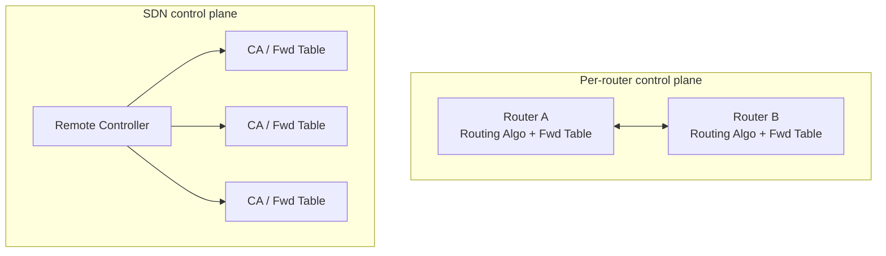
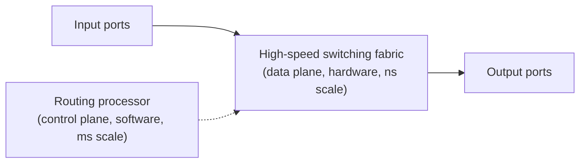
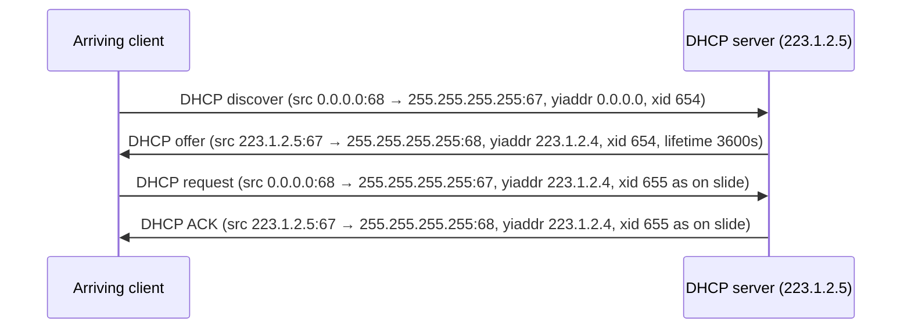
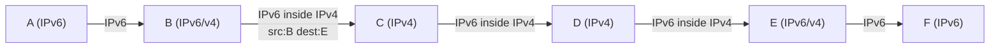

# Ch4 Network Layer: Data Plane

> [!abstract] Chapter goals
> - Understand the principles behind network layer services, focusing on the **data plane**:
>   - network layer service models
>   - forwarding vs. routing
>   - how a router works
>   - addressing
>   - generalized forwarding
>   - Internet architecture
> - Instantiation and implementation in the Internet: **IP protocol**, **NAT**, middleboxes

> [!info] How this note is marked
> - `[!bug] Erratum`: a typo or error in the original slides
> - `[!info] Supplement`: something the slides leave unclear, skip over, or that is now outdated
> - Everything is collected in [[#Errata and Supplements Summary]] at the end

## Contents
- [[#1. Network Layer Overview]]
- [[#2. Inside a Router]]
- [[#3. IP - the Internet Protocol]]
- [[#4. NAT - Network Address Translation]]
- [[#5. IPv6]]
- [[#6. Generalized Forwarding and SDN]]
- [[#Review Questions]]
- [[#Errata and Supplements Summary]]

---

## 1. Network Layer Overview

### 1.1 Network-layer services and protocols
- Transports segments from the **sending host** to the **receiving host**
  - sender: encapsulates segments into **datagrams** and passes them to the link layer
  - receiver: delivers segments up to the transport layer
- Network-layer protocols run in **every** Internet device (hosts and routers)
- **Routers**:
  - examine header fields in every IP datagram passing through
  - move datagrams from input ports to output ports along the end-to-end path

### 1.2 Two key functions: Forwarding vs. Routing

| | Forwarding | Routing |
|---|---|---|
| What it does | Moves a packet from a router's input link to the appropriate output link | Determines the route packets take from source to destination |
| Scope | Single router, local | Network-wide |
| Trip analogy | Getting through a **single interchange** | **Planning the whole trip** |
| Belongs to | Data plane | Control plane (routing algorithms) |

### 1.3 Data Plane vs. Control Plane

| Data plane | Control plane |
|---|---|
| **Local, per-router** function | **Network-wide** logic |
| Decides which output port a datagram arriving on an input port is forwarded to | Decides how a datagram is routed among routers along the end-to-end path |
| Looks up the table using values in the arriving packet's header | Two approaches: traditional routing algorithms (in routers), SDN (in remote servers) |

Two control-plane architectures:
- **Per-router control plane**: each router runs its own routing-algorithm components, which interact with each other in the control plane
- **SDN (Software-Defined Networking) control plane**: a **remote controller** computes forwarding tables and installs them in routers (each router keeps only a control agent, CA)

### 1.4 Network Service Model
Question: what service model should the "channel" carrying datagrams from sender to receiver provide?

- Example services for **individual datagrams**: guaranteed delivery; guaranteed delivery within 40 ms
- Example services for a **flow of datagrams**: in-order delivery; guaranteed minimum bandwidth; limits on changes in inter-packet spacing

| Network Architecture | Service Model | Bandwidth | Loss | Order | Timing |
|---|---|---|---|---|---|
| Internet | **best effort** | none | no | no | no |
| ATM | Constant Bit Rate | constant rate | yes | yes | yes |
| ATM | Available Bit Rate | guaranteed min | no | yes | no |
| Internet | Intserv Guaranteed (RFC 1633) | yes | yes | yes | yes |
| Internet | Diffserv (RFC 2475) | possible | possibly | possibly | no |

> [!important] The Internet's best-effort model guarantees **none** of the following
> 1. successful delivery of a datagram to its destination
> 2. the timing or order of delivery
> 3. the bandwidth available to an end-to-end flow

### 1.5 Why has best effort worked so well?
- The mechanism is **simple**, which let the Internet be widely deployed and adopted
- With enough bandwidth provisioned, real-time apps (voice, video) perform "well enough" "most of the time"
- Replicated, application-layer distributed services (datacenters, CDNs) sit close to clients' networks, so services can be served from multiple locations
- Congestion control of "elastic" services also helps

> [!quote] It's hard to argue with success of best-effort service model.

> [!bug]- Erratum (4-12)
> The slide reads "allowed Internet to be widely deployed adopted". There's a missing conjunction; it should be "widely deployed **and** adopted".

---

## 2. Inside a Router

### 2.1 Architecture overview

- **Control plane** (routing, management): software, operates on a **millisecond** time scale
- **Forwarding data plane**: hardware, operates on a **nanosecond** time scale
- Analogy: input ports = entry stations, switching fabric = roundabout, output ports = exit roads, routing processor = station manager

### 2.2 Input port functions
Pipeline: `line termination (physical) → link layer protocol (receive) → lookup, forwarding + queueing → switch fabric`

- Physical layer: bit-level reception
- Link layer: e.g., Ethernet (Ch6)
- **Decentralized switching**:
  - Uses header field values to look up the output port in a forwarding table held in input-port memory (**"match plus action"**)
  - Goal: finish input-port processing at **line speed**
  - **Input port queuing**: happens when datagrams arrive faster than the forwarding rate into the switch fabric
- Two kinds of forwarding:
  - **Destination-based forwarding**: forward based only on the destination IP address (traditional)
  - **Generalized forwarding**: forward based on any set of header field values

> [!info]- Supplement: what does "decentralized" switching mean? (not explained on 4-16)
> After the routing processor computes the forwarding table, a **copy is pushed to every input port**. Each input port does its lookup locally with its own copy, instead of asking the central routing processor for every packet. That's what lets it keep up with line speed. "Decentralized" means the lookup is spread across the input ports.

### 2.3 Destination-based forwarding

| Destination Address Range | Link Interface |
|---|---|
| `11001000 00010111 00010000 00000000` – `11001000 00010111 00010111 11111111` | 0 |
| `11001000 00010111 00011000 00000000` – `11001000 00010111 00011000 11111111` | 1 |
| `11001000 00010111 00011001 00000000` – `11001000 00010111 00011111 11111111` | 2 |
| otherwise | 3 |

Question: what if the ranges don't divide up so nicely? → Longest prefix matching

> [!info]- Supplement: what the pink box on 4-18 is about (animation frames overlap in the PDF)
> The slide was an animation, and several frames are stacked on top of each other in the PDF. The point it makes: suppose a small piece inside interface 0's range,
> `11001000 00010111 00010000 00000100` – `11001000 00010111 00010000 00000111`,
> must go out **interface 3** instead. Then the clean "one range → one interface" table has to be split into several pieces, and the table gets big and messy.
> The fix is to describe entries as **prefixes** instead of ranges and use longest prefix matching, so a longer (more specific) prefix takes precedence over a shorter one.

### 2.4 Longest Prefix Matching (LPM)

> [!definition] Longest prefix match
> When looking up the forwarding table entry for a destination address, use the **longest address prefix that matches** the destination address.

| Destination Address Range | Link interface |
|---|---|
| `11001000 00010111 00010*** ********` | 0 |
| `11001000 00010111 00011000 ********` | 1 |
| `11001000 00010111 00011*** ********` | 2 |
| otherwise | 3 |

> [!example]- Examples (expand for answers)
> - `11001000 00010111 00010110 10100001` → matches only `00010***` (21 bits) → **interface 0**
> - `11001000 00010111 00011000 10101010` → matches both `00011000` (24 bits) and `00011***` (21 bits); the longest wins → **interface 1**

- Why use LPM? We'll see when we get to addressing (route aggregation)
- Often implemented with **TCAM (Ternary Content Addressable Memory)**
  - content addressable: present an address to the TCAM and get the result in **one clock cycle**, regardless of table size
  - Cisco Catalyst: about 1M routing table entries in TCAM

### 2.5 Switching fabrics
- Job: transfer a packet from the input link to the appropriate output link
- **Switching rate**: the rate at which packets can be transferred from inputs to outputs (the slide says "can be transfer"; it should be **transferred**)
  - often measured as a multiple of the input/output line rate
  - with N inputs, a switching rate of **N times** the line rate (NR) is desirable

Three major types:

| Type | Description | Limitation / example |
|---|---|---|
| **Memory** | First-generation routers; traditional computers with switching under direct CPU control; packet copied into system memory | Limited by memory bandwidth (**2 bus crossings** per datagram) |
| **Bus** | Datagram goes from input-port memory to output-port memory over a **shared bus** | **Bus contention**: speed limited by bus bandwidth; e.g., the Cisco 5600's 32 Gbps bus is fast enough for access routers |
| **Interconnection network** | Crossbar, Clos networks, etc., originally built to connect processors in multiprocessors | See below |

Interconnection network details:
- **Multistage switch**: an n×n switch built from multiple stages of smaller switches (e.g., an 8×8 multistage switch)
- Exploiting parallelism: fragment the datagram into **fixed-length cells** on entry, switch the cells through the fabric, reassemble at the exit
- Scaling: multiple switching **planes** in parallel → speedup and scaleup
  - e.g., **Cisco CRS router**: basic unit of 8 switching planes, each a 3-stage interconnection network, up to hundreds of Tbps of switching capacity

### 2.6 Input port queuing
- If the switch fabric is slower than all input ports combined, queueing can build up at the input queues
  - this causes queueing delay and **loss** from input buffer overflow
- **HOL (Head-of-the-Line) blocking**: a queued datagram at the front of the queue keeps the others behind it from moving forward (even if the output port those others want is free)

### 2.7 Output port queuing

> [!important] The slide itself says: "This is a really important slide"

Pipeline: `switch fabric (rate: NR) → datagram buffer / queueing → link layer protocol (send) → line termination (R)`

- **Buffering** is needed when datagrams arrive from the fabric faster than the link transmission rate
  - **Drop policy**: which datagrams get dropped when there are no free buffers?
  - → datagrams can be lost due to congestion and lack of buffers
- **Scheduling discipline**: chooses which queued datagram to transmit next
  - → priority scheduling: who gets the best performance? This ties into **network neutrality**
- Leads to queueing (delay) and loss from output buffer overflow

### 2.8 How much buffering?
- **RFC 3439 rule of thumb**: average buffering = "typical" RTT (say 250 ms) × link capacity $C$
  - e.g., $C = 10\text{ Gbps}$ → $2.5\text{ Gbit}$ buffer
- More recent recommendation: with $N$ flows,
  $$\text{buffer} = \frac{\text{RTT} \cdot C}{\sqrt{N}}$$
- But **too much buffering can increase delays** (especially in home routers → bufferbloat)
  - long RTTs: poor performance for real-time apps, sluggish TCP response
  - recall delay-based congestion control: "keep the bottleneck link just full enough (busy) but no fuller"

### 2.9 Buffer management
Abstraction: packet arrivals → **queue** (waiting area) → **link** (server, rate R) → packet departures

- **Drop**: which packet to admit or drop when buffers are full
  - **Tail drop**: drop the arriving packet
  - **Priority**: drop/remove on a priority basis
- **Marking**: which packets to mark to signal congestion (**ECN**, **RED**)

> [!info]- Supplement: the drop definition is unclear, and ECN / RED aren't explained (4-34)
> - The slide's "drop: which packet to add, drop when buffers are full" means: when buffers are full, decide **which packet to accept and which to drop**
> - **RED (Random Early Detection)**: instead of waiting until the buffer is completely full, once the average queue length passes a threshold it **drops (or marks) packets early at random** with some probability. This makes TCP senders slow down sooner and avoids everyone timing out at once (global synchronization)
> - **ECN (Explicit Congestion Notification)**: instead of dropping the packet, the router **marks congestion** in the IP header's ECN bits (bits 6:7 of the ToS field). The receiver reports this back to the sender via TCP, and the sender slows down
> - RED decides *when* to signal congestion; ECN is a way to signal it *by marking instead of dropping*. They're often used together

### 2.10 Packet scheduling
Deciding which packet to send next on the link.

| Policy | Description |
|---|---|
| **FCFS / FIFO** | Packets transmitted in order of arrival at the output port |
| **Priority** | Arriving traffic is **classified** and queued by class (any header fields can be used); send from the **highest-priority queue that has buffered packets**; FCFS within a class |
| **Round Robin (RR)** | Classify and queue; the server **cyclically** scans the class queues, sending one complete packet from each class (if available) in turn |
| **Weighted Fair Queuing (WFQ)** | Generalized RR; each class $i$ has weight $w_i$ and gets a share of service per cycle of $\dfrac{w_i}{\sum_j w_j}$ → **minimum bandwidth guarantee per traffic class** |

### 2.11 Sidebar: Network neutrality
- **What is network neutrality?**
  - Technical: how an ISP should share/allocate its resources (packet scheduling and buffer management are the mechanisms)
  - Social and economic principles: protecting free speech, encouraging innovation and competition
  - Enforced legal rules and policies (different countries take different views)
- **2015 US FCC Order on Protecting and Promoting an Open Internet**: three "clear, bright line" rules
  1. **No blocking**: shall not block lawful content, applications, services, or non-harmful devices (subject to reasonable network management)
  2. **No throttling**: shall not impair or degrade lawful traffic based on content, application, service, or non-harmful device (subject to reasonable network management)
  3. **No paid prioritization**
- **Is an ISP a "telecommunications service" or an "information service"?** (this matters a lot for regulation)
  - US Communications Act of 1934 / Telecommunications Act of 1996
  - **Title II**: imposes "common carrier duties" on telecommunications services: reasonable rates, non-discrimination, and regulation
  - **Title I**: applies to information services: no common carrier duties (not regulated), but gives the FCC authority as needed to carry out its functions

> [!bug]- Errata (4-39, 4-41)
> - 4-39 "how an ISP should share/**allocation** its resources" → should be share/**allocate**
> - 4-41 "US **Telecommunication** Act of 1934 and 1996" is imprecise. The 1934 law is the **Communications Act of 1934**; the 1996 law is the **Telecommunications Act of 1996** (which amended the former). Title I / Title II refer to sections of the Communications Act

> [!info]- Supplement: what happened after (the 2015 rules no longer exist)
> The slides only cover the 2015 FCC Order, which could make it look like those rules are still in force. What happened next:
> - 2015: the FCC classified broadband ISPs under Title II and adopted the three rules
> - 2017 onward: the FCC repealed them
> - 2024: the FCC voted to reinstate them
> - January 2025: in *Ohio Telecom Association v. FCC*, the US Court of Appeals for the Sixth Circuit held that broadband ISPs provide only a Title I "information service", so the FCC lacks authority to reinstate the rules
> - There are currently no federal net neutrality rules in the US, but state laws (e.g., California, Washington) remain in effect
>
> This is exactly the point of 4-41: how an ISP is classified makes a huge regulatory difference.

---

## 3. IP - the Internet Protocol

### 3.1 The Internet network layer
- **Path-selection algorithms**: implemented in routing protocols (OSPF, BGP) or an SDN controller → produce the **forwarding table**
- **IP protocol**: datagram format, addressing, packet-handling conventions
- **ICMP protocol**: error reporting, router "signaling"

(Above: transport layer, TCP and UDP. Below: link layer, physical layer.)

### 3.2 IPv4 datagram format (32 bits per row)

| Field | Description |
|---|---|
| **ver** | IP protocol version number |
| **head. len** | Header length, in units of **32-bit words** (see the erratum below) |
| **type of service** | diffserv (bits 0:5), ECN (bits 6:7) |
| **length** | Total datagram length in bytes (16 bits); max 65,535 bytes (the slide says 64K); typically ≤ 1500 bytes |
| **16-bit identifier / flgs / fragment offset** | Used for fragmentation / reassembly; offset is in units of **8 bytes** |
| **TTL (time to live)** | Remaining max hops (decremented at each router) |
| **upper layer** | Upper-layer protocol (e.g., TCP or UDP) |
| **header checksum** | Checksum over the header |
| **source IP address** | 32-bit source address |
| **destination IP address** | 32-bit destination address |
| **options (if any)** | e.g., timestamp, record route taken |
| **payload data** | Variable length, typically a TCP or UDP segment |

> [!note] Overhead
> 20 bytes of TCP header + 20 bytes of IP header = **40 bytes** + application-layer overhead

> [!bug] Erratum (4-44): header length is not in bytes
> The slide says "header length (bytes)", but this 4-bit field (IHL) is actually counted in **32-bit words (4 bytes)**.
> - With no options, IHL = 5 → 5 × 4 = **20 bytes**
> - The max 4-bit value is 15 → the longest header is 15 × 4 = **60 bytes**
>
> By contrast, the "length" (total length) field **really is** in bytes. These two fields' units are easy to mix up on exams.

> [!info]- Supplement: field details the slides skip
> - **flgs** is 3 bits: a reserved bit, **DF** (Don't Fragment), and **MF** (More Fragments). The "fragflag" in the 4-46 example is MF
> - **fragment offset** is in units of 8 bytes, so every fragment except the last must carry a multiple of 8 bytes of data
> - When **TTL** reaches 0, the router drops the packet and sends back an ICMP Time Exceeded message (this is how traceroute works)
> - **header checksum** covers only the header. Because TTL changes at every hop, every router has to **recompute** the checksum

### 3.3 IP fragmentation / reassembly
- Every link has an **MTU (Maximum Transmission Unit)**: the largest possible link-level frame. Different link types have different MTUs (e.g., 1500 bytes for Ethernet)
- A large IP datagram is **fragmented** within the network
  - one datagram becomes several datagrams
  - **reassembled only at the destination**
  - IP header fields (ID, flag, offset) are used to identify and order related fragments

> [!bug]- Erratum (4-45)
> The slide says "MTU (max. **transfer size**)". The standard name is **Maximum Transmission Unit**.

> [!example] Example: 4000-byte datagram, MTU = 1500 bytes
> Original datagram: length = 4000, ID = x, fragflag = 0, offset = 0 (20-byte header + 3980 bytes of data)
>
> Each fragment's data field holds at most 1500 − 20 = **1480 bytes**; offset is in units of **8 bytes**
>
> | Fragment | length | ID | fragflag | offset |
> |---|---|---|---|---|
> | 1 | 1500 | x | 1 | 0 |
> | 2 | 1500 | x | 1 | 185 (= 1480/8) |
> | 3 | 1040 | x | 0 | 370 |
>
> Last fragment's data = 3980 − 2×1480 = 1020 bytes, plus a 20-byte header → 1040. fragflag = 0 means "no more fragments after this one".
>
> **What the slide doesn't make clear**: the 4000 bytes is the total length **including the 20-byte header**, so there are only 3980 bytes of data. Check: 1480 + 1480 + 1020 = 3980 ✓
>
> **General method**:
> 1. Max data per fragment = MTU − 20, rounded down to a multiple of 8 (1480 already is one)
> 2. Offset of fragment $k$ = total data in all earlier fragments ÷ 8
> 3. Only the last fragment has MF = 0

### 3.4 IP addressing basics
- **IP address**: a 32-bit identifier associated with each host or router **interface**
- **Interface**: the connection between a host/router and a physical link
  - routers typically have multiple interfaces (the slide says "**router's** typically have"; it should be the plural **routers**)
  - a host typically has one or two (e.g., wired Ethernet, wireless 802.11)
- **Dotted-decimal** notation: `223.1.1.1 = 11011111 00000001 00000001 00000001`
- How are interfaces actually connected? Covered in Ch6 and Ch7 (wired: Ethernet switches; wireless: WiFi base station). For now, don't worry about how interfaces connect to each other without an intervening router.

### 3.5 Subnets
- **Subnet**: a set of device interfaces that can physically reach each other without passing through an intervening router
- IP addresses have structure:
  - **Subnet part**: devices in the same subnet share the same high-order bits
  - **Host part**: the remaining low-order bits
- **Recipe for defining subnets**: detach each interface from its host or router, creating "islands" of isolated networks. Each isolated network is a subnet
- **Subnet mask**: e.g., `/24` means the high-order 24 bits are the subnet part (as in `223.1.1.0/24`)
- Note: each point-to-point link between routers is **also its own subnet** (the slide's example has 6 subnets: `223.1.1/24`, `223.1.2/24`, `223.1.3/24`, `223.1.7/24`, `223.1.8/24`, `223.1.9/24`)

> [!bug]- Erratum / caution (4-52): the `.0` addresses in the figure
> The figure labels some interfaces `223.1.7.0` and `223.1.8.0`. In a `/24` subnet, the address whose host part is all zeros (`x.x.x.0`) is the **network address** and normally **can't** be assigned to an interface (the all-ones `x.x.x.255` is the broadcast address). This is a simplification in the textbook figure; you wouldn't configure it this way in practice.
>
> Also: a `/x` subnet has $2^{32-x} - 2$ usable host addresses (minus the network and broadcast addresses). For example, `/24` → 254.

### 3.6 CIDR: Classless InterDomain Routing
- Pronounced "cider"
- The subnet portion of the address can be of **arbitrary length**
- Address format: `a.b.c.d/x`, where $x$ is the number of bits in the subnet portion
- e.g., `200.23.16.0/23` → `11001000 00010111 0001000|0 00000000` (first 23 bits are the subnet part)

### 3.7 How do you get an IP address?
That's really two questions:
1. How does a host get an IP address within its network (the host part)?
2. How does a network get its own network part?

**How a host gets an IP address:**
- Hard-coded by the sysadmin in a config file (e.g., `/etc/rc.config` in UNIX)
- **DHCP**: dynamically get an address from a server, "plug-and-play" (the slide says "from **as** server"; it should be "from **a** server")

### 3.8 DHCP: Dynamic Host Configuration Protocol
**Goal**: a host dynamically obtains an IP address from a network server when it "joins" the network
- can renew its lease on an address in use
- allows reuse of addresses (an address is held only while connected/on)
- supports mobile users who join and leave the network

**Four steps** (DORA):

1. **Discover** (optional): host broadcasts "Is there a DHCP server out there?"
2. **Offer** (optional): server replies "I'm a DHCP server! Here's an IP address you can use"
3. **Request**: host asks "OK. I'd like to use this IP address!"
4. **ACK**: server confirms "OK. You've got that IP address!"

> [!bug] Erratum / caution (4-57): the transaction ID changes from 654 to 655
> In the figure, discover/offer use transaction ID 654 but request/ACK switch to 655, which makes it look like a new ID is used for each round trip. Per RFC 2131, the DHCPREQUEST a client sends in response to an offer **should reuse the same transaction ID (xid)**, and the server's ACK echoes it. In a real packet capture, all four messages in one DORA exchange share the same xid.
> Also on this slide, the request's "dest**::** 255.255.255.255" has an extra colon.

> [!tip]
> - The first two steps can be skipped "if a client remembers and wishes to reuse a previously allocated network address" [RFC 2131]
> - All messages are **broadcast** (the client has no IP yet)
> - Client uses port **68**, server uses port **67**
> - The DHCP server is typically co-located in the router, serving all subnets the router is attached to

**DHCP returns more than just an IP address**:
- the address of the client's **first-hop router** (default gateway)
- the name and IP address of the **DNS server** (the slide says "DNS **sever**"; it should be server)
- the **network mask** (which part of the address is network vs. host)

> [!info]- Supplement: why is the request broadcast?
> The slides don't explain why the client still broadcasts its request after getting an offer. The reason: there may be **several DHCP servers** on the network, each sending an offer. The client broadcasts its request (naming the server it picked), so the servers that weren't chosen see it and know they can take back the addresses they offered.

**Encapsulation example** (a laptop joining a network):
- The DHCP REQUEST is encapsulated in **UDP** → **IP** → **Ethernet**
- The Ethernet frame is broadcast (dest: `FFFFFFFFFFFF`) on the LAN and received at the router running the DHCP server
- Demuxed layer by layer: Ethernet → IP → UDP → DHCP
- The server builds a DHCP ACK (client IP, first-hop router, DNS server), encapsulates it, and sends it back to the client, where it's demuxed up to DHCP
- The client now knows its IP address, its DNS server, and its first-hop router

> [!bug]- Errata (4-59, 4-60)
> - 4-60 "**DCP** server formulates DHCP ACK" → should be **DHCP** server
> - 4-59 shows only REQUEST → ACK, which compresses the full DORA exchange into two steps. If the client has never had an address before, discover/offer come first

### 3.9 How does a network get its subnet part?
It gets an **allocated portion** of its provider ISP's address space.

| | Binary | CIDR |
|---|---|---|
| ISP's block | `11001000 00010111 0001`0000 00000000 | `200.23.16.0/20` |
| Organization 0 | `11001000 00010111 0001000`0 00000000 | `200.23.16.0/23` |
| Organization 1 | `11001000 00010111 0001001`0 00000000 | `200.23.18.0/23` |
| Organization 2 | `11001000 00010111 0001010`0 00000000 | `200.23.20.0/23` |
| … | … | … |
| Organization 7 | `11001000 00010111 0001111`0 00000000 | `200.23.30.0/23` |

The ISP splits its `/20` into 8 `/23` blocks.

### 3.10 Hierarchical addressing
- **Route aggregation**: hierarchical addressing allows efficient advertisement of routing information
  - Fly-By-Night-ISP tells the world: "Send me anything with addresses beginning `200.23.16.0/20`"
  - ISPs-R-Us says: "Send me anything with addresses beginning `199.31.0.0/16`"
- **More specific routes**: Organization 1 moves from Fly-By-Night-ISP to ISPs-R-Us
  - ISPs-R-Us now advertises: "`199.31.0.0/16` **or `200.23.18.0/23`**"
  - Because of **longest prefix matching**, traffic to `200.23.18.x` follows the more specific `/23` route → goes to ISPs-R-Us ✅ (this is why LPM exists)

### 3.11 IP addressing: last words
- **How does an ISP get a block of addresses?** → **ICANN** (Internet Corporation for Assigned Names and Numbers)
  - allocates IP addresses through 5 **regional registries (RRs)**, which may then allocate to local registries
  - manages the DNS root zone, including delegating management of individual TLDs (.com, .edu, …)
- **Are there enough 32-bit IP addresses?**
  - ICANN allocated the last chunk of IPv4 addresses to the RRs in **2011**
  - **NAT** helps with IPv4 address-space exhaustion
  - **IPv6** has a 128-bit address space
  - Looking back on the decision to make IPv4 addresses 32 bits, Vint Cerf remarked that nobody back then knew how much address space would be needed

---

## 4. NAT - Network Address Translation

### 4.1 Concept
As far as the outside world is concerned, **all devices in the local network share just one IPv4 address**.
- e.g., home network `10.0.0/24`, NAT router's public IP `138.76.29.7`
- every datagram leaving the local network has source IP `138.76.29.7`, but **different source port numbers**
- traffic inside the local network uses `10.0.0/24` addresses as usual

### 4.2 Private address space
Private addresses usable only within a local network: `10/8`, `172.16/12`, `192.168/16`

**Advantages:**
- only **one** IP address needed from the provider ISP for all devices
- can change host addresses in the local network without notifying the outside world
- can change ISPs without changing the addresses of local devices
- **security**: devices inside the local net aren't directly addressable or visible from outside

### 4.3 Implementation: what the NAT router must do (transparently)
1. **Outgoing**: replace (source IP, port #) of every outgoing datagram with (NAT IP, new port #)
   - remote clients/servers respond using (NAT IP, new port #) as the destination
2. **Remember**: store every (source IP, port #) ↔ (NAT IP, new port #) pair in the **NAT translation table**
3. **Incoming**: replace (NAT IP, new port #) in the destination fields of every incoming datagram with the matching (source IP, port #) from the table

> [!example] NAT translation walkthrough
> | Step | Action | Source | Destination |
> |---|---|---|---|
> | 1 | host `10.0.0.1` sends | `10.0.0.1:3345` | `128.119.40.186:80` |
> | 2 | NAT router rewrites source, updates table | `138.76.29.7:5001` | `128.119.40.186:80` |
> | 3 | reply arrives at NAT router | `128.119.40.186:80` | `138.76.29.7:5001` |
> | 4 | NAT router rewrites destination, forwards to host | `128.119.40.186:80` | `10.0.0.1:3345` |
>
> NAT translation table: WAN side `138.76.29.7, 5001` ↔ LAN side `10.0.0.1, 3345`

### 4.4 Why NAT is controversial
- Routers "should" only process up to **layer 3**
- The address "shortage" should be solved by **IPv6**
- Violates the **end-to-end argument** (a network-layer device manipulating port #s)
- **NAT traversal**: what if a client wants to connect to a server behind a NAT?

But **NAT is here to stay**: used extensively in home and institutional networks and 4G/5G cellular networks.

---

## 5. IPv6

### 5.1 Motivation
- Initial motivation: the 32-bit IPv4 address space would be completely allocated
- Additional motivation:
  - faster processing/forwarding: **40-byte fixed-length header**
  - enable different network-layer treatment of "flows"

### 5.2 IPv6 datagram format

| Field | Description |
|---|---|
| ver | Version (4 bits, value 6) |
| **pri (priority)** | Identifies priority among datagrams in a flow; official name is **Traffic Class** (8 bits) |
| **flow label** | Identifies datagrams in the same "flow" (the concept of a flow isn't well defined); 20 bits |
| payload len | Payload length |
| next hdr | Next header (upper-layer protocol or an extension header) |
| hop limit | Like IPv4's TTL |
| source address | **128 bits** |
| destination address | **128 bits** |
| payload (data) | |

> [!important] What's **missing** compared with IPv4
> - **No checksum** (to speed up processing at routers)
> - **No fragmentation / reassembly**
> - **No options** (available as an upper-layer, next-header protocol instead)

> [!info]- Supplement: what "no fragmentation" and "no checksum" mean precisely
> - **No fragmentation**: **routers along the path don't fragment**. If a datagram is too big, the router drops it and sends back an **ICMPv6 "Packet Too Big"** message, and the **source** sends smaller packets (Path MTU Discovery). The source itself can still fragment using the Fragment extension header.
> - **No checksum**: the link layer (e.g., Ethernet CRC) and transport layer (TCP/UDP checksum) already check for errors, so doing it again at the network layer is redundant. IPv4 has to recompute the checksum at every hop (because TTL changes), so dropping it speeds up routers.
> - **pri** is called priority on the slide, but its official name in RFC 8200 is **Traffic Class**. It plays the same role as IPv4's ToS (DiffServ + ECN).

### 5.3 Transition from IPv4 to IPv6
- Not all routers can be upgraded at once → no "flag days"
- How does the network work with a mix of IPv4 and IPv6 routers?
- **Tunneling**: an IPv6 datagram is carried as the **payload** of an IPv4 datagram among IPv4 routers ("packet within a packet")
  - tunneling is used extensively in other contexts too (4G/5G)

- **Logical view**: an IPv4 tunnel between B and E
- **Physical view**: A → B → C → D → E → F
- Note the addresses:
  - A→B and E→F: plain IPv6 (flow X, src A, dest F)
  - B→C→D→E: outer IPv4 header (src B, dest E) wrapping the original IPv6 datagram (src A, dest F)

### 5.4 IPv6 adoption (figures from the slides)
- Google: ~40% of clients access its services via IPv6 (2023)
- NIST: 1/3 of all US government domains are IPv6 capable
- Deployment has taken a long (long!) time: **25 years and counting!**
  - compare application-layer changes over the last 25 years: WWW, social media, streaming, gaming, telepresence, …
  - Why? (discussion question)

> [!info]- Supplement: updated numbers and the usual answers to "why"
> - The ~40% figure on the slide is from 2023. Google's statistics passed 50% for the first time on **28 March 2026** (50.10%) and have hovered around 50% since (about 48.7% in mid-June 2026)
> - Adoption varies widely by country: France and India are around 70%, while Italy and Spain are in the 10–20% range
> - Main reasons adoption has been slow:
>   1. IPv6 offers network operators **few new features**, so there's little incentive to upgrade
>   2. **NAT** let everyone keep stretching IPv4
>   3. The network layer is the "narrow waist" every device shares, so upgrading it means upgrading equipment worldwide. That's much harder than an app changing on its own at the application layer

---

## 6. Generalized Forwarding and SDN

### 6.1 Match plus action
Review: each router contains a forwarding table (aka **flow table**)
- **"Match plus action"** abstraction: match bits in the arriving packet, then take an action
  - **Destination-based forwarding**: forward based on the destination IP address
  - **Generalized forwarding**:
    - **many** header fields can determine the action
    - **many** actions are possible: drop / copy / modify / log the packet

### 6.2 Flow table abstraction
- **Flow**: defined by header field values (link-, network-, and transport-layer fields)
- Generalized forwarding = simple packet-handling rules:
  - **Match**: pattern values in packet header fields
  - **Actions**: for a matched packet: drop, forward, or modify it, or send it to the controller (the slide's "drop, forward, modify, matched packet or send matched packet to controller" is garbled; it means **drop / forward / modify the matched packet, or send it to the controller**)
  - **Priority**: disambiguates overlapping patterns
  - **Counters**: #bytes and #packets

> [!example] Flow table example (`*` is a wildcard)
> | Match | Action |
> |---|---|
> | `src = *.*.*.*, dest = 3.4.*.*` | forward(2) |
> | `src = 1.2.*.*, dest = *.*.*.*` | drop |
> | `src = 10.1.2.3, dest = *.*.*.*` | send to controller |

> [!note] The slides end here (4-83)
> The remaining roadmap items, **OpenFlow: match+action in action** and **Middleboxes**, aren't in this PDF.

---

## Review Questions

> [!question]- What's the difference between forwarding and routing?
> Forwarding moves a packet from an input link to an output link inside a single router (data plane, local). Routing determines the whole end-to-end path (control plane, network-wide).

> [!question]- What does the Internet's best-effort service guarantee?
> Nothing: no guaranteed delivery, no guaranteed timing or order, no guaranteed bandwidth.

> [!question]- What is HOL blocking, and where does it happen?
> It happens in input-port queues: the datagram at the front is blocked by output-port contention, so the datagrams behind it can't move even if their output ports are free.

> [!question]- On what time scales do a router's control plane and data plane operate?
> Control plane (software): milliseconds. Data plane (hardware): nanoseconds.

> [!question]- Why is longest prefix matching needed?
> To support more specific routes under hierarchical addressing / route aggregation (e.g., after an organization switches ISPs, its new ISP advertises a longer prefix and traffic is still routed correctly).

> [!question]- A 4000-byte datagram crosses a link with MTU 1500. What are the fragment offsets?
> 0, 185, 370 (each fragment carries 1480 bytes of data; offset is in units of 8 bytes).

> [!question]- Besides an IP address, what does DHCP provide?
> The first-hop router's address, the DNS server's name and IP address, and the network mask.

> [!question]- What did IPv6 remove from the header compared with IPv4?
> Checksum, fragmentation/reassembly, and options.

> [!question]- Why is NAT controversial?
> Routers should only process up to L3; the address shortage should be solved by IPv6; it violates the end-to-end argument (rewriting port #s); and it creates the NAT traversal problem.

> [!question]- In WFQ, what share of bandwidth does class i get?
> $w_i / \sum_j w_j$, which gives each traffic class a minimum bandwidth guarantee.

> [!question]- An IPv4 header has IHL = 6. How long is the header, and does it have options?
> 6 × 4 = 24 bytes. That's 4 bytes more than the basic 20, so it has 4 bytes of options.

> [!question]- What does an IPv6 router do with a datagram larger than the next link's MTU?
> It doesn't fragment it. It drops the datagram and sends back ICMPv6 Packet Too Big, and the source adjusts the packet size.

---

## Errata and Supplements Summary

### Errata (typos / errors)

| Slide | Original text | Correction |
|---|---|---|
| 4-12 | widely deployed adopted | widely deployed **and** adopted |
| 4-24, 4-25 | packets can be transfer | packets can be **transferred** |
| 4-39 | share/allocation its resources | share/**allocate** its resources |
| 4-41 | US Telecommunication Act of 1934 and 1996 | **Communications Act of 1934** and **Telecommunications Act of 1996** |
| 4-44 | header length (bytes) | Units are **32-bit words** (IHL × 4 = bytes) |
| 4-44 | Maximum length: 64K bytes | Precisely 65,535 bytes (2¹⁶ − 1) |
| 4-45 | MTU (max. transfer size) | **Maximum Transmission Unit** |
| 4-47, 4-48 | router's typically have | **routers** typically have |
| 4-52 | interface addresses `223.1.7.0`, `223.1.8.0` | `.0` is the network address of a /24; not assignable to an interface in practice |
| 4-54 | get address from as server | from **a** server |
| 4-57 | transaction ID changes to 655 for request / ACK | RFC 2131: one DORA exchange should use the **same xid** |
| 4-57 | dest:: 255.255.255.255 | dest: (extra colon) |
| 4-58 | DNS sever | DNS **server** |
| 4-60 | DCP server | **DHCP** server |
| 4-82, 4-83 | drop, forward, modify, matched packet or send matched packet to controller | drop / forward / modify the matched packet, or send it to the controller |

### Supplements (unclear / omitted / outdated)

| Slide | Topic | Key point |
|---|---|---|
| 4-16 | decentralized switching | Forwarding table is copied to each input port and looked up locally |
| 4-18 | pink box | Overlapping animation frames; shows why fragmented ranges call for prefixes + LPM |
| 4-34 | drop, ECN, RED | RED drops early at random; ECN marks instead of dropping |
| 4-40, 4-41 | net neutrality today | Repealed from 2017; reinstated 2024; struck down by the Sixth Circuit in 2025 |
| 4-44 | flags, TTL, checksum | DF / MF; TTL hitting 0 triggers ICMP; checksum recomputed at each hop |
| 4-46 | fragmentation example | 4000 bytes includes the header; 3980 bytes of data; general method |
| 4-55 – 4-57 | why the DHCP request is broadcast | Tells every server which one the client picked |
| 4-59 | DHCP example shows only two steps | The full exchange is still DORA |
| 4-73 | IPv6 pri / no fragmentation / no checksum | pri = Traffic Class; routers don't fragment, they send ICMPv6; other layers already checksum |
| 4-78, 4-79 | IPv6 adoption | Google's statistics passed 50% for the first time in March 2026 |

---

## Related Notes
- [[CN Ch4 - Network Layer Data Plane]] (Chinese version)
- [[CN Ch3 - Transport Layer]]
- [[CN Ch5 - Network Layer Control Plane]]
- [[CN Ch6 - Link Layer]]
