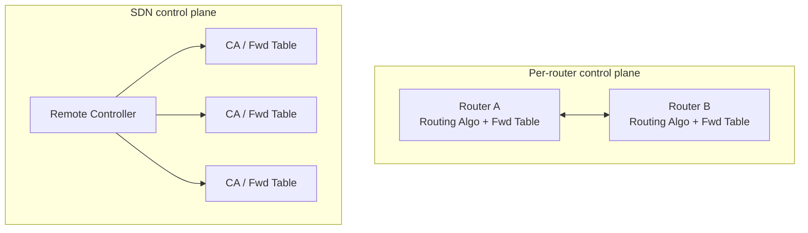
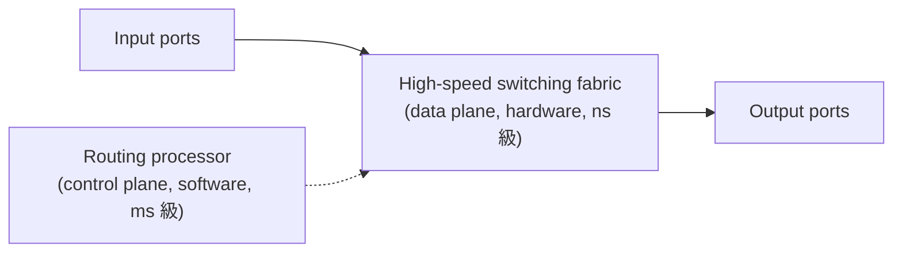
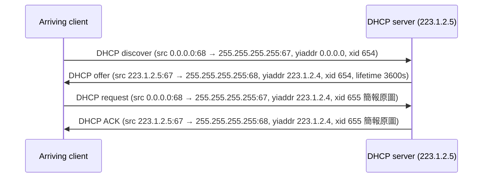
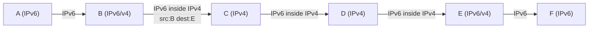

# Ch4 Network Layer: Data Plane

> [!abstract] 本章目標
> - 理解網路層服務背後的原理，聚焦在 **data plane**：
>   - network layer service models
>   - forwarding vs. routing
>   - router 內部如何運作
>   - addressing
>   - generalized forwarding
>   - Internet architecture
> - 在 Internet 中的實作：**IP protocol**、**NAT**、middleboxes

> [!info] 筆記標記說明
> - `[!bug] 勘誤`：簡報原文的 typo 或錯誤
> - `[!info] 補充`：簡報講得不清楚、省略或過時的地方
> - 全部整理在最後的 [[#簡報勘誤與補充總表]]

## 目錄
- [[#1. 網路層概觀]]
- [[#2. Router 內部構造]]
- [[#3. IP：Internet Protocol]]
- [[#4. NAT：Network Address Translation]]
- [[#5. IPv6]]
- [[#6. Generalized Forwarding 與 SDN]]
- [[#複習問題]]
- [[#簡報勘誤與補充總表]]

---

## 1. 網路層概觀

### 1.1 網路層的服務與協定
- 把 transport segment 從**發送端主機**送到**接收端主機**
  - sender：把 segment 封裝 (encapsulate) 成 **datagram**，交給 link layer
  - receiver：把 segment 往上交給 transport layer
- **每一台** Internet 裝置（host、router）都有網路層協定
- **Router**：
  - 檢查所有經過它的 IP datagram 的 header 欄位
  - 把 datagram 從 input port 搬到 output port，沿著端到端路徑傳遞

### 1.2 兩個關鍵功能：Forwarding vs. Routing

| | Forwarding（轉送） | Routing（路由） |
|---|---|---|
| 做什麼 | 把封包從 router 的 input link 移到適當的 output link | 決定封包從來源到目的地走的路徑 |
| 範圍 | 單一 router、局部 | 整個網路 |
| 旅行比喻 | 通過**單一個交流道**的過程 | **規劃整趟旅程**的過程 |
| 所屬 | Data plane | Control plane（routing algorithms） |

### 1.3 Data Plane vs. Control Plane

| Data plane | Control plane |
|---|---|
| **local、per-router** 功能 | **network-wide** 邏輯 |
| 決定從 input port 進來的 datagram 要被轉送到哪個 output port | 決定 datagram 在 routers 之間沿哪條端到端路徑走 |
| 依據到達封包 header 內的值查表 | 兩種做法：傳統 routing algorithm（在 router 裡）、SDN（在遠端 server） |

兩種 control plane 架構：
- **Per-router control plane**：每台 router 都有自己的 routing algorithm 元件，彼此在 control plane 互動
- **SDN (Software-Defined Networking) control plane**：**遠端 controller** 計算 forwarding table 並安裝到各 router（router 上只留 control agent, CA）

### 1.4 Network Service Model
問題：從 sender 到 receiver 傳送 datagram 的「通道」應該提供什麼服務？

- 針對**單一 datagram** 的服務：保證送達、保證在 40 ms 內送達
- 針對 **datagram flow** 的服務：依序送達、保證最低頻寬、限制封包間隔 (inter-packet spacing) 的變化

| Network Architecture | Service Model | Bandwidth | Loss | Order | Timing |
|---|---|---|---|---|---|
| Internet | **best effort** | none | no | no | no |
| ATM | Constant Bit Rate | constant rate | yes | yes | yes |
| ATM | Available Bit Rate | guaranteed min | no | yes | no |
| Internet | Intserv Guaranteed (RFC 1633) | yes | yes | yes | yes |
| Internet | Diffserv (RFC 2475) | possible | possibly | possibly | no |

> [!important] Internet 的 best-effort 模型**不保證**
> 1. datagram 一定成功送達
> 2. 送達的時間或順序
> 3. 端到端 flow 可用的頻寬

### 1.5 為什麼 best-effort 能成功？
- 機制**簡單** → Internet 能被廣泛部署採用
- 頻寬配置足夠時，即時應用（語音、視訊）在「大部分時間」表現「夠好」
- 複製式、應用層分散服務（datacenter、CDN）靠近使用者網路，可從多個地點提供服務
- 對 "elastic" 服務做 congestion control 也有幫助

> [!quote] It's hard to argue with success of best-effort service model.

> [!bug]- 勘誤（4-12）
> 原文 "allowed Internet to be widely deployed adopted"：多了一個動詞，應為 "widely deployed **and** adopted"。

---

## 2. Router 內部構造

### 2.1 架構總覽

- **Control plane**（routing、management）：軟體，以 **millisecond** 時間尺度運作
- **Forwarding data plane**：硬體，以 **nanosecond** 時間尺度運作
- 比喻：input ports = 入口收費站、switching fabric = 圓環、output ports = 出口道路、routing processor = 站長

### 2.2 Input Port 功能
流程：`line termination (physical) → link layer protocol (receive) → lookup, forwarding + queueing → switch fabric`

- Physical layer：bit-level 接收
- Link layer：例如 Ethernet（Ch6）
- **Decentralized switching**：
  - 依 header 欄位值，在 input port 記憶體中的 forwarding table 查出 output port（**"match plus action"**）
  - 目標：在 **line speed** 內完成 input port 處理
  - **Input port queuing**：當 datagram 到達速率 > 轉送進 switch fabric 的速率
- 兩種轉送方式：
  - **Destination-based forwarding**：只依 destination IP address（傳統）
  - **Generalized forwarding**：依任意一組 header 欄位值

> [!info]- 補充：什麼是 "decentralized" switching？（4-16 沒解釋）
> Routing processor 算出 forwarding table 後，會**複製一份到每個 input port**。每個 input port 用自己手上那份表在本地查詢，不必每個封包都去問中央的 routing processor，這樣才跟得上 line speed。「decentralized」指的就是查表這件事分散在各 input port 做。

### 2.3 Destination-based Forwarding

| Destination Address Range | Link Interface |
|---|---|
| `11001000 00010111 00010000 00000000` ~ `11001000 00010111 00010111 11111111` | 0 |
| `11001000 00010111 00011000 00000000` ~ `11001000 00010111 00011000 11111111` | 1 |
| `11001000 00010111 00011001 00000000` ~ `11001000 00010111 00011111 11111111` | 2 |
| otherwise | 3 |

問題：如果範圍沒辦法切得這麼整齊怎麼辦？→ Longest prefix matching

> [!info]- 補充：4-18 的粉紅色區塊在講什麼（PDF 動畫疊在一起看不清楚）
> 投影片原本是動畫，PDF 裡幾個畫面疊在一起。它想表達：假設 interface 0 的範圍中有一小段
> `11001000 00010111 00010000 00000100` ~ `11001000 00010111 00010000 00000111`
> 要改走 **interface 3**，原本「一段範圍對應一個 interface」的表就得被拆成好幾段，表會變很大、很亂。
> 解法是不用「範圍」而用「**prefix**」描述，再搭配 longest prefix match：較長（較精確）的 prefix 會優先於較短的。

### 2.4 Longest Prefix Matching (LPM)

> [!definition] Longest prefix match
> 在 forwarding table 中為目的地址找對應項目時，使用**與目的地址相符的最長 prefix**。

| Destination Address Range | Link interface |
|---|---|
| `11001000 00010111 00010*** ********` | 0 |
| `11001000 00010111 00011000 ********` | 1 |
| `11001000 00010111 00011*** ********` | 2 |
| otherwise | 3 |

> [!example]- 例題（點開看答案）
> - `11001000 00010111 00010110 10100001` → 只符合 `00010***`（21 bits）→ **interface 0**
> - `11001000 00010111 00011000 10101010` → 同時符合 `00011000`（24 bits）與 `00011***`（21 bits），取最長的 → **interface 1**

- 為什麼要用 LPM？之後講 addressing（route aggregation）時會看到
- 實作上常用 **TCAM (Ternary Content Addressable Memory)**
  - content addressable：把地址丟進 TCAM，**一個 clock cycle** 就取回結果，與表大小無關
  - Cisco Catalyst：TCAM 中約 1M 筆 routing table entries

### 2.5 Switching Fabrics
- 功能：把封包從 input link 傳到適當的 output link
- **Switching rate**：封包從 inputs 傳到 outputs 的速率（原文 "rate at which packets can be transfer"，應為 **transferred**）
  - 常以 input/output line rate 的倍數表示
  - N 個 inputs：理想上 switching rate 要是 line rate 的 **N 倍**（NR）

三種主要類型：

| 類型 | 說明 | 限制 / 例子 |
|---|---|---|
| **Memory** | 第一代 router；傳統電腦，由 CPU 直接控制交換；封包複製到系統記憶體 | 受 memory bandwidth 限制（每個 datagram 要**跨 bus 兩次**） |
| **Bus** | datagram 經**共享 bus** 從 input port memory 到 output port memory | **Bus contention**：速度受 bus bandwidth 限制；例：Cisco 5600 的 32 Gbps bus，足夠用於 access router |
| **Interconnection network** | Crossbar、Clos network 等，原用於多處理器互連 | 見下方 |

Interconnection network 細節：
- **Multistage switch**：用多級較小的 switch 組成 n×n switch（例：用小 switch 組成 8×8 multistage switch）
- 利用平行化：進入時把 datagram 切成**固定長度 cell**，在 fabric 中交換 cell，出口再重組
- Scaling：多個 switching **planes** 平行運作 → speedup、scaleup
  - 例：**Cisco CRS router**：基本單位 8 個 switching planes，每個 plane 是 3-stage interconnection network，交換容量可達數百 Tbps

### 2.6 Input Port Queuing
- 若 switch fabric 比所有 input ports 加總還慢 → input queue 會排隊
  - 造成 queueing delay，以及 input buffer overflow 導致的 **loss**
- **HOL (Head-of-the-Line) blocking**：佇列最前面的 datagram 被擋住，使後面的 datagram 也無法前進（即使後面那個要去的 output port 是空的）

### 2.7 Output Port Queuing

> [!important] 投影片特別標註：This is a really important slide

流程：`switch fabric (rate: NR) → datagram buffer / queueing → link layer protocol (send) → line termination (R)`

- 當 datagram 從 fabric 到達的速度 > link 傳輸速率 → 需要 **buffering**
  - **Drop policy**：沒有空 buffer 時要丟哪個 datagram？
  - → datagram 可能因壅塞、buffer 不足而遺失
- **Scheduling discipline**：從排隊中的 datagram 選出下一個要傳的
  - → Priority scheduling：誰能得到最好效能？牽涉 **network neutrality**
- 會造成 queueing (delay) 與 output buffer overflow 導致的 loss

### 2.8 需要多少 Buffer？
- **RFC 3439 經驗法則**：平均 buffer = 典型 RTT（例如 250 ms）× link capacity $C$
  - 例：$C = 10\text{ Gbps}$ → $2.5\text{ Gbit}$ buffer
- 較新的建議：有 $N$ 個 flow 時，
  $$\text{buffer} = \frac{\text{RTT} \cdot C}{\sqrt{N}}$$
- 但 **buffer 太多也會增加延遲**（尤其家用 router → bufferbloat）
  - RTT 變長：即時應用表現差、TCP 反應遲鈍
  - 回想 delay-based congestion control：「讓 bottleneck link 剛好滿（忙碌），但不要更滿」

### 2.9 Buffer Management
抽象模型：packet arrivals → **queue**（waiting area）→ **link**（server, 速率 R）→ packet departures

- **Drop**：buffer 滿時要加入 / 丟掉哪個封包
  - **Tail drop**：丟掉新到達的封包
  - **Priority**：依優先權丟棄 / 移除
- **Marking**：標記哪些封包以通知壅塞（**ECN**、**RED**）

> [!info]- 補充：簡報的 drop 定義不清楚，ECN / RED 也沒展開（4-34）
> - 原文 "drop: which packet to add, drop when buffers are full" 意思是：buffer 滿時，決定**要接收哪個封包、要丟掉哪個封包**
> - **RED (Random Early Detection)**：不等 buffer 全滿才丟，而是當平均佇列長度超過門檻時就以某個機率**提早隨機丟棄（或標記）**封包，讓 TCP 提早降速，避免大家同時 timeout（global synchronization）
> - **ECN (Explicit Congestion Notification)**：router 不丟封包，而是在 IP header 的 ECN bits（ToS 欄位的 bit 6:7）**標記壅塞**，接收端再透過 TCP 回報給發送端，讓它降速
> - RED 決定「何時」發出壅塞訊號，ECN 是「用標記取代丟包」的訊號方式，兩者常搭配使用

### 2.10 Packet Scheduling
決定下一個要送上 link 的封包。

| 策略 | 說明 |
|---|---|
| **FCFS / FIFO** | 依到達 output port 的順序傳送 |
| **Priority** | 到達的流量先**分類**、依 class 排隊（可用任何 header 欄位分類）；從**有封包的最高優先權佇列**送出；同一 class 內 FCFS |
| **Round Robin (RR)** | 分類排隊；server **循環**掃描各 class 佇列，輪流從每個 class 送出一個完整封包（若有） |
| **Weighted Fair Queuing (WFQ)** | 廣義的 RR；每個 class $i$ 有權重 $w_i$，每輪得到的服務比例為 $\dfrac{w_i}{\sum_j w_j}$ → 提供**每個 traffic class 的最低頻寬保證** |

### 2.11 Sidebar：Network Neutrality
- **什麼是 network neutrality？**
  - 技術面：ISP 應如何分享 / 分配資源（packet scheduling、buffer management 是機制）
  - 社會、經濟原則：保護言論自由、鼓勵創新與競爭
  - 法律規範與政策（各國看法不同）
- **2015 US FCC Order on Protecting and Promoting an Open Internet** 的三條 "bright line" 規則：
  1. **No blocking**：不得封鎖合法內容、應用、服務或無害裝置（合理網路管理除外）
  2. **No throttling**：不得依內容、應用、服務或無害裝置而降低合法流量品質（合理網路管理除外）
  3. **No paid prioritization**：不得進行付費優先
- **ISP 是 "telecommunications service" 還是 "information service"？**（對監管影響很大）
  - US Telecommunication Act of 1934 & 1996
  - **Title II**：對 telecommunications services 施加 "common carrier duties"——合理費率、不歧視，需受監管
  - **Title I**：適用 information services——沒有 common carrier duties（不受監管），但給 FCC 執行職能所需的權限

> [!bug]- 勘誤（4-39、4-41）
> - 4-39 "how an ISP should share/**allocation** its resources" → 應為 share/**allocate**
> - 4-41 "US **Telecommunication** Act of 1934 and 1996"：不精確。1934 年的是 **Communications Act of 1934**，1996 年的是 **Telecommunications Act of 1996**（後者修訂前者）；Title I / Title II 指的是 Communications Act 的章節

> [!info]- 補充：簡報沒提後續發展（2015 年的規則現在已不存在）
> 簡報只講 2015 FCC Order，容易讓人以為規則仍有效。後續：
> - 2015：FCC 把寬頻 ISP 歸類為 Title II，並訂下三條規則
> - 2017 起：FCC 廢除這些規則
> - 2024：FCC 投票恢復
> - 2025 年 1 月：美國第六巡迴上訴法院在 *Ohio Telecom Association v. FCC* 中判定寬頻 ISP 只提供 Title I 的 "information service"，FCC 無權恢復這些規則
> - 目前美國沒有聯邦層級的 net neutrality 規則，但加州、華盛頓州等州法仍有效
>
> 這正好呼應 4-41：ISP 被歸類為哪一種服務，在監管上影響非常大。

---

## 3. IP：Internet Protocol

### 3.1 Internet 網路層的組成
- **Path-selection algorithms**：實作於 routing protocols（OSPF、BGP）或 SDN controller → 產生 **forwarding table**
- **IP protocol**：datagram 格式、addressing、封包處理慣例
- **ICMP protocol**：錯誤回報、router "signaling"

（上層 transport：TCP、UDP；下層：link layer、physical layer）

### 3.2 IPv4 Datagram 格式（每列 32 bits）

| 欄位 | 說明 |
|---|---|
| **ver** | IP 版本號 |
| **head. len** | header 長度，單位是 **32-bit words**（見下方勘誤） |
| **type of service** | diffserv (bits 0:5)、ECN (bits 6:7) |
| **length** | datagram 總長度（bytes，16 bits），最大 65,535 bytes（簡報寫 64K），通常 ≤ 1500 bytes |
| **16-bit identifier / flgs / fragment offset** | 用於 fragmentation / reassembly；offset 單位是 **8 bytes** |
| **TTL (time to live)** | 剩餘最大跳數（每經過一個 router 就減 1） |
| **upper layer** | 上層協定（例如 TCP 或 UDP） |
| **header checksum** | header 檢查碼 |
| **source IP address** | 32-bit 來源地址 |
| **destination IP address** | 32-bit 目的地址 |
| **options (if any)** | 例如 timestamp、記錄經過的路徑 |
| **payload data** | 可變長度，通常是 TCP 或 UDP segment |

> [!note] Overhead
> 20 bytes TCP header + 20 bytes IP header = **40 bytes** + 應用層 overhead

> [!bug] 勘誤（4-44）：header length 的單位不是 bytes
> 簡報寫 "header length (bytes)"，但這個 4-bit 欄位（IHL）的單位其實是 **32-bit words（4 bytes）**。
> - 沒有 options 時 IHL = 5 → 5 × 4 = **20 bytes**
> - 4 bits 最大值 15 → header 最長 15 × 4 = **60 bytes**
>
> 反過來，"length"（total length）欄位的單位**真的是 bytes**。考試很容易混淆這兩個欄位的單位。

> [!info]- 補充：簡報沒說清楚的欄位細節
> - **flgs** 有 3 bits：保留位、**DF** (Don't Fragment)、**MF** (More Fragments)。4-46 例題中的 "fragflag" 指的就是 MF
> - **fragment offset** 以 8 bytes 為單位，所以除了最後一片之外，每片的 data 長度都必須是 8 的倍數
> - **TTL** 減到 0 時，router 丟棄該封包並回送 ICMP Time Exceeded（traceroute 就是利用這個機制）
> - **header checksum** 只涵蓋 header；因為 TTL 每一跳都會改變，每個 router 都要**重新計算** checksum

### 3.3 IP Fragmentation / Reassembly
- 每種 link 都有 **MTU (Maximum Transmission Unit)**：link-level frame 能承載的最大大小，不同 link 類型 MTU 不同（例：Ethernet 為 1500 bytes）

> [!bug]- 勘誤（4-45）
> 簡報寫 "MTU (max. **transfer size**)"，標準名稱是 **Maximum Transmission Unit**。
- 大的 IP datagram 在網路中被**切割 (fragmented)**
  - 一個 datagram 變成數個 datagram
  - **只在目的地重組 (reassembled)**
  - 用 IP header 的欄位（ID、flag、offset）辨識、排序相關的 fragments

> [!example] 例：4000 bytes datagram，MTU = 1500 bytes
> 原 datagram：length = 4000，ID = x，fragflag = 0，offset = 0（header 20 bytes + data 3980 bytes）
>
> 每個 fragment 的 data 欄位最多 1500 − 20 = **1480 bytes**；offset 以 **8 bytes** 為單位
>
> | Fragment | length | ID | fragflag | offset |
> |---|---|---|---|---|
> | 1 | 1500 | x | 1 | 0 |
> | 2 | 1500 | x | 1 | 185 (= 1480/8) |
> | 3 | 1040 | x | 0 | 370 |
>
> 最後一片 data = 3980 − 2×1480 = 1020 bytes，加上 header 20 → 1040；fragflag = 0 表示「後面沒有了」
>
> **簡報沒講清楚的地方**：題目的 4000 bytes 是**含 20-byte header** 的總長度，所以實際 data 只有 3980 bytes。驗算：1480 + 1480 + 1020 = 3980 ✓
>
> **通用解法**：
> 1. 每片最大 data = MTU − 20，向下取 8 的倍數（1480 剛好是 8 的倍數）
> 2. 第 $k$ 片的 offset = 前面所有片的 data 總和 ÷ 8
> 3. 只有最後一片 MF = 0

### 3.4 IP Addressing 基本概念
- **IP address**：與每個 host 或 router **interface** 綁定的 32-bit 識別碼
- **Interface**：host / router 與實體 link 之間的連接
  - router 通常有多個 interface（原文 "**router's** typically have"，應為複數 **routers**）
  - host 通常有一兩個（例如有線 Ethernet、無線 802.11）
- **Dotted-decimal** 表示法：`223.1.1.1 = 11011111 00000001 00000001 00000001`
- interface 之間實際怎麼連？Ch6、Ch7 會講（有線：Ethernet switch；無線：WiFi base station）。目前不需在意沒經過 router 的 interface 之間如何相連。

### 3.5 Subnets
- **Subnet**：不經過任何 router 就能在實體上互相到達的裝置 interface 集合
- IP 地址有結構：
  - **Subnet part**：同一 subnet 的裝置有相同的 high-order bits
  - **Host part**：剩下的 low-order bits
- **定義 subnet 的方法**：把每個 interface 從它的 host 或 router 上拆開，形成一個個孤立網路的「島」，每個島就是一個 subnet
- **Subnet mask**：例如 `/24` 表示高位 24 bits 是 subnet part（如 `223.1.1.0/24`）
- 注意：router 之間的點對點連線**也各自是 subnet**（投影片例子中共 6 個 subnet：`223.1.1/24`、`223.1.2/24`、`223.1.3/24`、`223.1.7/24`、`223.1.8/24`、`223.1.9/24`）

> [!bug]- 勘誤 / 注意（4-52）：圖中的 `.0` 地址
> 圖裡有 interface 被標成 `223.1.7.0` 和 `223.1.8.0`。在 `/24` subnet 中，host part 全為 0 的地址（`x.x.x.0`）是**網路地址**，通常**不能**指派給 interface（全為 1 的 `x.x.x.255` 則是 broadcast 地址）。這只是課本圖的簡化，實務上不會這樣配。
>
> 補充：一個 `/x` subnet 可用的 host 地址數為 $2^{32-x} - 2$（扣掉網路地址和 broadcast 地址）。例：`/24` → 254 個。

### 3.6 CIDR：Classless InterDomain Routing
- 讀作 "cider"
- subnet portion 可以是**任意長度**
- 地址格式：`a.b.c.d/x`，$x$ 是 subnet portion 的 bit 數
- 例：`200.23.16.0/23` → `11001000 00010111 0001000|0 00000000`（前 23 bits 是 subnet part）

### 3.7 如何取得 IP 地址？
其實是兩個問題：
1. Host 如何在網路中取得自己的 IP（host part）？
2. 網路如何取得自己的 network part？

**Host 取得 IP 的方式：**
- 由系統管理員寫死在設定檔（例如 UNIX 的 `/etc/rc.config`）
- **DHCP**：從 server 動態取得，「plug-and-play」（原文 "get address from **as** server"，應為 "from **a** server"）

### 3.8 DHCP：Dynamic Host Configuration Protocol
**目標**：host 加入網路時，從 network server 動態取得 IP 地址
- 可以**續租 (renew lease)** 正在使用的地址
- 地址可重複利用（只在連線/開機時持有）
- 支援進出網路的行動使用者

**四步驟**（DORA）：

1. **Discover**（optional）：host 廣播「有 DHCP server 嗎？」
2. **Offer**（optional）：server 回應「我是 DHCP server，這個 IP 給你用」
3. **Request**：host 請求「我想用這個 IP」
4. **ACK**：server 確認「好，這個 IP 是你的了」

> [!bug] 勘誤 / 注意（4-57）：transaction ID 從 654 變成 655
> 圖中 discover / offer 的 transaction ID 是 654，request / ACK 卻變成 655，看起來像是「每來回一次就換一個 ID」。但依照 RFC 2131，client 回應 offer 時送出的 DHCPREQUEST **應沿用同一個 transaction ID (xid)**，server 的 ACK 也會沿用。實際抓封包時，同一次 DORA 的四個訊息 xid 都一樣。
> 另外，同頁 request 的 "dest**::** 255.255.255.255" 多打了一個冒號。

> [!tip]
> - 前兩步可以省略：如果 client 記得並想重用先前分配過的地址 [RFC 2131]
> - 所有訊息都是 **broadcast**（client 還沒有 IP）
> - Client 用 port **68**、server 用 port **67**
> - DHCP server 通常和 router 放在一起，服務該 router 連接的所有 subnet

**DHCP 不只給 IP**，還會回傳：
- client 的 **first-hop router** 地址（default gateway）
- **DNS server** 的名稱與 IP（原文 "DNS **sever**"，應為 server）
- **network mask**（區分 network / host 部分）

> [!info]- 補充：為什麼 request 要用 broadcast？
> 簡報沒解釋 client 收到 offer 後為什麼還要 broadcast request。原因是網路上可能有**多個 DHCP server** 同時送 offer，client 用 broadcast 送出 request（裡面帶著它選定的 server），其他沒被選中的 server 看到後就知道可以收回自己 offer 的地址。

**封裝範例**（筆電連上網路）：
- DHCP REQUEST 封裝在 **UDP** → **IP** → **Ethernet** 中
- Ethernet frame 廣播（dest: `FFFFFFFFFFFF`），被執行 DHCP server 的 router 收到
- 逐層 demux：Ethernet → IP → UDP → DHCP
- Server 回 DHCP ACK（含 client IP、first-hop router、DNS server），封裝後送回 client，一路 demux 到 client 的 DHCP
- 之後 client 就知道自己的 IP、DNS server、first-hop router

> [!bug]- 勘誤（4-59、4-60）
> - 4-60 "**DCP** server formulates DHCP ACK" → 應為 **DHCP** server
> - 4-59 只畫了 REQUEST → ACK，是把完整 DORA 省略成兩步；如果 client 之前沒拿過地址，前面還會有 discover / offer

### 3.9 網路如何取得 subnet part？
從 provider ISP 的地址空間中**分配一部分**。

| | Binary | CIDR |
|---|---|---|
| ISP's block | `11001000 00010111 0001`0000 00000000 | `200.23.16.0/20` |
| Organization 0 | `11001000 00010111 0001000`0 00000000 | `200.23.16.0/23` |
| Organization 1 | `11001000 00010111 0001001`0 00000000 | `200.23.18.0/23` |
| Organization 2 | `11001000 00010111 0001010`0 00000000 | `200.23.20.0/23` |
| … | … | … |
| Organization 7 | `11001000 00010111 0001111`0 00000000 | `200.23.30.0/23` |

ISP 把 `/20` 切成 8 個 `/23` 區塊。

### 3.10 Hierarchical Addressing
- **Route aggregation**：階層式地址讓 routing 資訊可以有效率地廣播
  - Fly-By-Night-ISP 對外只說：「任何 `200.23.16.0/20` 開頭的都送給我」
  - ISPs-R-Us 說：「任何 `199.31.0.0/16` 開頭的都送給我」
- **More specific routes**：Organization 1 從 Fly-By-Night-ISP 換到 ISPs-R-Us
  - ISPs-R-Us 改廣播：「`199.31.0.0/16` **或 `200.23.18.0/23`**」
  - 因為 **longest prefix matching**，往 `200.23.18.x` 的流量會走更精確的 `/23` 路由 → 送到 ISPs-R-Us ✅（這就是 LPM 存在的理由）

### 3.11 IP Addressing：最後幾句
- **ISP 怎麼拿到地址區塊？** → **ICANN** (Internet Corporation for Assigned Names and Numbers)
  - 透過 5 個 **regional registries (RRs)** 分配 IP 地址（RR 再分給 local registries）
  - 管理 DNS root zone，包括委派各 TLD（.com、.edu…）的管理
- **32-bit IP 地址夠用嗎？**
  - ICANN 在 **2011** 年把最後一批 IPv4 地址分給 RRs
  - **NAT** 緩解 IPv4 位址耗盡
  - **IPv6** 有 128-bit 地址空間
  - Vint Cerf 回顧當初把 IPv4 定為 32 bits 的決定時感嘆：當時誰知道需要多少地址空間

---

## 4. NAT：Network Address Translation

### 4.1 概念
對外部世界而言，**區域網路內所有裝置只共用一個 IPv4 地址**。
- 例：家用網路 `10.0.0/24`，NAT router 對外 IP 為 `138.76.29.7`
- 所有離開區網的 datagram 來源 IP 都是 `138.76.29.7`，但**來源 port 不同**
- 區網內部通訊照常使用 `10.0.0/24` 地址

### 4.2 Private address space
只能在區網內使用的私有地址：`10/8`、`172.16/12`、`192.168/16`

**優點：**
- 整個區網只需向 ISP 要**一個** IP
- 可更改區網內 host 地址而不需通知外界
- 換 ISP 不用改區網內裝置的地址
- **安全性**：區網內裝置不能被外界直接定址、看見

### 4.3 實作：NAT router 要（透明地）做到
1. **Outgoing**：把每個外送 datagram 的 (source IP, port #) 換成 (NAT IP, new port #)
   - 遠端會用 (NAT IP, new port #) 作為目的地址回覆
2. **記住**：在 **NAT translation table** 記錄每組 (source IP, port #) ↔ (NAT IP, new port #)
3. **Incoming**：把進來的 datagram 目的欄位的 (NAT IP, new port #) 換回對應的 (source IP, port #)

> [!example] NAT 轉換流程
> | 步驟 | 動作 | Source | Destination |
> |---|---|---|---|
> | 1 | host `10.0.0.1` 送出 | `10.0.0.1:3345` | `128.119.40.186:80` |
> | 2 | NAT router 改寫來源並更新表 | `138.76.29.7:5001` | `128.119.40.186:80` |
> | 3 | 回覆到達 NAT router | `128.119.40.186:80` | `138.76.29.7:5001` |
> | 4 | NAT router 改寫目的地後轉給 host | `128.119.40.186:80` | `10.0.0.1:3345` |
>
> NAT translation table：WAN side `138.76.29.7, 5001` ↔ LAN side `10.0.0.1, 3345`

### 4.4 NAT 的爭議
- Router「應該」只處理到 **layer 3**
- 地址「短缺」應該由 **IPv6** 解決
- 違反 **end-to-end argument**（網路層裝置去改 port #）
- **NAT traversal**：如果 client 想連到 NAT 後面的 server 怎麼辦？

但 **NAT is here to stay**：廣泛用於家用、機構網路、4G/5G 行動網路。

---

## 5. IPv6

### 5.1 動機
- 最初動機：32-bit IPv4 地址空間會被分配完
- 額外動機：
  - 加速處理 / 轉送：**40-byte 固定長度 header**
  - 能對 "flow" 做不同的網路層處理

### 5.2 IPv6 Datagram 格式

| 欄位 | 說明 |
|---|---|
| ver | 版本（4 bits，值為 6） |
| **pri (priority)** | 標示 flow 中 datagram 的優先權；正式名稱是 **Traffic Class**（8 bits） |
| **flow label** | 標示屬於同一個 "flow" 的 datagram（flow 的概念沒有明確定義）；20 bits |
| payload len | payload 長度 |
| next hdr | 下一個 header（上層協定或 extension header） |
| hop limit | 類似 IPv4 TTL |
| source address | **128 bits** |
| destination address | **128 bits** |
| payload (data) | |

> [!important] 與 IPv4 相比**少了什麼**
> - **沒有 checksum**（加速 router 處理）
> - **沒有 fragmentation / reassembly**
> - **沒有 options**（改用 upper-layer、next-header 協定的方式提供）

> [!info]- 補充：「沒有 fragmentation」和「沒有 checksum」的精確意思
> - **No fragmentation**：指的是**中間的 router 不做分片**。如果 datagram 太大，router 直接丟掉並回送 **ICMPv6 "Packet Too Big"**，由**來源端**縮小封包（Path MTU Discovery）。來源端仍可用 Fragment extension header 自己分片。
> - **No checksum**：因為 link layer（如 Ethernet CRC）和 transport layer（TCP/UDP checksum）都已經有檢查，網路層再做一次是多餘的；IPv4 每跳都要重算 checksum（TTL 會變），拿掉可以加速 router。
> - **pri** 在簡報中叫 priority，但 RFC 8200 中的正式名稱是 **Traffic Class**，作用類似 IPv4 的 ToS（DiffServ + ECN）。

### 5.3 IPv4 → IPv6 的過渡
- 不可能所有 router 同時升級 → 沒有 "flag day"
- 網路要如何在 IPv4 / IPv6 router 混合下運作？
- **Tunneling**：在 IPv4 router 之間，把 IPv6 datagram 當作 IPv4 datagram 的 **payload** 傳送（"packet within a packet"）
  - Tunneling 在其他情境也大量使用（4G/5G）

- **Logical view**：B 與 E 之間是一條 IPv4 tunnel
- **Physical view**：A → B → C → D → E → F
- 注意地址：
  - A→B、E→F：純 IPv6（flow X, src A, dest F）
  - B→C→D→E：外層 IPv4 header（src B, dest E），內層包著原本的 IPv6 datagram（src A, dest F）

### 5.4 IPv6 採用現況（投影片資料）
- Google：約 40% 的 client 透過 IPv6 存取服務（2023）
- NIST：美國政府網域有 1/3 支援 IPv6
- 部署時間非常非常長：**25 年還在進行中**！
  - 對比過去 25 年應用層的變化：WWW、社群媒體、串流、遊戲、遠端臨場…
  - 為什麼？（思考題）

> [!info]- 補充：數據更新 & 「為什麼」的常見答案
> - 簡報的 ~40% 是 2023 年資料。Google 的統計在 **2026 年 3 月 28 日**首度超過 50%（50.10%），之後在 50% 附近上下波動（2026 年 6 月中約 48.7%）
> - 各國差異很大：法國、印度約七成，義大利、西班牙則在一兩成
> - 採用緩慢的主要原因：
>   1. IPv6 對網路業者來說**沒有多少新功能**，缺乏升級誘因
>   2. **NAT** 讓大家能繼續用 IPv4 撐下去
>   3. 網路層是所有裝置共用的「窄腰」，要全世界設備一起升級很難，不像應用層可以一個 app 自己改

---

## 6. Generalized Forwarding 與 SDN

### 6.1 Match plus Action
複習：每台 router 都有一張 forwarding table（又稱 **flow table**）
- **"match plus action"** 抽象：比對到達封包的 bits，然後執行 action
  - **Destination-based forwarding**：依目的 IP 轉送
  - **Generalized forwarding**：
    - **多個** header 欄位都能決定 action
    - **多種** action：drop / copy / modify / log packet

### 6.2 Flow Table 抽象
- **Flow**：由 header 欄位值定義（可涵蓋 link、network、transport 層欄位）
- Generalized forwarding = 簡單的封包處理規則：
  - **Match**：封包 header 欄位的 pattern 值
  - **Actions**：對符合的封包 drop、forward、modify，或送給 controller（原文 "drop, forward, modify, matched packet or send matched packet to controller" 語句不通，意思是：**drop / forward / modify 符合的封包，或把它送給 controller**）
  - **Priority**：消除重疊 pattern 的歧義
  - **Counters**：#bytes、#packets

> [!example] Flow table 範例（`*` 為 wildcard）
> | Match | Action |
> |---|---|
> | `src = *.*.*.*, dest = 3.4.*.*` | forward(2) |
> | `src = 1.2.*.*, dest = *.*.*.*` | drop |
> | `src = 10.1.2.3, dest = *.*.*.*` | send to controller |

> [!note] 投影片到此（4-83）為止
> Roadmap 中後續的 **OpenFlow: match+action in action** 與 **Middleboxes** 不在這份 PDF 中。

---

## 複習問題

> [!question]- Forwarding 和 routing 的差別？
> Forwarding 是單一 router 內把封包從 input link 移到 output link（data plane，局部）；routing 是決定整條端到端路徑（control plane，全網路）。

> [!question]- Internet best-effort service 保證了什麼？
> 什麼都不保證：不保證送達、不保證時間與順序、不保證頻寬。

> [!question]- 什麼是 HOL blocking？發生在哪裡？
> 發生在 input port queue：佇列最前面的 datagram 因 output port contention 被擋住，導致後面的 datagram 即使目的 port 空閒也無法前進。

> [!question]- Router 的 control plane 和 data plane 各在什麼時間尺度運作？
> Control plane（軟體）：millisecond；data plane（硬體）：nanosecond。

> [!question]- 為什麼需要 longest prefix matching？
> 為了支援 hierarchical addressing / route aggregation 下的 more specific routes（例如某組織換 ISP 後，新 ISP 廣播更長的 prefix，流量仍能正確導向）。

> [!question]- 4000 bytes datagram 經過 MTU 1500 的 link，fragment 的 offset 分別為？
> 0、185、370（每片 data 1480 bytes，offset 以 8 bytes 為單位）。

> [!question]- DHCP 除了 IP 之外還提供什麼？
> First-hop router 地址、DNS server 名稱與 IP、network mask。

> [!question]- IPv6 header 和 IPv4 相比拿掉了哪些東西？
> Checksum、fragmentation/reassembly、options。

> [!question]- NAT 為什麼有爭議？
> Router 應只處理到 L3；應由 IPv6 解決地址短缺；違反 end-to-end argument（改 port #）；有 NAT traversal 問題。

> [!question]- WFQ 中 class i 分到的頻寬比例？
> $w_i / \sum_j w_j$，提供每個 traffic class 的最低頻寬保證。

> [!question]- IPv4 header 的 IHL 欄位值為 6，header 有多長？有 options 嗎？
> 6 × 4 = 24 bytes，比基本的 20 bytes 多 4 bytes，所以有 4 bytes 的 options。

> [!question]- IPv6 router 收到比下一段 link MTU 還大的 datagram 會怎麼做？
> 不分片，直接丟棄並回送 ICMPv6 Packet Too Big，由來源端調整大小。

---

## 簡報勘誤與補充總表

### 勘誤（typo / 錯誤）

| 頁 | 簡報原文 | 修正 |
|---|---|---|
| 4-12 | widely deployed adopted | widely deployed **and** adopted |
| 4-24, 4-25 | packets can be transfer | packets can be **transferred** |
| 4-39 | share/allocation its resources | share/**allocate** its resources |
| 4-41 | US Telecommunication Act of 1934 and 1996 | **Communications Act of 1934** 與 **Telecommunications Act of 1996** |
| 4-44 | header length (bytes) | 單位是 **32-bit words**（IHL × 4 = bytes） |
| 4-44 | Maximum length: 64K bytes | 精確為 65,535 bytes（2¹⁶ − 1） |
| 4-45 | MTU (max. transfer size) | **Maximum Transmission Unit** |
| 4-47, 4-48 | router's typically have | **routers** typically have |
| 4-52 | interface 地址 `223.1.7.0`、`223.1.8.0` | `.0` 是 /24 的網路地址，實務上不能指派給 interface |
| 4-54 | get address from as server | from **a** server |
| 4-57 | request / ACK 的 transaction ID 變成 655 | RFC 2131：同一次 DORA 應沿用**同一個 xid** |
| 4-57 | dest:: 255.255.255.255 | dest: （多一個冒號） |
| 4-58 | DNS sever | DNS **server** |
| 4-60 | DCP server | **DHCP** server |
| 4-82, 4-83 | drop, forward, modify, matched packet or send matched packet to controller | drop / forward / modify 符合的封包，或送給 controller |

### 補充（講得不清楚 / 省略 / 過時）

| 頁 | 主題 | 補充重點 |
|---|---|---|
| 4-16 | decentralized switching | forwarding table 複製到每個 input port，在本地查表 |
| 4-18 | 粉紅色區塊 | 動畫疊圖；示範範圍被切碎時需要 prefix + LPM |
| 4-34 | drop、ECN、RED | RED 提早隨機丟棄；ECN 用標記取代丟包 |
| 4-40, 4-41 | net neutrality 現況 | 2017 起廢除；2024 恢復；2025 年遭第六巡迴上訴法院判決推翻 |
| 4-44 | flags、TTL、checksum | DF / MF；TTL 歸零回 ICMP；每跳重算 checksum |
| 4-46 | 分片例題 | 4000 bytes 含 header；data 3980；通用解法 |
| 4-55 ~ 4-57 | DHCP request 為何 broadcast | 通知所有 server 自己選了誰 |
| 4-59 | DHCP 範例只有兩步 | 完整流程仍是 DORA |
| 4-73 | IPv6 pri / 無分片 / 無 checksum | pri = Traffic Class；router 不分片改回 ICMPv6；上下層已有 checksum |
| 4-78, 4-79 | IPv6 採用率 | 2026 年 3 月 Google 統計首度破 50% |

---

## 相關筆記
- [[CN Ch3 - Transport Layer]]
- [[CN Ch5 - Network Layer Control Plane]]
- [[CN Ch6 - Link Layer]]
