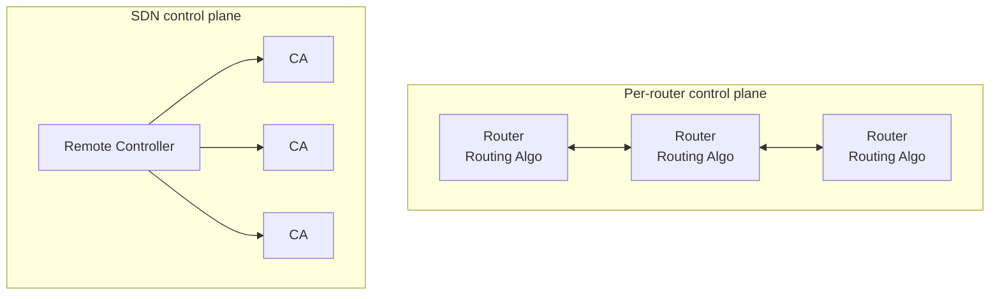
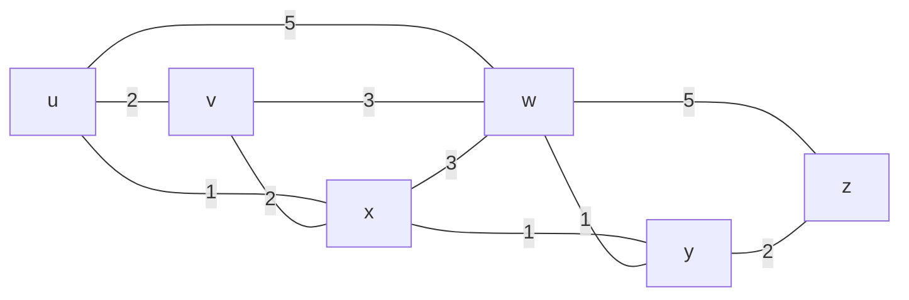
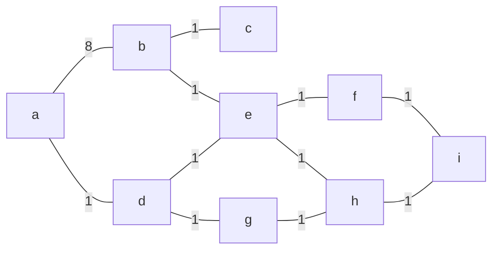

# Ch5 Network Layer: Control Plane

> [!abstract] Chapter goals
> - Understand the principles behind the network control plane:
>   - traditional routing algorithms
>   - SDN controllers
>   - network management, configuration
> - Instantiation and implementation in the Internet:
>   - **OSPF, BGP**
>   - OpenFlow, ODL and ONOS controllers
>   - Internet Control Message Protocol: ICMP
>   - SNMP, YANG/NETCONF

> [!note] Scope of these slides
> The roadmap also lists the SDN control plane, ICMP, and network management (SNMP, NETCONF/YANG), but this PDF stops after BGP (5-79) plus two extra distance-vector slides (5-81, 5-82). Those topics aren't in this note.

> [!info] How this note is marked
> - `[!bug] Erratum`: a typo or error in the original slides
> - `[!info] Supplement`: something the slides leave unclear, skip over, or that is now outdated
> - Everything is collected in [[#Errata and Supplements Summary]] at the end

## Contents
- [[#1. Introduction]]
- [[#2. Routing Protocols]]
- [[#3. Link State - Dijkstra's Algorithm]]
- [[#4. Distance Vector - Bellman-Ford]]
- [[#5. LS vs. DV]]
- [[#6. Making Routing Scalable - Autonomous Systems]]
- [[#7. Intra-AS Routing - OSPF]]
- [[#8. Inter-AS Routing - BGP]]
- [[#Review Questions]]
- [[#Errata and Supplements Summary]]

---

## 1. Introduction

### 1.1 Network-layer functions

| Function | Plane | What it does |
|---|---|---|
| **Forwarding** | data plane | move packets from a router's input to the appropriate router output |
| **Routing** | control plane | determine the route taken by packets from source to destination |

Two approaches to structuring the network control plane:
- **per-router control** (traditional)
- **logically centralized control** (software-defined networking, SDN)

### 1.2 Per-router control plane
Individual routing-algorithm components in **each and every router** interact in the control plane. Each router computes its own forwarding table.

### 1.3 SDN control plane
A **remote controller** computes and installs forwarding tables in routers. Each router only runs a control agent (CA).



See also [[CN Ch4 - Network Layer Data Plane (EN)#1.3 Data Plane vs. Control Plane]].

---

## 2. Routing Protocols

### 2.1 Goal
**Routing protocol goal**: determine "good" paths (equivalently, routes) from sending hosts to the receiving host, through a network of routers.
- **path**: sequence of routers that packets traverse from a given initial source host to a final destination host
- **"good"**: least "cost", "fastest", "least congested"
- Routing: a "top-10" networking challenge!

### 2.2 Graph abstraction: link costs



- graph $G = (N, E)$
  - $N$ = set of routers = { u, v, w, x, y, z }
  - $E$ = set of links = { (u,v), (u,x), (v,x), (v,w), (x,w), (x,y), (w,y), (w,z), (y,z) }
- $c_{a,b}$: cost of the direct link connecting a and b
  - e.g., $c_{w,z} = 5$, $c_{u,z} = \infty$ (no direct link)
- Cost is defined by the network operator: could always be 1, or inversely related to bandwidth, or inversely related to congestion

### 2.3 Routing algorithm classification

| | |
|---|---|
| **Global** | all routers have the complete topology and link-cost info → **"link state"** algorithms |
| **Decentralized** | iterative process of computation and exchange of info with neighbors; routers initially only know link costs to attached neighbors → **"distance vector"** algorithms |
| **Static** | routes change slowly over time |
| **Dynamic** | routes change more quickly: periodic updates or in response to link-cost changes |

---

## 3. Link State - Dijkstra's Algorithm

### 3.1 Properties
- **Centralized**: network topology and link costs are known to all nodes
  - accomplished via "link state broadcast"
  - all nodes have the same info
- Computes least-cost paths from one node ("source") to all other nodes
  - gives the forwarding table for that node
- **Iterative**: after k iterations, the least-cost path to k destinations is known

> [!info]- Supplement: "centralized" vs. "global"
> 5-13 calls link state "centralized", while 5-11 calls the same class "global". They mean the same thing here: every router has the **whole** map and runs the computation itself. It's not centralized in the sense of one central server computing for everyone (that's SDN).

**Notation:**
- $c_{x,y}$: direct link cost from node x to y; = ∞ if not direct neighbors
- $D(v)$: current estimate of the cost of the least-cost path from the source to destination v
- $p(v)$: predecessor node along the path from the source to v
- $N'$: set of nodes whose least-cost path is definitively known

### 3.2 The algorithm

```
1  Initialization:
2    N' = {u}                       /* compute least cost path from u to all other nodes */
3    for all nodes v
4      if v adjacent to u           /* u initially knows direct-path-cost only to direct neighbors */
5        then D(v) = c(u,v)         /* but may not be minimum cost! */
6      else D(v) = ∞
7
8  Loop
9    find w not in N' such that D(w) is a minimum
10   add w to N'
11   update D(v) for all v adjacent to w and not in N':
         D(v) = min( D(v), D(w) + c(w,v) )
12   /* new least-path-cost to v is either old least-cost-path to v
13      or known least-cost-path to w plus direct-cost from w to v */
15 until all nodes in N'
```

### 3.3 Example (5-15 to 5-27), source u

| Step | N' | D(v),p(v) | D(w),p(w) | D(x),p(x) | D(y),p(y) | D(z),p(z) |
|---|---|---|---|---|---|---|
| 0 | u | 2,u | 5,u | **1,u** | ∞ | ∞ |
| 1 | ux | 2,u | 4,x | | 2,x | ∞ |
| 2 | uxy | **2,u** | 3,y | | | 4,y |
| 3 | uxyv | | **3,y** | | | 4,y |
| 4 | uxyvw | | | | | **4,y** |
| 5 | uxyvwz | | | | | |

Key updates:
- Step 1 (add x): D(v) = min(2, 1+2) = 2; D(w) = min(5, 1+3) = 4; D(y) = min(∞, 1+1) = 2
- Step 2 (add y): D(w) = min(4, 2+1) = 3; D(z) = min(∞, 2+2) = 4
- Step 3 (add v): D(w) = min(3, 2+3) = 3
- Step 4 (add w): D(z) = min(4, 3+5) = 4

> [!note] At step 2, v and y are tied at 2. The slides pick y first; ties can be broken arbitrarily.

**Resulting least-cost-path tree from u**: u→v, u→x, x→y, y→w, y→z

**Resulting forwarding table in u:**

| Destination | Outgoing link |
|---|---|
| v | (u,v) |
| x | (u,x) |
| y | (u,x) |
| w | (u,x) |
| z | (u,x) |

Route from u to v directly; route from u to all other destinations via x.

### 3.4 Another example (5-28)

| Step | N' | D(v),p(v) | D(w),p(w) | D(x),p(x) | D(y),p(y) | D(z),p(z) |
|---|---|---|---|---|---|---|
| 0 | u | 7,u | **3,u** | 5,u | ∞ | ∞ |
| 1 | uw | 6,w | | **5,u** | 11,w | ∞ |
| 2 | uwx | **6,w** | | | 11,w | 14,x |
| 3 | uwxv | | | | **10,v** | 14,x |
| 4 | uwxvy | | | | | **12,y** |
| 5 | uwxvyz | | | | | |

Notes:
- construct the least-cost-path tree by tracing predecessor nodes
- ties can exist (can be broken arbitrarily)

### 3.5 Discussion
**Algorithm complexity** (n nodes):
- each of n iterations needs to check all nodes not in N'
- n(n+1)/2 comparisons: **O(n²)** complexity
- more efficient implementations possible: O(n log n)

**Message complexity:**
- each router must broadcast its link-state information to the other n routers
- efficient broadcast algorithms: O(n) link crossings to disseminate a broadcast message from one source
- each router's message crosses O(n) links: overall message complexity **O(n²)**

> [!bug]- Erratum (5-29)
> "need to check all nodes, w, not in **N**" → not in **N'**.

> [!info]- Supplement: the O(n log n) claim
> With a binary-heap priority queue, Dijkstra runs in **O((n + |E|) log n)**, where |E| is the number of links. It's only O(n log n) if the graph is sparse (|E| = O(n)), which router topologies usually are.

### 3.6 Oscillations possible
- When link costs depend on **traffic volume**, route oscillations are possible
- Sample scenario (5-30):
  - routing to destination a; traffic entering at d, c, e with rates 1, e (< 1), 1
  - link costs are directional and volume-dependent
- Each time routes are recomputed from the current costs, traffic moves to the cheaper path, which then becomes the expensive one. Routes flip back and forth.

> [!info]- Supplement: how to avoid oscillations
> The slides don't give a fix. Common answers: don't make link costs depend on current load, or **randomize** when each router runs its link-state computation so they don't all switch at the same moment.

---

## 4. Distance Vector - Bellman-Ford

### 4.1 Bellman-Ford equation (dynamic programming)
Let $D_x(y)$ = cost of the least-cost path from x to y. Then:

$$D_x(y) = \min_v \{ c_{x,v} + D_v(y) \}$$

- min taken over all neighbors v of x
- $c_{x,v}$: direct cost of the link from x to v
- $D_v(y)$: v's estimated least-cost-path cost to y

> [!example] Bellman-Ford example (5-33)
> u's neighbors know, for destination z: $D_v(z) = 5$, $D_x(z) = 3$, $D_w(z) = 3$.
> $$D_u(z) = \min\{c_{u,v} + D_v(z),\ c_{u,x} + D_x(z),\ c_{u,w} + D_w(z)\} = \min\{2+5,\ 1+3,\ 5+3\} = 4$$
> The node achieving the minimum (**x**) is the **next hop** on the estimated least-cost path to z.

### 4.2 Key idea
- From time to time, each node sends its own **distance vector** estimate to its neighbors
- When x receives a new DV estimate from any neighbor, it updates its own DV using the B-F equation:
  $$D_x(y) \leftarrow \min_v \{c_{x,v} + D_v(y)\} \quad \text{for each node } y \in N$$
- Under minor, natural conditions, the estimate $D_x(y)$ converges to the actual least cost $d_x(y)$

> [!bug]- Erratum (5-34)
> "the estimate Dx(y) **converge**" → **converges**.

### 4.3 The algorithm at each node

```
wait for (change in local link cost or msg from neighbor)
recompute DV estimates using DV received from neighbor
if DV to any destination has changed, notify neighbors
```

- **Iterative, asynchronous**: each local iteration is caused by
  - a local link-cost change
  - a DV update message from a neighbor
- **Distributed, self-stopping**: each node notifies neighbors only when its DV changes
  - neighbors then notify their neighbors, only if necessary
  - no notification received → no actions taken!

### 4.4 Example (5-36 to 5-49)

Topology (3×3 grid with a few asymmetries):



Asymmetries: the a–b link has a larger cost (8), and there's a **missing link** between c and f.

- **t = 0**: all nodes have distance estimates to nearest neighbors only, and send their local DV to their neighbors
- **t = 1, 2, …**: all nodes receive DVs from neighbors, compute their new local DV, and send it to their neighbors

**Initial DVs (t = 0):**

| Node | a | b | c | d | e | f | g | h | i |
|---|---|---|---|---|---|---|---|---|---|
| a | 0 | 8 | ∞ | 1 | ∞ | ∞ | ∞ | ∞ | ∞ |
| b | 8 | 0 | 1 | ∞ | 1 | ∞ | ∞ | ∞ | ∞ |
| c | ∞ | 1 | 0 | ∞ | ∞ | ∞ | ∞ | ∞ | ∞ |
| e | ∞ | 1 | ∞ | 1 | 0 | 1 | ∞ | 1 | ∞ |

**b's computation at t = 1** (b receives DVs from a, c, e; $c_{b,a}=8$, $c_{b,c}=1$, $c_{b,e}=1$):

| Dest | $c_{b,a}+D_a$ | $c_{b,c}+D_c$ | $c_{b,e}+D_e$ | $D_b$ |
|---|---|---|---|---|
| a | 8 | ∞ | ∞ | 8 |
| c | ∞ | 1 | ∞ | 1 |
| d | 9 | ∞ | 2 | **2** |
| e | ∞ | ∞ | 1 | 1 |
| f | ∞ | ∞ | 2 | **2** |
| g | ∞ | ∞ | ∞ | ∞ |
| h | ∞ | ∞ | 2 | **2** |
| i | ∞ | ∞ | ∞ | ∞ |

**c's computation at t = 1** (c receives the DV from b only, $c_{c,b}=1$):
- $D_c(a) = 1 + 8 = 9$, $D_c(b) = 1$, $D_c(d) = 1 + ∞ = ∞$, $D_c(e) = 1 + 1 = 2$, everything else ∞

> [!bug]- Errata in the DV computation slides
> - **5-45**: `Db(d) = min{9,2,∞} = 2`. The three terms are via a, c, e in that order, so it should read **min{9, ∞, 2}** (via c is ∞ because $D_c(d) = ∞$ at t = 0; via e is 1 + 1 = 2). The answer 2 is right; the order is wrong.
> - **5-47**: the computations correctly give $D_c(d) = ∞$ and $D_c(e) = 2$, but the resulting "DV in c" box shows **Dc(d) = 2, Dc(e) = ∞**. Those two values are swapped. The table above has the correct result.
> - **5-47**: `Dc(h) = min{cbc,bg+Db(h)}` is garbled; it should be $D_c(h) = c_{c,b} + D_b(h) = 1 + ∞ = ∞$.
> - **5-48**: the DV boxes for **d, h, f** are all labeled `Dc(·)` (copied from c's box). They should be $D_d(\cdot)$, $D_h(\cdot)$, $D_f(\cdot)$.

> [!example]- Q (5-48): what is the new DV computed in e at t = 1? (expand for answer)
> e's neighbors are b, d, f, h, all with link cost 1. Their t = 0 DVs:
> - $D_b$: a 8, b 0, c 1, e 1
> - $D_d$: a 1, d 0, e 1, g 1
> - $D_f$: e 1, f 0, i 1
> - $D_h$: e 1, g 1, h 0, i 1
>
> | Dest | via b | via d | via f | via h | $D_e$ |
> |---|---|---|---|---|---|
> | a | 9 | 2 | ∞ | ∞ | **2** (via d) |
> | b | 1 | ∞ | ∞ | ∞ | 1 |
> | c | 2 | ∞ | ∞ | ∞ | **2** (via b) |
> | d | ∞ | 1 | ∞ | ∞ | 1 |
> | e | — | — | — | — | 0 |
> | f | ∞ | ∞ | 1 | ∞ | 1 |
> | g | ∞ | 2 | ∞ | 2 | **2** (via d or h) |
> | h | ∞ | ∞ | ∞ | 1 | 1 |
> | i | ∞ | ∞ | 2 | 2 | **2** (via f or h) |

### 4.5 State information diffusion
Iterative communication and computation diffuses information through the network. Following c's state at t = 0:

| Time | c's t=0 state may influence DV computations at… |
|---|---|
| t = 0 | c only |
| t = 1 | b (1 hop away) |
| t = 2 | b, and now a, e (2 hops) |
| t = 3 | d, f, h (3 hops) |
| t = 4 | g, i (4 hops) |

### 4.6 Link-cost changes
When a node detects a local link-cost change, it updates routing info, recalculates its local DV, and notifies neighbors if its DV changed.

**"Good news travels fast"** (x–y cost drops from 4 to 1; x–z = 50, y–z = 1):
- $t_0$: y detects the change, updates its DV ($D_y(x) = 1$), informs its neighbors
- $t_1$: z receives the update from y, updates its DV ($D_z(x) = 2$), sends its DV to its neighbors
- $t_2$: y receives z's update; y's least costs don't change, so y does **not** send a message to z

**"Bad news travels slow": count-to-infinity** (x–y cost rises from 4 to 60):
- Before the change: $D_y(x) = 4$, $D_z(x) = 5$ (via y)
- y sees its direct link to x now costs 60, but z has said it has a path at cost 5. So y computes "my new cost to x is 6, via z" and tells z.
- z learns the path to x via y now costs 6, so z computes "my new cost to x is 7, via y" and tells y.
- y learns the path via z costs 7, so y computes 8 (via z) and tells z.
- z computes 9 (via y), and so on…
- See the text for solutions. Distributed algorithms are tricky!

> [!bug]- Erratum (5-51)
> The third bullet says y's new cost is "8 **via y**". y can't route via itself; it should be "8 **via z**". The bullets also have mismatched parentheses: `"my new cost to x will be 6, via z);`.

> [!info]- Supplement: how long it takes, and the textbook's fix (poisoned reverse)
> - The values climb by 2 per round (y: 6, 8, 10, …; z: 7, 9, 11, …). This continues until z's cost via y exceeds its direct link cost of 50, so z switches to the direct link. That takes **44 iterations** in this example. Meanwhile y and z bounce packets for x back and forth (a routing loop).
> - **Poisoned reverse**: if z routes through y to get to x, z tells y its distance to x is **∞**. Then y won't try to route to x through z, which breaks this particular loop.
> - Limitation: poisoned reverse only fixes loops between **two** neighbors. Loops of three or more nodes can still count to infinity. (RIP caps "infinity" at 16 hops for this reason.)

### 4.7 Another example (5-81, 5-82)
Three nodes: x–y = 2, y–z = 1, x–z = 7.

| Table at x | x | y | z |
|---|---|---|---|
| initially | 0 | 2 | 7 |
| after 1st exchange | 0 | 2 | **3** |

- $D_x(y) = \min\{c_{x,y} + D_y(y),\ c_{x,z} + D_z(y)\} = \min\{2+0,\ 7+1\} = 2$
- $D_x(z) = \min\{c_{x,y} + D_y(z),\ c_{x,z} + D_z(z)\} = \min\{2+1,\ 7+0\} = 3$

After one more exchange, z also learns $D_z(x) = 3$ (via y), and all three tables converge to:

| from \ to | x | y | z |
|---|---|---|---|
| x | 0 | 2 | 3 |
| y | 2 | 0 | 1 |
| z | 3 | 1 | 0 |

---

## 5. LS vs. DV

| | Link State (LS) | Distance Vector (DV) |
|---|---|---|
| **Message complexity** | n routers, O(n²) messages sent | exchange between neighbors; convergence time varies |
| **Speed of convergence** | O(n²) algorithm, O(n²) messages; **may have oscillations** | convergence time varies; **may have routing loops**; **count-to-infinity** problem |
| **Robustness** (router malfunctions or is compromised) | router can advertise an incorrect **link** cost; each router computes only its **own** table | router can advertise an incorrect **path** cost ("I have a really low-cost path to everywhere"): **black-holing**; each router's DV is used by others, so **errors propagate** through the network |

> [!bug]- Erratum (5-52)
> "error **propagate** thru network" → errors **propagate** (or error **propagates**).

---

## 6. Making Routing Scalable - Autonomous Systems

### 6.1 Why the flat model breaks
Our routing study so far is idealized: all routers identical, network "flat". Not true in practice:

| Scale: billions of destinations | Administrative autonomy |
|---|---|
| can't store all destinations in routing tables! | Internet: a network of networks |
| routing-table exchange would swamp links! | each network admin may want to control routing in its own network |

### 6.2 Internet approach: autonomous systems (AS)
Aggregate routers into regions known as **autonomous systems (AS)**, a.k.a. "domains".

| Intra-AS (intra-domain) | Inter-AS (inter-domain) |
|---|---|
| routing among routers within the same AS ("network") | routing among ASes |
| all routers in an AS must run the **same** intra-domain protocol | gateways perform inter-domain routing (as well as intra-domain routing) |
| routers in different ASes can run different intra-domain protocols | |
| **gateway router**: at the "edge" of its own AS, has link(s) to router(s) in other ASes | |

### 6.3 Interconnected ASes
The forwarding table is configured by **both** intra- and inter-AS routing algorithms:
- intra-AS routing determines entries for destinations **within** the AS
- inter-AS & intra-AS together determine entries for **external** destinations

### 6.4 Inter-AS routing's role in intra-domain forwarding
Suppose a router in AS1 receives a datagram destined outside AS1. It should forward the packet to a gateway router in AS1, **but which one?**

AS1's inter-domain routing must:
1. learn which destinations are reachable through AS2, and which through AS3
2. propagate this reachability info to all routers in AS1

---

## 7. Intra-AS Routing - OSPF

### 7.1 Common intra-AS routing protocols

| Protocol | Type | Notes |
|---|---|---|
| **RIP**: Routing Information Protocol | classic DV | DVs exchanged every 30 s; no longer widely used |
| **EIGRP**: Enhanced Interior Gateway Routing Protocol | DV based | Cisco-proprietary for decades; became open in 2013 [RFC 7868] |
| **OSPF**: Open Shortest Path First [RFC 2328] | link state | **IS-IS** (ISO standard, not an RFC standard) is essentially the same as OSPF |

> [!bug]- Erratum (5-59)
> RIP is cited as **[RFC 1723]**, which was obsoleted long ago. The current RIP version 2 spec is **RFC 2453** (and RIPng for IPv6 is RFC 2080).

### 7.2 OSPF (Open Shortest Path First)
- **"Open"**: publicly available
- **Classic link state**:
  - each router **floods** OSPF link-state advertisements (**directly over IP** rather than using TCP/UDP) to all other routers in the entire AS
  - multiple link-cost metrics possible: bandwidth, delay
  - each router has the full topology and uses **Dijkstra's algorithm** to compute its forwarding table
- **Security**: all OSPF messages are authenticated (to prevent malicious intrusion)

> [!info]- Supplement
> - "Directly over IP" means OSPF has its own IP protocol number (**89**) in the IP header's upper-layer field, instead of using a TCP or UDP port.
> - RFC 2328 is OSPFv2 (IPv4). OSPF for IPv6 is **OSPFv3** (RFC 5340).

### 7.3 Hierarchical OSPF
- **Two-level hierarchy**: local area, backbone
  - link-state advertisements are flooded only within an area, or within the backbone
  - each node has the detailed topology of its own area; it only knows the **direction** to reach other destinations

| Router role | What it does |
|---|---|
| **Internal (local) routers** | flood LS in their area only; compute routing within the area; forward packets to outside via the area border router |
| **Area border routers** | "summarize" distances to destinations in their own area, advertise them in the backbone |
| **Backbone routers** | run OSPF limited to the backbone |
| **Boundary router** | connects to other ASes |

---

## 8. Inter-AS Routing - BGP

### 8.1 BGP (Border Gateway Protocol)
- The **de facto** inter-domain routing protocol: "glue that holds the Internet together"
- Allows a subnet to advertise its existence, and the destinations it can reach, to the rest of the Internet: *"I am here, here is who I can reach, and how"*
- BGP gives each AS a way to:
  - obtain destination-network reachability info from neighboring ASes (**eBGP**)
  - determine routes to other networks based on reachability information **and policy**
  - propagate reachability information to all AS-internal routers (**iBGP**)
  - advertise (to neighboring networks) destination reachability info

### 8.2 eBGP and iBGP connections
- **eBGP**: between gateway routers in **different** ASes
- **iBGP**: logical connectivity between routers **within** the same AS
- **Gateway routers run both** eBGP and iBGP

### 8.3 BGP basics
- **BGP session**: two BGP routers ("peers") exchange BGP messages over a **semi-permanent TCP connection**
  - advertising paths to different destination network prefixes (BGP is a **"path vector"** protocol)
- When AS3 gateway 3a advertises the path **AS3, X** to AS2 gateway 2c:
  - AS3 **promises** AS2 it will forward datagrams toward X

### 8.4 BGP protocol messages
Exchanged between peers over a TCP connection:

| Message | Purpose |
|---|---|
| **OPEN** | opens the TCP connection to a remote BGP peer and authenticates the sending BGP peer |
| **UPDATE** | advertises a new path (or withdraws an old one) |
| **KEEPALIVE** | keeps the connection alive in the absence of UPDATEs; also ACKs an OPEN request |
| **NOTIFICATION** | reports errors in the previous message; also used to close the connection |

> [!bug]- Erratum (5-69)
> The slide cites BGP messages as **[RFC 4371]**. The BGP-4 specification is **RFC 4271**. (RFC 4371 is an unrelated document.)

> [!info]- Supplement
> BGP runs over **TCP port 179**. Using TCP means BGP doesn't need its own reliability mechanism, and peers only send incremental UPDATEs instead of periodically resending whole tables.

### 8.5 Path attributes and BGP routes
- BGP advertised route = **prefix + attributes**
  - prefix: the destination being advertised
  - two important attributes:
    - **AS-PATH**: list of ASes through which the prefix advertisement has passed
    - **NEXT-HOP**: indicates the specific internal-AS router to the next-hop AS
- **Policy-based routing**:
  - a gateway receiving a route advertisement uses an **import policy** to accept/decline the path (e.g., never route through AS Y)
  - AS policy also determines whether to advertise a path to other neighboring ASes

> [!bug]- Erratum (5-70)
> "advertise path to **other other** neighboring ASes" → duplicated word; "to **other** neighboring ASes".

> [!info]- Supplement: AS-PATH also prevents loops
> If a router sees its **own** AS number already in a route's AS-PATH, it rejects the route. That's how BGP avoids the routing loops that plain distance vector suffers from.

### 8.6 BGP path advertisement
1. AS2 router 2c receives the path advertisement **AS3, X** (via eBGP) from AS3 router 3a
2. Based on AS2 policy, 2c accepts AS3, X and propagates it (via iBGP) to all AS2 routers
3. Based on AS2 policy, AS2 router 2a advertises (via eBGP) the path **AS2, AS3, X** to AS1 router 1c

**Multiple paths**: a gateway router may learn about multiple paths to a destination:
- AS1 gateway 1c learns path AS2, AS3, X from 2a
- AS1 gateway 1c learns path AS3, X from 3a
- based on policy, 1c chooses **AS3, X** and advertises it within AS1 via iBGP

### 8.7 BGP: populating forwarding tables
- 1a, 1b, 1d learn via iBGP from 1c: "path to X goes through 1c"
- at 1d: OSPF intra-domain routing says "to get to 1c, use interface 1" → so at 1d, to get to X, **use interface 1**
- at 1a: OSPF says "to get to 1c, use interface 2" → so at 1a, to get to X, **use interface 2**

| Router | dest | interface |
|---|---|---|
| 1d | 1c | 1 |
| 1d | X | 1 |
| 1a | 1c | 2 |
| 1a | X | 2 |

> [!important] This is how BGP and OSPF combine
> BGP says **which gateway** (1c) to use for X; OSPF says **which interface** reaches that gateway. The forwarding-table entry for X copies the interface of the entry for 1c.

### 8.8 Hot potato routing
- 2d learns (via iBGP) it can route to X via **2a** or **2c**
- **Hot potato routing**: choose the local gateway with the **least intra-domain cost** (e.g., 2d chooses 2a, even though there are more AS hops to X). Don't worry about inter-domain cost!
- In the figure, the OSPF link weights are 2d–2a = **201** and 2d–2c = **263** (2b–2c = 112). Via 2a the BGP path is AS1, AS3, X (2 AS hops); via 2c it's AS3, X (1 AS hop). 2d still picks **2a**, because 201 < 263 inside AS2.

> [!info]- Supplement: why "hot potato"?
> The AS wants to get the packet **out of its own network** as quickly (cheaply) as possible, like passing a hot potato, even if the total end-to-end path ends up longer.

### 8.9 BGP: achieving policy via advertisements
Legend: A, B, C are **provider networks**; w, x, y are **customer networks**.

A typical "real world" policy: an ISP only wants to route traffic to/from **its own customer networks** (it doesn't want to carry **transit traffic** between other ISPs).

**Example 1 (5-76):**
- A advertises path **Aw** to B and to C
- B chooses **not** to advertise **BAw** to C!
  - B gets no "revenue" for routing CBAw, since none of C, A, w are B's customers
- C doesn't learn about the CBAw path
- C routes **CAw** (not using B) to get to w

**Example 2 (5-77):**
- x is **dual-homed**: attached to two networks (B and C)
- Policy to enforce: x doesn't want to route traffic from B to C via x
- … so x will **not advertise to B a route to C**

### 8.10 BGP route selection
A router may learn about more than one route to a destination AS. It selects a route based on:
1. **local preference** value attribute: policy decision
2. **shortest AS-PATH**
3. **closest NEXT-HOP router**: hot potato routing
4. additional criteria

### 8.11 Why different intra- and inter-AS routing?

| | Inter-AS | Intra-AS |
|---|---|---|
| **Policy** | admin wants control over how its traffic is routed and who routes through its network | single admin, so policy is less of an issue |
| **Scale** | hierarchical routing saves table size and reduces update traffic | |
| **Performance** | **policy dominates** over performance | can focus on performance |

---

## Review Questions

> [!question]- What's the difference between global (link-state) and decentralized (distance-vector) routing algorithms?
> LS: every router has the complete topology and link costs, then runs Dijkstra locally. DV: each router only knows its neighbors' link costs and iteratively exchanges distance vectors with neighbors (Bellman-Ford).

> [!question]- Run Dijkstra from u on the 6-node example. What's the forwarding table?
> v via (u,v); x, y, w, z via (u,x). Costs: v 2, x 1, y 2, w 3, z 4.

> [!question]- What is the time complexity of Dijkstra's algorithm and the message complexity of LS?
> O(n²) naive (O((n+|E|) log n) with a heap); O(n²) messages.

> [!question]- Write the Bellman-Ford equation and say how the next hop is chosen.
> $D_x(y) = \min_v\{c_{x,v} + D_v(y)\}$. The neighbor v achieving the minimum is the next hop.

> [!question]- Why does "good news travel fast" but "bad news travel slow" in DV?
> A decreased cost immediately gives a better route that propagates outward. An increased cost can be masked by neighbors' stale estimates that actually route back through the node itself, so the two nodes keep incrementing each other's cost (count-to-infinity).

> [!question]- What does poisoned reverse do, and does it always work?
> If z routes to x via y, z advertises ∞ to y for x. It fixes 2-node loops but not loops involving 3 or more nodes.

> [!question]- Compare LS and DV robustness.
> LS: a bad router can only advertise wrong link costs, and each router computes its own table. DV: a bad router can advertise wrong path costs (black-holing), and errors propagate through everyone's DVs.

> [!question]- Why does the Internet use separate intra-AS and inter-AS routing?
> Policy (inter-AS admins control transit; intra-AS has a single admin), scale (hierarchy shrinks tables and update traffic), and performance (intra-AS can optimize performance; inter-AS is policy-driven).

> [!question]- What is OSPF's hierarchy?
> Two levels: local areas and a backbone. LSAs are flooded only within an area; area border routers summarize their area's destinations into the backbone.

> [!question]- What's the difference between eBGP and iBGP?
> eBGP: between gateway routers of different ASes, to learn reachability from neighbors. iBGP: within an AS, to propagate that reachability to all internal routers.

> [!question]- What are AS-PATH and NEXT-HOP?
> AS-PATH: the list of ASes a prefix advertisement has passed through. NEXT-HOP: the specific internal-AS router interface that begins the path to the next-hop AS.

> [!question]- What is hot potato routing?
> Choosing the gateway with the least intra-domain cost, ignoring the inter-domain path length.

> [!question]- In BGP route selection, what's the order of criteria?
> Local preference → shortest AS-PATH → closest NEXT-HOP (hot potato) → additional criteria.

> [!question]- Why wouldn't provider B advertise the path BAw to C?
> None of C, A, or w are B's customers, so B would carry transit traffic without getting paid for it.

---

## Errata and Supplements Summary

### Errata (typos / errors)

| Slide | Original text | Correction |
|---|---|---|
| 5-29 | check all nodes, w, not in N | not in **N'** |
| 5-34 | the estimate Dx(y) converge | **converges** |
| 5-45 | Db(d) = min{9,2,∞} = 2 | **min{9, ∞, 2}** (terms are via a, c, e) |
| 5-47 | "DV in c" box: Dc(d) = 2, Dc(e) = ∞ | swapped: **Dc(d) = ∞, Dc(e) = 2** |
| 5-47 | Dc(h) = min{cbc,bg+Db(h)} | $D_c(h) = c_{c,b} + D_b(h) = ∞$ |
| 5-48 | DV boxes of d, h, f labeled `Dc(·)` | **Dd(·), Dh(·), Df(·)** |
| 5-51 | y's new cost "8 via y" | **8 via z**; parentheses mismatched |
| 5-52 | error propagate thru network | errors **propagate** |
| 5-59 | RIP [RFC 1723] | current RIPv2 is **RFC 2453** |
| 5-69 | BGP messages [RFC 4371] | **RFC 4271** |
| 5-70 | to other other neighboring ASes | to **other** neighboring ASes |

### Supplements (unclear / omitted / outdated)

| Slide | Topic | Key point |
|---|---|---|
| (roadmap) | missing topics | SDN control plane, ICMP, SNMP/NETCONF not in this PDF |
| 5-13 | "centralized" vs. "global" | same meaning: each router has the full map |
| 5-29 | Dijkstra complexity | O((n+\|E\|) log n) with a heap |
| 5-30 | oscillations | avoid load-dependent costs, or randomize timing |
| 5-48 | e's DV at t = 1 | a 2, b 1, c 2, d 1, e 0, f 1, g 2, h 1, i 2 |
| 5-51 | count-to-infinity | 44 iterations; poisoned reverse and its limits |
| 5-60 | OSPF over IP | IP protocol number 89; OSPFv3 for IPv6 |
| 5-69 | BGP transport | TCP port 179 |
| 5-70 | AS-PATH | also used for loop detection |
| 5-75 | hot potato | get the packet out of your own AS cheapest |

---

## Related Notes
- [[CN Ch3 - Transport Layer]]
- [[CN Ch4 - Network Layer Data Plane (EN)]]
- [[CN Ch6 - Link Layer]]
