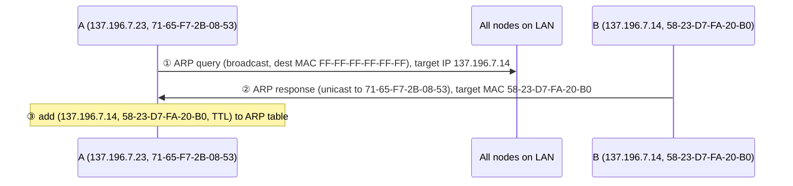
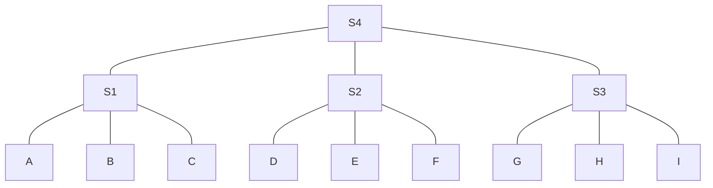

# Ch6 The Link Layer and LANs

> [!abstract] Roadmap covered in these slides
> - Introduction
> - LANs
>   - addressing, ARP
>   - Ethernet
>   - switches

> [!note] Scope of these slides
> The full roadmap on 6-24 also lists error detection/correction, multiple access protocols, VLANs, MPLS, data center networking, and "a day in the life of a web request". This 42-slide PDF only covers the four topics above, so this note does too.

> [!info] How this note is marked
> - `[!bug] Erratum`: a typo or error in the original slides
> - `[!info] Supplement`: something the slides leave unclear, skip over, or that is now outdated
> - Everything is collected in [[#Errata and Supplements Summary]] at the end

## Contents
- [[#1. Link Layer Introduction]]
- [[#2. MAC Addresses]]
- [[#3. ARP - Address Resolution Protocol]]
- [[#4. Routing to Another Subnet - Addressing Walkthrough]]
- [[#5. Ethernet]]
- [[#6. Ethernet Switches]]
- [[#7. Switches vs. Routers]]
- [[#Review Questions]]
- [[#Errata and Supplements Summary]]

---

## 1. Link Layer Introduction

### 1.1 Terminology
- hosts and routers: **nodes**
- communication channels that connect adjacent nodes along the communication path: **links**
  - wired, wireless
  - LANs
- layer-2 packet: **frame**, which encapsulates a datagram

> [!important] The link layer's job
> Transfer a datagram from one node to a **physically adjacent** node over a link.

### 1.2 Context
- A datagram is transferred by **different link protocols over different links**
  - e.g., WiFi on the first link, Ethernet on the next link
- Each link protocol provides **different services**
  - e.g., may or may not provide reliable data transfer over the link

> [!example] Transportation analogy: a trip from Princeton to Lausanne
> - limo: Princeton → JFK
> - plane: JFK → Geneva
> - train: Geneva → Lausanne
>
> | Trip | Network |
> |---|---|
> | tourist | datagram |
> | transport segment | communication link |
> | transportation mode | link-layer protocol |
> | travel agent | routing algorithm |

### 1.3 Link-layer services

| Service | Details |
|---|---|
| **Framing, link access** | encapsulate datagram into a frame, adding a header and trailer; channel access if the medium is shared; **"MAC" addresses** in frame headers identify source and destination (different from IP addresses!) |
| **Reliable delivery between adjacent nodes** | we already know how to do this (Ch3 rdt)! seldom used on low bit-error links; used on wireless links (high error rates) |
| **Flow control** | pacing between adjacent sending and receiving nodes |
| **Error detection** | errors caused by signal attenuation, noise; receiver detects errors and signals retransmission, or drops the frame |
| **Error correction** | receiver identifies and corrects bit error(s) without retransmission |
| **Half-duplex and full-duplex** | with half duplex, nodes at both ends of a link can transmit, but not at the same time |

> [!info]- Supplement: "Q: why both link-level and end-end reliability?" (6-6 asks but doesn't answer)
> - **Link-level** reliability fixes errors **locally and quickly** on links that need it (e.g., wireless). Recovering at the end hosts would mean a full end-to-end retransmission after a long timeout.
> - **End-to-end** reliability (TCP) is still needed, because errors can happen in places the link layer doesn't cover: inside a router's memory, from buffer overflow drops, or on a link that doesn't provide reliability at all. Only the endpoints can confirm the data actually arrived. This is the **end-to-end argument**.

### 1.4 Host link-layer implementation
- In **each and every** host
- Link layer implemented on-chip or in a **network interface card (NIC)**
  - implements the link **and** physical layers
- Attaches into the host's system buses (e.g., PCI)
- A combination of hardware, software, and firmware

### 1.5 Interfaces communicating

| Sending side | Receiving side |
|---|---|
| encapsulates datagram in a frame | looks for errors, reliable data transfer, flow control, etc. |
| adds error-checking bits, reliable data transfer, flow control, etc. | extracts datagram, passes it to the upper layer |

---

## 2. MAC Addresses

### 2.1 IP address vs. MAC address

| | IP address | MAC address |
|---|---|---|
| Size | **32 bits** (IPv4) | **48 bits** (for most LANs) |
| Layer | network-layer address for an interface | also called LAN, physical, or Ethernet address |
| Used for | layer-3 (network-layer) forwarding | used "locally" to get a frame from one interface to another **physically connected** interface (same subnet, in the IP-addressing sense) |
| Where it comes from | depends on the subnet the node is attached to | **burned in NIC ROM**, sometimes also software-settable |
| Example | `128.119.40.136` | `1A-2F-BB-76-09-AD` (hexadecimal, each numeral = 4 bits) |

Each interface on a LAN:
- has a **unique** 48-bit MAC address
- has a **locally unique** 32-bit IP address

> [!example] LAN from 6-12 (subnet `137.196.7/24`)
> | IP | MAC |
> |---|---|
> | 137.196.7.78 | 1A-2F-BB-76-09-AD |
> | 137.196.7.23 | 71-65-F7-2B-08-53 |
> | 137.196.7.14 | 58-23-D7-FA-20-B0 |
> | 137.196.7.88 | 0C-C4-11-6F-E3-98 |

### 2.2 MAC address allocation
- MAC address allocation is administered by **IEEE**
- A manufacturer buys a portion of the MAC address space (to assure uniqueness)
- Analogy:
  - MAC address: like a **Social Security Number**
  - IP address: like a **postal address**
- **MAC flat address → portability**
  - you can move an interface from one LAN to another
  - recall the IP address is **not** portable: it depends on the IP subnet the node is attached to

> [!info]- Supplement: the structure of a MAC address, and random MACs
> - The first 3 bytes are the **OUI** (Organizationally Unique Identifier), the block IEEE sells to a manufacturer; the last 3 bytes are assigned by the manufacturer.
> - Modern phones and laptops often use **randomized MAC addresses** on WiFi for privacy, so "burned in and unique" isn't always the address you see on the network.
> - The broadcast MAC address is `FF-FF-FF-FF-FF-FF` (all 1s).

---

## 3. ARP - Address Resolution Protocol

**Question**: how do you determine an interface's MAC address, knowing its IP address?

### 3.1 ARP table
Each IP node (host, router) on a LAN has an **ARP table**:
- IP/MAC address mappings for some LAN nodes: `< IP address; MAC address; TTL >`
- **TTL** (Time To Live): time after which the address mapping will be forgotten (typically 20 min)

### 3.2 ARP protocol in action
Example: A wants to send a datagram to B, but B's MAC address isn't in A's ARP table, so A uses ARP to find it.



1. **A broadcasts an ARP query** containing B's IP address
   - destination MAC address = `FF-FF-FF-FF-FF-FF`
   - all nodes on the LAN receive the ARP query
   - query fields: source MAC 71-65-F7-2B-08-53, source IP 137.196.7.23, target IP 137.196.7.14
2. **B replies to A with an ARP response**, giving its MAC address
   - sent in an Ethernet frame addressed to A's MAC (`71-65-F7-2B-08-53`)
3. **A receives B's reply** and adds B's entry to its local ARP table

> [!info]- Supplement: ARP details the slides don't mention
> - ARP is **plug-and-play**: nodes build their ARP tables without any administrator.
> - The query is **broadcast**, but the response is **unicast** (straight back to A).
> - B also learns A's IP/MAC from the query and can cache it, since B will probably reply to A soon.
> - ARP only works **within one subnet**. To reach a host on another subnet, a host ARPs for the **router's** MAC instead (see the next section).
> - ARP's EtherType in the Ethernet frame is `0x0806`. IPv6 doesn't use ARP; it uses **Neighbor Discovery** (ICMPv6).

---

## 4. Routing to Another Subnet - Addressing Walkthrough

Sending a datagram from A to B via router R, focusing on addressing at the IP (datagram) and MAC (frame) levels.

| Node | IP | MAC |
|---|---|---|
| A | 111.111.111.111 | 74-29-9C-E8-FF-55 |
| R (left interface, A's subnet) | 111.111.111.110 | E6-E9-00-17-BB-4B |
| R (right interface, B's subnet) | 222.222.222.220 | 1A-23-F9-CD-06-9B |
| B | 222.222.222.222 | 49-BD-D2-C7-56-2A |

(Other hosts in the figure: 111.111.111.112 / CC-49-DE-D0-AB-7D and 222.222.222.221 / 88-B2-2F-54-1A-0F.)

Assume:
- A knows B's IP address
- A knows the IP address of the first-hop router R (**how?**)
- A knows R's MAC address (**how?**)

> [!info]- Supplement: answers to the two "(how?)" questions on 6-18
> - A learns the first-hop router's IP address from **DHCP** (the "default gateway" in the DHCP ACK; see [[CN Ch4 - Network Layer Data Plane (EN)#3.8 DHCP Dynamic Host Configuration Protocol]]).
> - A learns R's MAC address with **ARP**, by ARPing for R's IP address 111.111.111.110.

**Step by step:**

| Step | What happens | MAC src | MAC dest | IP src | IP dest |
|---|---|---|---|---|---|
| 1 | A creates IP datagram (src A, dst B), then a link-layer frame with **R's MAC as frame destination** | 74-29-9C-E8-FF-55 (A) | E6-E9-00-17-BB-4B (R left) | 111.111.111.111 | 222.222.222.222 |
| 2 | frame sent A → R; R receives it, removes the datagram, passes it up to IP | | | 111.111.111.111 | 222.222.222.222 |
| 3 | R determines the outgoing interface, passes the datagram (still src A, dst B) to the link layer; creates a new frame with **B's MAC as destination** and transmits it | 1A-23-F9-CD-06-9B (R right) | 49-BD-D2-C7-56-2A (B) | 111.111.111.111 | 222.222.222.222 |
| 4 | B receives the frame, extracts the IP datagram (destination B), passes it up the protocol stack to IP | | | 111.111.111.111 | 222.222.222.222 |

> [!important] Key takeaway
> The **IP** source and destination stay the same end to end (A → B). The **MAC** addresses change on **every hop**: each frame only goes between two physically adjacent interfaces.

---

## 5. Ethernet

### 5.1 The "dominant" wired LAN technology
- first widely used LAN technology
- simpler, cheap
- kept up with the speed race: **10 Mbps – 400 Gbps**
- single chip, multiple speeds (e.g., Broadcom BCM5761)
- **Bob Metcalfe**: Ethernet co-inventor, 2022 ACM Turing Award recipient

### 5.2 Physical topology

| Topology | Description |
|---|---|
| **Bus** (coaxial cable) | popular through the mid-90s; all nodes in the **same collision domain** (can collide with each other) |
| **Switched** | prevails today; an active link-layer (layer-2) switch in the center; each "spoke" runs a separate Ethernet protocol (nodes **don't collide** with each other) |

### 5.3 Ethernet frame structure
The sending interface encapsulates the IP datagram (or another network-layer packet) in an Ethernet frame:

```
| preamble | dest. address | source address | type | data (payload) | CRC |
```

| Field | Size | Purpose |
|---|---|---|
| **preamble** | 8 bytes | synchronize receiver and sender clock rates: 7 bytes of `10101010` followed by one byte of `10101011` |
| **dest. address** | 6 bytes | destination MAC address |
| **source address** | 6 bytes | source MAC address |
| **type** | 2 bytes | indicates the higher-layer protocol; used to demultiplex up at the receiver |
| **data (payload)** | 46–1500 bytes | the IP datagram |
| **CRC** | 4 bytes | cyclic redundancy check at the receiver; error detected → frame is dropped |

- **Addresses**: if an adapter receives a frame with a **matching destination address**, or with the **broadcast address** (e.g., an ARP packet), it passes the data in the frame to the network-layer protocol. Otherwise, the adapter **discards** the frame.
- **Type**: mostly IP, but others are possible

> [!info]- Supplement: field sizes and type values the slides leave out
> - The slides give the 6-byte address size but not the others; the table above fills them in. The 1500-byte maximum payload is where Ethernet's familiar **MTU of 1500** comes from. If the datagram is shorter than 46 bytes, it's padded.
> - The slide's examples of other type values, **Novell IPX** and **AppleTalk**, are long obsolete. Common type values today: `0x0800` IPv4, `0x86DD` IPv6, `0x0806` ARP, `0x8100` VLAN tag.
> - The last byte of the preamble (`10101011`) is called the **start frame delimiter (SFD)**: the two 1s at the end tell the receiver "the real frame starts now".

### 5.4 Ethernet: unreliable, connectionless
- **Connectionless**: no handshaking between sending and receiving NICs
- **Unreliable**: the receiving NIC doesn't send ACKs or NAKs to the sending NIC
  - data in dropped frames is recovered only if the initial sender uses higher-layer rdt (e.g., TCP); otherwise the dropped data is lost

### 5.5 802.3 Ethernet standards
- **Many** different Ethernet standards
  - common MAC protocol and frame format
  - different speeds: 2 Mbps, …, 100 Mbps, 1 Gbps, 10 Gbps, 40 Gbps, 80 Gbps
  - different physical-layer media: fiber, cable
- Examples at 100 Mbps:
  - copper (twisted pair) physical layer: 100BASE-TX, 100BASE-T2, 100BASE-T4
  - fiber physical layer: 100BASE-FX, 100BASE-SX, 100BASE-BX

> [!bug]- Errata (6-30)
> - "copper (**twister** pair)" → **twisted** pair.
> - The speed list ends with "**80 Gbps**", which isn't an IEEE 802.3 Ethernet speed. Standard speeds include 10 M, 100 M, 1 G, 2.5 G, 5 G, 10 G, 25 G, 40 G, 50 G, 100 G, 200 G, 400 G, and 800 G. (The list also contradicts 6-25, which says Ethernet reaches 400 Gbps.)
> - In the figure, the colored boxes overlap so that 100BASE-T2 looks like it might be grouped with the fiber standards. 100BASE-**T**2 is copper (the "T" means twisted pair); the fiber ones are FX, SX, BX.

---

## 6. Ethernet Switches

### 6.1 What a switch is
- A **link-layer device**: takes an active role
  - stores and forwards Ethernet (or other) frames
  - examines the incoming frame's MAC address and **selectively** forwards the frame to one or more outgoing links
- **Transparent**: hosts are unaware of the presence of switches
- **Plug-and-play, self-learning**: switches don't need to be configured

### 6.2 Multiple simultaneous transmissions
Example: a switch with six interfaces (1–6), hosts A, B, C, A', B', C'.
- hosts have a dedicated, direct connection to the switch
- switches **buffer** packets
- the Ethernet protocol is used on each incoming link, so:
  - **no collisions; full duplex**
  - each link is its own collision domain
- **Switching**: A-to-A' and B-to-B' can transmit **simultaneously**, without collisions
  - but A-to-A' and C-to-A' can't happen simultaneously

> [!info]- Supplement: what "can't happen simultaneously" means
> A and C can both **send** to the switch at the same time; their links are separate, so there's no collision. What can't happen at the same time is both frames going **out** on A''s single link. The switch buffers one frame while the other is transmitted, then sends the second. (If the buffer fills, frames get dropped; this is the output-port queuing from Ch4.)

### 6.3 Switch forwarding table
- Q: how does the switch know A' is reachable via interface 4 and B' via interface 5?
- A: each switch has a **switch table**; each entry is **(MAC address of host, interface to reach host, time stamp)**
  - looks like a routing table!
- Q: how are entries created and maintained? Something like a routing protocol? → **self-learning**

### 6.4 Self-learning
The switch learns which hosts can be reached through which interfaces:
- when a frame is received, the switch "learns" the location of the **sender**: the incoming LAN segment
- it records the sender/location pair in the switch table

> [!example] From 6-36
> A frame from A (dest A') arrives on interface 1. The initially empty switch table gets the entry **(A, 1, TTL 60)**.

### 6.5 Frame filtering/forwarding
When a frame is received at the switch:

```
1. record incoming link, MAC address of sending host
2. index switch table using MAC destination address
3. if entry found for destination
     then {
       if destination on segment from which frame arrived
         then drop frame                       /* filtering */
         else forward frame on interface indicated by entry
     }
   else flood   /* forward on all interfaces except arriving interface */
```

> [!example] Self-learning, forwarding example (6-38)
> 1. A sends a frame to A'. Switch records (A, 1). A''s location is **unknown** → **flood** to all interfaces except 1.
> 2. A' replies to A. Switch records (A', 4). A's location is **known** → send selectively on just interface 1.
>
> | MAC addr | interface | TTL |
> |---|---|---|
> | A | 1 | 60 |
> | A' | 4 | 60 |

### 6.6 Interconnecting switches
Self-learning switches can be connected together:



- Q: sending from A to G, how does S1 know to forward a frame destined to G via S4 and S3?
- A: **self-learning!** It works exactly the same as in the single-switch case.

> [!example]- Q (6-40): C sends a frame to I, I responds to C. Show switch tables and forwarding. (expand for answer)
> **C → I** (no switch knows I yet):
> - S1: learns **C on C's port**; I unknown → floods (to A, B, and the link to S4)
> - S4: learns **C via S1's port**; I unknown → floods (to S2 and S3)
> - S2: learns **C via S4's port**; floods to D, E, F
> - S3: learns **C via S4's port**; floods to G, H, I → I receives it
>
> **I → C** (everyone on the path already knows C):
> - S3: learns **I on I's port**; C known (via S4) → sends only to S4
> - S4: learns **I via S3's port**; C known (via S1) → sends only to S1
> - S1: learns **I via S4's port**; C known → sends only to C
> - S2 sees nothing this time, so S2 **does not** learn where I is
>
> | Switch | Entries after both frames |
> |---|---|
> | S1 | C → C's port; I → port to S4 |
> | S2 | C → port to S4 |
> | S3 | C → port to S4; I → I's port |
> | S4 | C → port to S1; I → port to S3 |

> [!info]- Supplement: what if switches form a loop?
> Flooding only works safely if the switches form a **tree**. If there's a loop, a flooded (or broadcast) frame circulates forever and multiplies (a **broadcast storm**). Real switched networks run the **Spanning Tree Protocol (STP)** to disable redundant links. The slides' topology is already a tree, so the issue doesn't come up there.

---

## 7. Switches vs. Routers

**Both are store-and-forward:**
- **routers**: network-layer devices (examine network-layer headers)
- **switches**: link-layer devices (examine link-layer headers)

**Both have forwarding tables:**
- **routers**: compute tables using **routing algorithms**, **IP addresses**
- **switches**: learn forwarding tables using **flooding, learning, MAC addresses**

| | Router | Switch |
|---|---|---|
| Layer | 3 (network) | 2 (link) |
| Header examined | IP datagram | Ethernet frame |
| Address used | IP | MAC |
| Table built by | routing algorithms (OSPF, BGP, …) | self-learning (flooding + learning) |
| Configuration | needs configuration | plug-and-play |
| Protocol stack in the figure | network, link, physical | link, physical |

> [!bug]- Erratum (6-41)
> The slide footer reads "6-416-41 Link Layer:", a duplicated page number. Also, slides 6-3 to 6-9 are footed "Link Layer 3" … "Link Layer 9" instead of the "Link Layer: 6-x" format used elsewhere. (Cosmetic only.)

### Chapter 6 summary
- Principle behind data link layer services: link-layer addressing
- Instantiation and implementation of various link-layer technologies: Ethernet, switched LANs

---

## Review Questions

> [!question]- What's the link layer's responsibility, in one sentence?
> Transferring a datagram from one node to a physically adjacent node over a link.

> [!question]- List the link-layer services.
> Framing and link access, reliable delivery between adjacent nodes, flow control, error detection, error correction, half/full duplex.

> [!question]- Why do we need both MAC addresses and IP addresses?
> MAC addresses are flat and portable, used to deliver frames within one subnet. IP addresses are hierarchical and depend on the subnet, used for routing across networks.

> [!question]- How many bits are in a MAC address and an IPv4 address?
> MAC: 48 bits. IPv4: 32 bits.

> [!question]- Walk through ARP when A wants B's MAC.
> A broadcasts an ARP query (dest FF-FF-FF-FF-FF-FF) with B's IP; B replies (unicast) with its MAC; A caches it in its ARP table with a TTL (~20 min).

> [!question]- When A sends to B on another subnet via R, what are the MAC and IP destinations of the frame leaving A?
> MAC dest = R's interface on A's subnet; IP dest = B. On the next hop, the MAC changes (R → B) but the IP stays the same.

> [!question]- What does the Ethernet preamble do, and what does its last byte look like?
> It synchronizes receiver and sender clocks. 7 bytes of 10101010, then 10101011 (the start frame delimiter).

> [!question]- What happens when an Ethernet frame fails its CRC check?
> It's dropped. Ethernet is unreliable and sends no NAK; recovery depends on a higher layer like TCP.

> [!question]- What's the switch's self-learning rule, and when does it flood?
> On every incoming frame, record (source MAC, incoming interface, time). Look up the destination MAC: if found on a different interface, forward there; if found on the same interface, drop; if not found, flood to all other interfaces.

> [!question]- Can A→A' and C→A' happen at the same time through a switch?
> Both senders can transmit to the switch at once (no collision), but the two frames can't go out on A''s link simultaneously; the switch buffers one.

> [!question]- Compare switches and routers.
> Both store-and-forward with forwarding tables. Switches: layer 2, MAC addresses, self-learning, plug-and-play. Routers: layer 3, IP addresses, routing algorithms, configured.

---

## Errata and Supplements Summary

### Errata (typos / errors)

| Slide | Original text | Correction |
|---|---|---|
| 6-30 | copper (twister pair) | copper (**twisted** pair) |
| 6-30 | speeds … 40 Gbps, 80 Gbps | 80 Gbps isn't a standard Ethernet speed (… 40G, 50G, 100G, 200G, 400G, 800G) |
| 6-30 | figure boxes group 100BASE-T2 ambiguously | 100BASE-T2 is **copper** |
| 6-3 to 6-9, 6-41 | footers "Link Layer 3", "6-416-41" | cosmetic page-number errors |

### Supplements (unclear / omitted / outdated)

| Slide | Topic | Key point |
|---|---|---|
| 6-24 | missing topics | error detection, MAC protocols, VLANs, MPLS, data centers not in this PDF |
| 6-6 | why both link-level and end-to-end reliability | local fast recovery vs. end-to-end argument |
| 6-13 | MAC structure | OUI + device part; randomized WiFi MACs; broadcast FF-FF-FF-FF-FF-FF |
| 6-15 to 6-17 | ARP details | broadcast query, unicast reply; same subnet only; EtherType 0x0806; IPv6 uses Neighbor Discovery |
| 6-18 | the two "(how?)" questions | router IP from DHCP; router MAC from ARP |
| 6-27, 6-28 | frame field sizes | 8 / 6 / 6 / 2 / 46–1500 / 4 bytes; SFD |
| 6-28 | type examples | IPX and AppleTalk are obsolete; 0x0800, 0x86DD, 0x0806, 0x8100 |
| 6-34 | A→A' and C→A' | both can send; switch buffers on the shared output link |
| 6-40 | multi-switch exercise | full switch tables after C→I and I→C |
| 6-39 | switch loops | broadcast storms; Spanning Tree Protocol |

---

## Related Notes
- [[CN Ch3 - Transport Layer]]
- [[CN Ch4 - Network Layer Data Plane (EN)]]
- [[CN Ch5 - Network Layer Control Plane]]
